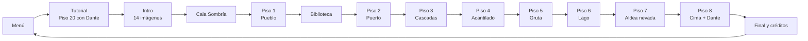
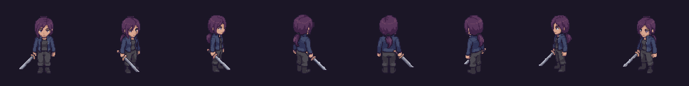
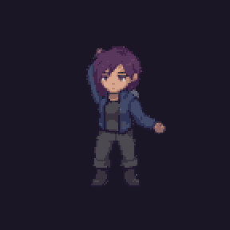
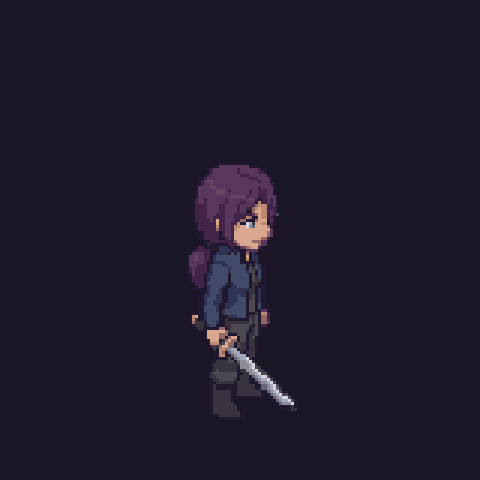
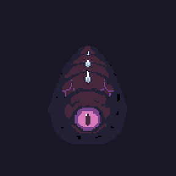
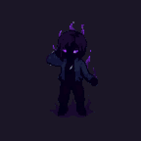

# Abby's Tower: avance jugable

Abby tiene 17 años y entra sola a la torre que se tragó a su hermano Dante. Sube ocho pisos, pelea con espada contra las criaturas del abismo, lee las hojas que él fue dejando y lo encuentra en la cima, convertido en La Sombra.

## Recorrido de una sesión

| Área | Contenido de esta versión |
| --- | --- |
| Partida | Menú con `Continuar · Piso N`, `Nueva partida`, `Configuración` y `Créditos`. 14 escenas en el build. |
| Control | Teclado y mouse o mando. Mover, saltar, combo de 3 tajos, bloqueo, impulso, interactuar y cámara libre. Ver [[04 - Controles]]. |
| Combate | Combo `10 / 10 / 15`, bloqueo al `8 %` con stamina, impulso con invulnerabilidad, esquiva perfecta y tajo de impulso. Ver [[02 - Mecánicas]]. |
| Enemigos | Seis tipos de horda y un jefe: Dante, La Sombra. 166 enemigos de horda en la ruta. Ver [[03 - Enemigos y NPC]]. |
| Pisos | Ocho pisos con 4 hordas cada uno, la Biblioteca con 1, Cala Sombría como exterior y el tutorial en el piso 20. Ver [[02 - Niveles]]. |
| Historia | Intro en 14 imágenes fijas, comentarios de Abby en cada piso, 18 notas legibles y escena final con cliffhanger. Ver [[04 - Diálogos y Narrativa]]. |
| Audio | Seis pistas de música y 16 efectos, sintetizados por código. Ver [[05 - Audio y Música]]. |

| Combo de 3 tajos | Impulso | Larva del Abismo | Dante, La Sombra |
| --- | --- | --- | --- |
|  |  |  |  |

> **Pendiente:** capturas del juego corriendo (HUD, menús y cada piso). Van en `Media/Capturas/` y se enlazan desde [[06 - Registro visual]].
