# Abby's Tower — GDD 1.0.0 (completo)

**Nombre clave:** Ascending · Estudio 02 · Integradora IDYGS103 · Universidad Tecnológica de Cancún

Cerrado el 10 de noviembre de 2026 sobre `animaciones` @ `bf6203d`. Este archivo reúne todas las notas del vault para exportar a PDF; los GIF se exportan como imagen fija.

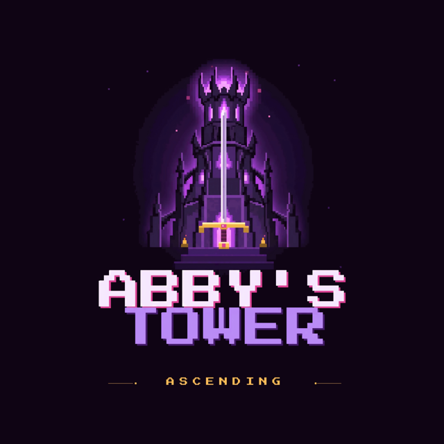

## Abby's Tower: avance jugable

Abby tiene 17 años y entra sola a la torre que se tragó a su hermano Dante. Sube ocho pisos, pelea con espada contra las criaturas del abismo, lee las hojas que él fue dejando y lo encuentra en la cima, convertido en La Sombra.

### Recorrido de una sesión

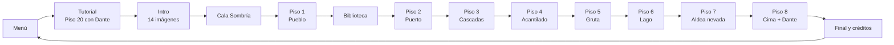

| Área | Contenido de esta versión |
| --- | --- |
| Partida | Menú con `Continuar · Piso N`, `Nueva partida`, `Configuración` y `Créditos`. 14 escenas en el build. |
| Control | Teclado y mouse o mando. Mover, saltar, combo de 3 tajos, bloqueo, impulso, interactuar y cámara libre. Ver *Controles*. |
| Combate | Combo `10 / 10 / 15`, bloqueo al `8 %` con stamina, impulso con invulnerabilidad, esquiva perfecta y tajo de impulso. Ver *Mecánicas*. |
| Enemigos | Seis tipos de horda y un jefe: Dante, La Sombra. 166 enemigos de horda en la ruta. Ver *Enemigos y NPC*. |
| Pisos | Ocho pisos con 4 hordas cada uno, la Biblioteca con 1, Cala Sombría como exterior y el tutorial en el piso 20. Ver *Niveles*. |
| Historia | Intro en 14 imágenes fijas, comentarios de Abby en cada piso, 18 notas legibles y escena final con cliffhanger. Ver *Diálogos y Narrativa*. |
| Audio | Seis pistas de música y 16 efectos, sintetizados por código. Ver *Audio y Música*. |

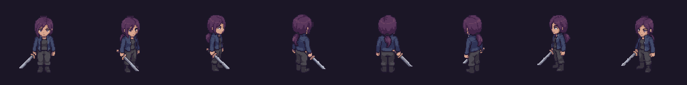

| Combo de 3 tajos | Impulso | Larva del Abismo | Dante, La Sombra |
| --- | --- | --- | --- |
| 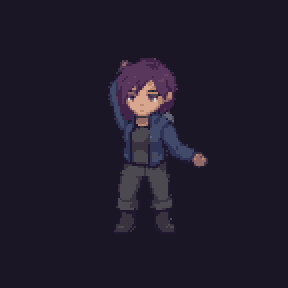 | 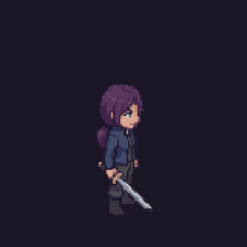 | 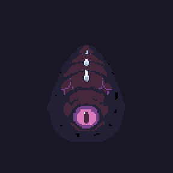 | 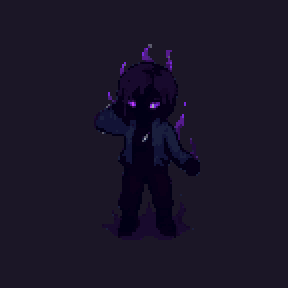 |

> **Pendiente:** capturas del juego corriendo (HUD, menús y cada piso). Van en `Media/Capturas/` y se enlazan desde *Registro visual*.


---

# 01 - Visión

## Ficha del proyecto

| Campo | Valor |
| --- | --- |
| Nombre oficial | **Abby's Tower** (`productName` en `ProjectSettings.asset`) |
| Subtítulo en pantalla | La torre del abismo |
| Nombre clave | Ascending |
| Estudio | Estudio 02 |
| Institución | Universidad Tecnológica de Cancún · Integradora · grupo IDYGS103 |
| Género | Acción 2.5D: beat 'em up por hordas con combate de lectura tipo soulslike |
| Plataforma | PC con Windows, ejecutable `AbbysTower.exe` (unos 330 MB) |
| Motor | Unity `6000.6.4f1`, Universal Render Pipeline `17.6.0` |
| Entrada | Teclado y mouse; mando |
| Jugadores | 1 |
| Duración de la demo | Meta de 15 minutos de principio a fin |
| Idioma | Español |
| Versión del juego | `0.1.0` (`bundleVersion`) |
| Versión del GDD | 1.0.0 (inicio del GDD: 16 de octubre de 2026; cierre: 10 de noviembre de 2026) |
| Estado | Juego congelado; en pruebas hasta la presentación |
| Repositorio | `Gabriel-Garcia69/AbbysTower`, rama `animaciones`, commit `bf6203d` |
| Presentación | 20 de noviembre de 2026, en laptop del equipo a 1920×1080 |

### Equipo

| Integrante | Rol en los créditos del juego (`DanteFinal.cs`) |
| --- | --- |
| Rodrigo Herrera | Dirección y programación |
| Gabriel García | Programación y arte |
| Francisco Uc | Música y sonido |
| Ricardo Cetina | Experiencia de usuario |
| Karla Damaris | Pruebas y experiencia de usuario |

Detalle de responsabilidades en *Roles y Responsabilidades*.

## Visión del juego

**En una frase:** una chica de 17 años sube sola la torre que se llevó a su hermano, y cada piso le cuenta un poco más de lo que le pasó.

### La experiencia que busca

- **Leer antes de pegar.** Todo ataque enemigo se anuncia con una sombra roja en el suelo. El jugador que mira, gana; el que aprieta botones, pierde stamina.
- **Subir es avanzar en la historia.** Cada piso es un paisaje distinto y trae un comentario de Abby y una hoja del diario de Dante. El combate y la historia avanzan al mismo paso.
- **Una partida corta y completa.** La demo dura unos 15 minutos y tiene principio, desarrollo y un final que deja la pregunta abierta: "Continuará…".

### Qué lo distingue

- Sprites 2D de pixel art moviéndose en escenarios 3D tipo maqueta, con cámara fija inclinada.
- El tutorial se juega con Dante el día en que su expedición se perdió, antes de conocer a Abby.
- El jefe final es la persona a la que Abby vino a buscar, y pelea con el mismo combo que ella.

### Tono

Melancólico y cálido más que oscuro. Los pisos tienen luz de atardecer (`AmbienteHistoria.cs`); lo único de noche cerrada es Cala Sombría. La frase que cierra los créditos resume el tono: *"Para los que todavía dejan una luz prendida."*

## Público y plataforma

### Público

| Aspecto | Definición |
| --- | --- |
| Público principal | Estudiantes, docentes y visitantes del UT Game Showcase; jugadores de 13 años en adelante |
| Experiencia previa | No se necesita: el tutorial enseña mover, saltar, atacar, curarse y bloquear, y ahí no se puede morir (`PlayerHealth.noMorir`) |
| Sesión | Una partida de unos 15 minutos, de pie frente a la laptop del stand |
| Qué le ofrece al jugador casual | Modo Fácil, asistencia de apuntado y `Continuar` si algo interrumpe la partida |
| Qué le ofrece al jugador con experiencia | Esquiva perfecta, tajo de impulso y modos Difícil y Pesadilla |

### Plataforma

| Aspecto | Valor |
| --- | --- |
| Sistema | Windows, ejecutable independiente |
| Resolución de presentación | 1920×1080, pantalla completa (se cambia en Configuración) |
| Cuadros por segundo | Límite de `60` con sincronía vertical (`LimiteFPS.cs`) |
| Entrada | Teclado y mouse como esquema principal; mando compatible |
| Conexión | No requiere internet |

Requisitos y mediciones en *Requisitos Técnicos*.

## Pilares de diseño

| Pilar | Qué significa | Cómo se ve en el juego |
| --- | --- | --- |
| **1. Todo ataque avisa** | Ningún daño llega sin señal previa | Franja o anillo rojo en el suelo durante el aviso de cada ataque (`telegraph` de `0,45` a `0,85 s`). Los enemigos salen de una grieta visible, no de la nada. |
| **2. Tres herramientas, bien usadas** | Espada, bloqueo e impulso bastan para toda la demo | Sin armas a distancia, sin inventario y sin árbol de mejoras en la ruta. La profundidad sale de combinar: tajo de impulso `×1,6`, esquiva perfecta y crítico `×2`. |
| **3. La torre cuenta la historia** | La trama se descubre caminando | Comentarios de Abby al entrar, a media horda y al abrirse la salida; hojas del diario; huellas y el colgante como hilo. |
| **4. Un piso, un lugar** | Cada piso se reconoce de un vistazo | Pueblo, puerto, cascadas, acantilado, gruta, lago, aldea nevada y cima, cada uno con su arquitectura, su luz y su enemigo nuevo. |
| **5. La demo no se puede romper** | Se presenta en vivo con poca tolerancia a fallos | `Continuar`, reaparición al caer al vacío, reintento directo contra el jefe, hordas colocadas sobre el camino para que siempre se puedan terminar. |

Cada decisión de alcance en *Alcance* se tomó contra estos pilares.


---

# 02 - Diseño

## Jugabilidad

### Bucle principal

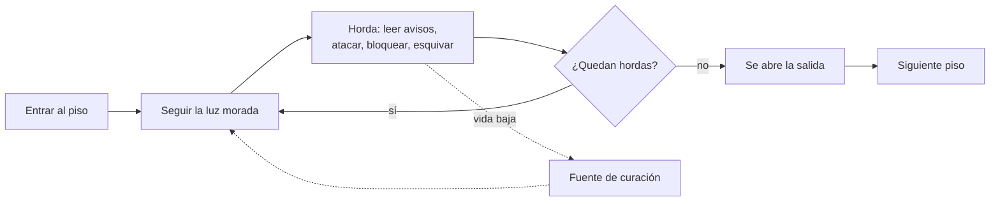

1. **Entrar.** Una toma aérea baja hasta Abby y ella comenta el lugar.
2. **Buscar la horda.** Un haz de luz morada marca la siguiente; el HUD indica cuántas faltan.
3. **Pelear.** Al pisar la arena, la horda sale de grietas en el suelo: 5 enemigos, hasta 4 a la vez.
4. **Reponerse.** Cada piso tiene al menos una fuente que cura toda la vida, una sola vez.
5. **Salir.** Con las 4 hordas derrotadas se abre la salida y aparece el resumen del piso.

### Bucle de combate (segundo a segundo)

| Momento | Qué ve el jugador | Qué decide |
| --- | --- | --- |
| Aviso | Franja o anillo rojo en el suelo, el enemigo se agacha | Salir de la marca, bloquear o impulsarse a través |
| Golpe | El enemigo se lanza | Si bloqueó: pierde `20` de stamina y recibe `8 %`. Si esquivó a tiempo: esquiva perfecta |
| Recuperación | El enemigo queda quieto de `0,7` a `1,25 s` | Ventana para el combo `10 / 10 / 15` |

### Estructura de la demo

| Tramo | Escenas | Función |
| --- | --- | --- |
| Prólogo | `Expedicion`, `Intro` | Enseñar los controles con Dante y contar por qué Abby sube |
| Entrada | `Exterior` | Caminar por Cala Sombría hasta la torre, sin combate |
| Ascenso | `Diorama` a `Nevado` | Siete pisos con 4 hordas y la Biblioteca con 1 |
| Clímax | `Cima` | 4 hordas y Dante |
| Cierre | `Final` | Escena sin enemigos, cliffhanger y créditos |

Valores exactos en *Mecánicas*; composición de cada piso en *Niveles*.

## Mecánicas

Todos los valores son del prefab `Abby.prefab` y de los scripts indicados, en el commit `bf6203d`.

### Movimiento y salto (`PlayerMotor.cs`)

| Parámetro | Valor |
| --- | ---: |
| Velocidad | `5 m/s` |
| Aceleración | `45 m/s²` (llega a velocidad máxima en `0,11 s`) |
| Altura de salto | `1,2 m` |
| Gravedad | `×1,5` de la de Unity, es decir `14,7 m/s²` |
| Coyote time | `0,1 s` después de dejar el borde |
| Memoria del salto | `0,15 s` (`PlayerInputReader.jumpBufferTime`) |

La dirección se interpreta respecto a la cámara. El sprite no gira el objeto: solo cambia el dibujo según la dirección.

### Combo de espada (`AbbyAttack.cs`)

| Tajo | Daño | Empuje | Congelación al impactar |
| --- | ---: | ---: | ---: |
| 1 | `10` | `5` | `0,035 s` |
| 2 | `10` | `5` | `0,035 s` |
| 3 | `15` | `11` | `0,07 s` |

| Parámetro | Valor |
| --- | ---: |
| Preparación / golpe activo / recuperación | `0,05 s` / `0,12 s` / `0,16 s` |
| Duración de un tajo | `0,33 s` |
| Combo completo | `35` de daño en `0,99 s` |
| Ventana para encadenar | `0,6 s`; pasado ese tiempo el combo vuelve al tajo 1 |
| Avance por tajo | `5 m/s` durante el golpe activo, unos `0,6 m` |
| Caja de golpe | `1,9 × 1,4 × 1,7 m`, centrada `0,95 m` al frente |
| Asistencia de apuntado | Gira hacia el enemigo más cercano a menos de `4,2 m` y dentro de `70°` |

Atacar **no gasta stamina**. Mientras bloquea, Abby no ataca. Un clic durante un tajo queda guardado y encadena el siguiente.

**Daño final de un tajo = `daño base × (1,6 si es tajo de impulso) × (2 si hay crítico)`**

### Bloqueo y stamina (`AbbyBlock.cs`)

| Parámetro | Valor |
| --- | ---: |
| Stamina máxima | `100` |
| Daño recibido al bloquear | `8 %` |
| Costo por golpe bloqueado | `20` |
| Empuje recibido al bloquear | `35 %` |
| Velocidad al cubrirse | `45 %` (`2,25 m/s`) |
| Espera antes de regenerar | `1 s` sin bloquear ni gastar |
| Regeneración | `25` por segundo (de 0 a 100 en `4 s`) |
| Invulnerabilidad tras bloquear | `0,25 s` |

Con stamina llena se bloquean **5 golpes seguidos**. Con menos de `20` no se puede bloquear y la barra parpadea. El bloqueo cubre en cualquier dirección.

### Impulso (`AbbyDash.cs`)

| Parámetro | Valor |
| --- | ---: |
| Velocidad | `17 m/s` |
| Duración | `0,18 s` (unos `3,1 m`) |
| Invulnerabilidad | `0,26 s` desde que empieza |
| Recarga | `0,5 s` |
| Costo | `20` de stamina |

Funciona en el aire y deja estelas del sprite cada `0,035 s`.

- **Esquiva perfecta:** si un golpe iba a alcanzarla durante la invulnerabilidad, aparece `¡ESQUIVA PERFECTA!`, el tiempo baja al `25 %` durante `0,35 s` y el siguiente tajo dentro de `1,6 s` es **crítico** (`×2`).
- **Tajo de impulso:** atacar durante el impulso o hasta `0,2 s` después hace `×1,6` de daño y `12` de empuje. Rompe la guardia del Guardián.

### Vida y daño recibido (`PlayerHealth.cs`)

| Parámetro | Valor |
| --- | ---: |
| Vida máxima | `100` |
| Invulnerabilidad tras un golpe | `0,7 s` (el sprite parpadea) |
| Daño por golpe enemigo | Se ajusta siempre al rango **`8` a `15`** |
| Caída al vacío | `10` de daño y reaparece en el último suelo firme (`FallGuard.cs`) |

Orden de resolución de un golpe entrante:

1. Si Abby está en invulnerabilidad de impulso: no hay daño (y puede contar como esquiva perfecta).
2. Si está en invulnerabilidad tras un golpe: no hay daño.
3. El daño se ajusta al rango `8–15`.
4. Si está bloqueando con stamina: el daño se multiplica por `0,08` y gasta `20` de stamina.
5. Se resta la vida, se aplica el empuje y se muestra el número flotante.

Por el paso 3, el golpe más fuerte del juego quita `15` y, bloqueado, `1,2`. Abby aguanta como mínimo **7 golpes** sin bloquear.

### Fuente de curación (`HealingShrine.cs`)

Se activa con `E` a menos de `2,4 m`. Restaura el `100 %` de la vida y se apaga: un solo uso. Con la vida llena no se gasta y muestra `Vida al máximo`.

## Sistemas

### Hordas (`RoomEncounter.cs`, `DioramaBuilder.Hordas.cs`)

| Regla | Valor |
| --- | --- |
| Hordas por piso | `4` (la Biblioteca tiene `1`) |
| Enemigos por horda | `5` puntos de aparición (4 o 6 en algunas arenas de Puerto y Cima) |
| Enemigos vivos a la vez | Hasta `4`; el resto entra cada `0,45 s` conforme caen |
| Inicio | Al pisar la arena o acercarse a menos de `7 m` de su marca |
| Tipo de enemigo | Se toma de la lista del piso en orden cíclico: aparición `i` usa `lista[i mod n]` |
| Vida | Vida base del tipo × multiplicador del piso × modo de juego |
| Correa | Los enemigos persiguen hasta `20 m` fuera de la arena |
| Abandono | Si Abby se aleja, aparece `TE ALEJASTE` y los enemigos vuelven a su guarida |
| Salida | Se abre al derrotar las 4. Dante solo aparece con las 4 derrotadas; antes muestra `AÚN NO` |

Las hordas se colocan sobre el camino, repartidas de la entrada a la salida y a `16 m` o más una de otra, para que siempre se puedan terminar.

### Guía de hordas (`GuiaHordas.cs`)

Un haz de luz morada con aros y runas marca la siguiente horda. El HUD dice `Faltan N hordas: sigue la luz morada` y, al terminar, `¡PISO DESPEJADO!`.

### Aparición de enemigos

Cada enemigo sale de una **grieta del abismo**: pozo negro con borde morado, humo y luz. No puede recibir ni hacer daño hasta que termina de subir.

### Aguante y empuje de los enemigos (`TowerEnemy.cs`)

- **Aguante (`poise`):** daño acumulado necesario para interrumpir al enemigo. Con `0`, cualquier tajo lo frena.
- **Empuje recibido (`knockTaken`):** de `1` (retrocede completo) a `0,08` (casi no se mueve).

### Modos de juego (`Difficulty.cs`)

Se eligen en Pausa → Opciones y se guardan entre sesiones.

| Modo | Vida de enemigos | Velocidad de enemigos | Pausa entre ataques |
| --- | ---: | ---: | ---: |
| FÁCIL | `×0,7` | `×0,9` | `×1,3` |
| NORMAL | `×1` | `×1` | `×1` |
| DIFÍCIL | `×1,35` | `×1,12` | `×0,8` |
| PESADILLA | `×1,8` | `×1,25` | `×0,6` |

> **Inconsistencia conocida:** la tarjeta de cada modo también anuncia `Daño recibido` y `Curación`, pero esos dos multiplicadores no se aplican en el código de `bf6203d`. Ver *Seguridad y Riesgos Técnicos*.

### Vida entre escenas (`RunState.cs`)

La vida con la que Abby sale de un piso es la que tiene al entrar al siguiente. Al morir se borra y el reintento empieza con vida completa.

### Cámara (`MouseOrbitCamera.cs`, `ZonasCamara.cs`)

| Parámetro | Valor |
| --- | --- |
| Tipo | Fija, inclinada, sigue a Abby |
| Campo de visión | `38°` |
| Distancia | `10 m` |
| Entrada al piso | Toma aérea que baja hasta Abby |
| Reposo | Tras `6 s` quieta, la cámara se abre y recorre el paisaje (no en Expedición, Gruta ni Final) |
| Zonas | Gira unos grados en ciertas zonas de cada mapa |
| Oclusión | Casas y árboles que tapan a Abby dejan de dibujarse (`OccluderFade.cs`) |

### Efectos de impacto

Congelación breve al conectar (`HitStop.cs`), sacudida de cámara (`CameraShake.cs`), números flotantes de daño y chispas (`CombatFx.cs`).

## Controles

Leídos de `PlayerInputReader.cs`, `AbbyAttack.cs`, `AbbyBlock.cs`, `AbbyDash.cs` y `MouseOrbitCamera.cs`.

### En juego

| Acción | Teclado y mouse | Mando |
| --- | --- | --- |
| Mover | `W A S D` o flechas | Stick izquierdo |
| Atacar (combo de 3) | Clic izquierdo o `J` | `X` (botón oeste) |
| Bloquear (sostenido) | Clic derecho | Gatillo izquierdo `LT` |
| Saltar | `Espacio` | `A` (botón sur) |
| Impulso | `Shift` | `B` o `RB` |
| Interactuar con la fuente | `E` | — |
| Leer y cerrar notas | `E` (cierra también `Esc`, `Enter`, `Espacio`) | `Y`; cierra `A` o `B` |
| Pausa | `Esc` | — |
| Cámara libre / volver | `F3` / `F4` | — |
| Inclinación normal / 5° más | `F5` / `F6` | — |

### Menús

| Acción | Teclado | Mando |
| --- | --- | --- |
| Elegir | `↑ ↓` o `W S` | Cruceta o stick |
| Aceptar | `Enter` | `A` |
| Ajustar volumen | `← →` | — |
| Regresar | `Esc` | `B` |
| Saltar la intro | Mantener `Esc` | — |
| Continuar tras un piso | `Enter` o `Espacio` | — |
| Reintentar al caer | `Enter` | — |

### Notas

- El HUD muestra la fila de controles abajo: `WASD Mover · Clic izq. Atacar (combo de 3) · Clic der. Bloquear · Espacio Saltar · Shift Impulso · E Interactuar · F3 Cámara libre · Esc Pausa`.
- El clic izquierdo solo ataca con el cursor capturado por el juego.
- **Limitación conocida:** la fuente de curación solo responde a la tecla `E`; con mando no hay botón asignado. Registrado en *Bugs y Seguimiento*.

## Progresión

No hay niveles de personaje ni mejoras en la ruta: Abby termina con las mismas herramientas con que empieza. La progresión es del **jugador** y del **piso**.

### Curva por piso

| Piso | Escena | Vida de enemigos | Enemigo nuevo | Lista de la horda (en orden cíclico) |
| --- | --- | ---: | --- | --- |
| Tutorial | `Expedicion` | `×0,8` | — | Larva (entrenamiento); Larva, Bruto, Larva, Acechador (la oleada) |
| 1 | `Diorama` | `×1` | Larva del Abismo | Larva |
| — | `CuartosA` | `×1,05` | — | Larva |
| 2 | `Puerto` | `×1,15` | Acechador, Bruto | Larva, Acechador, Larva, Bruto |
| 3 | `Cascadas` | `×1,3` | Embestidor | Larva, Embestidor, Acechador, Bruto |
| 4 | `Acantilado` | `×1,45` | Guardián | Guardián, Larva, Embestidor, Bruto, Acechador |
| 5 | `Cueva` | `×1,6` | — | Acechador, Guardián, Embestidor, Bruto |
| 6 | `Lago` | `×1,75` | Espectro | Espectro, Larva, Guardián, Embestidor |
| 7 | `Nevado` | `×2,05` | — | Espectro, Guardián, Bruto, Acechador |
| 8 | `Cima` | `×1,6` | Dante | Espectro, Guardián, Embestidor, Bruto, Acechador |

Fuentes: multiplicador en `DioramaBuilder.Level.cs` (`LevelInfo.hp`) y guardado en cada escena (`RoomEncounter.healthMultiplier`); listas en `DioramaBuilder.Roster`.

### Qué aprende el jugador en cada tramo

| Tramo | Lección | Cómo la enseña el juego |
| --- | --- | --- |
| Tutorial | Mover, saltar, combo, curarse, bloquear | Pasos guiados con Dante; ahí la vida no baja de `1` |
| Piso 1 | Leer la franja roja | Solo Larvas: `40` de vida, caen con un combo y un tajo |
| Piso 2 | Bloquear golpes fuertes | El Bruto pega `15` y solo lo frena el tercer tajo |
| Piso 3 | Moverse de la línea | El Embestidor carga `9,5 m` en línea recta |
| Piso 4 | Rodear o romper la guardia | El Guardián para de frente lo que no sea tercer tajo o tajo de impulso |
| Pisos 5 a 7 | Priorizar objetivos | El Espectro dispara de lejos y se teletransporta si te acercas |
| Piso 8 | Todo junto | Cinco tipos mezclados y Dante |

### Golpes necesarios por enemigo (modo Normal)

Con el combo `10 / 10 / 15` (35 por combo):

| Enemigo | Piso donde debuta | Vida ahí | Combos completos |
| --- | --- | ---: | ---: |
| Larva | 1 | `40` | 2 (cae en el 4.º tajo) |
| Acechador | 2 | `63` | 2 |
| Bruto | 2 | `138` | 4 |
| Embestidor | 3 | `91` | 3 |
| Guardián | 4 | `138` | 4 |
| Espectro | 6 | `79` | 3 |
| Dante | 8 | `768` | 22 |

La vida por piso de cada tipo está en *Enemigos y NPC*.

## Economía y recursos

**La ruta de la demo no tiene economía.** No hay moneda, tienda, inventario ni mejoras. Se decidió así el 20 de octubre para seguir el GDD 0.6.0: "solo notas".

### Recursos que sí administra el jugador

| Recurso | Máximo | Se gasta en | Se recupera con |
| --- | ---: | --- | --- |
| Vida | `100` | Golpes (`8` a `15`), caídas (`10`) | Fuente de curación (100 %, un uso por fuente); reintento |
| Stamina | `100` | Bloquear (`20` por golpe), impulso (`20`) | `25`/s tras `1 s` sin gastar |
| Fuentes | 1 o 2 por piso | Un uso cada una | No se recuperan en el mismo intento |

### Presupuesto de stamina

- 5 bloqueos seguidos, o 5 impulsos, o cualquier mezcla que sume `100`.
- De vacío a lleno: `1 s` de espera más `4 s` de regeneración.
- Atacar es gratis: la stamina es un recurso **defensivo**.

### Fuentes por escena

| Escena | Fuentes |
| --- | ---: |
| `Expedicion`, `Diorama`, `CuartosA`, `Puerto`, `Cascadas`, `Lago`, `Nevado`, `Cima` | 1 |
| `Acantilado`, `Cueva` | 2 |

### Sistemas presentes en el código y fuera de la ruta

`RunState.cs`, `ShardPickup.cs`, `MerchantShop.cs` y `TreasureChest.cs` implementan fragmentos de torre, mercader (daño `+25 %` y vida `+25` por nivel) y cofres. Pertenecen a la ruta de prueba anterior y están apagados en la ruta de la demo. Un consejo de la pantalla de carga todavía los menciona; ver *Bugs y Seguimiento*.

## Reglas y estados del juego

### Estados de la partida

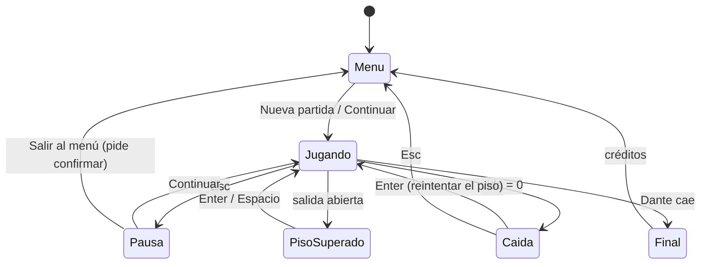

### Reglas

| Regla | Detalle |
| --- | --- |
| Victoria del piso | Derrotar las 4 hordas y cruzar la salida. Aparece `¡PISO N SUPERADO!` con tiempo y enemigos derrotados. |
| Victoria de la demo | Bajar la vida de Dante a `0`. No muere: cae, y la escena `Final` toma el control. |
| Derrota | Vida en `0`: `Abby cayó.` con `Enter · Reintentar el piso` y `Esc · Menú principal`. |
| Reintento | Reinicia el piso con vida y stamina completas. Las hordas vuelven a empezar. |
| Reintento contra Dante | Abby reaparece frente a la arena del jefe con el aviso `Reintenta contra el jefe`; no repite las 4 hordas. |
| Tutorial | La vida no baja de `1`: no se puede perder. |
| Caída al vacío | `¡Caíste al vacío!`, `10` de daño y vuelta al último suelo firme. |
| Pausa | Detiene el juego. `Continuar`, `Opciones`, `Reiniciar piso`, `Salir al menú`. |
| Guardado | Automático al entrar a cada lugar de la ruta; se borra al terminar. Ver *Guardado y Configuración*. |

### Estados de una horda

`Esperando` → `Combate` → `Limpia`. Si Abby se aleja durante el combate, la horda vuelve a `Esperando`.

### Estados de un enemigo

`Apareciendo` (grieta) → `Persiguiendo` → `Aviso` → `Golpe` → `Recuperación` → `Persiguiendo`. Al recibir daño por encima de su aguante pasa a `Interrumpido`.


---

# 03 - Historia y Mundo

## Premisa y trama

### Premisa

En 2030 una torre aparece en medio del pueblo de Cala Sombría. Dentro hay pisos que copian lugares del mundo y criaturas que las armas comunes no dañan. Al morir, las criaturas sueltan minerales que se vuelven el centro de la economía. Aparecen también los **canalizadores**: personas capaces de usar la energía de la torre en sus armas.

Angelo, padre de Abby y Dante, muere cumpliendo su deber cuando aparece la torre. Dante, de 17 años, queda a cargo de su hermana de 12.

### Trama de la demo

| Acto | Qué pasa | Dónde |
| --- | --- | --- |
| Prólogo jugable | 2035. La expedición del capitán Elías Vargas llega al piso 20. Dante, ya cazador del abismo, lleva el colgante de su padre. Una criatura enorme los alcanza; el golpe corta a negro. *"La expedición nunca regresó."* | `Expedicion` |
| Intro | La historia de la torre, el funeral, el discurso del capitán y la despedida: Abby le da el colgante a Dante. *"Me lo devuelves cuando vuelvas."* | `Intro` |
| Entrada | Tres meses después. A las dos semanas dejaron de buscar a la expedición. *"Nadie va a entrar por él. Entonces entro yo."* | `Exterior` |
| Ascenso | Abby sube siguiendo las hojas del diario de Dante. En el piso 4 encuentra huellas de botas que **regresan**, de una sola persona. En el 5, una mano negra marcada en el cristal. En el 7, una fogata con una sola manta. | Pisos 1 a 7 |
| Clímax | En la cima se acaban las huellas. Algo la espera: La Sombra, que pelea con su mismo combo. | `Cima` |
| Final | La Sombra cae. Abby reconoce el colgante: *"Era de papá. Yo te lo di."* Dante venía de regreso todo ese tiempo. *"Volví."* · **Continuará…** | `Final` |

### Hilos de la historia

- **El colgante de Angelo:** une la despedida, las hojas del diario y el reconocimiento final.
- **Las huellas:** primero muchas botas hacia adentro; luego una sola persona de regreso.
- **Lo negro en el brazo:** la energía de la torre "se queda" en quien la toca; es lo que convierte a Dante.
- **La luz prendida:** el cuarto de Abby con la luz como él la dejaba; cierra los créditos.

### Tema

La promesa de volver, y lo que cuesta cumplirla.

## Mundo

### La torre

Apareció en 2030. El ejército aseguró el piso 1 en 2031; desde el piso 2 la pólvora dejó de servir y solo funcionan armas canalizadas. Hasta 2035 la humanidad había llegado al piso 15. La expedición de Vargas fue la primera en alcanzar el 20.

La torre **copia lugares**: cada piso es un paisaje completo, con cielo propio, sin gente. En el lago del piso 6, quien se asoma ve su casa: *"la torre te muestra lo que extrañas para que te quedes"*.

### Lugares de la demo

| Lugar | Nombre en pantalla | Qué es |
| --- | --- | --- |
| Cala Sombría | CALA SOMBRÍA · Al pie de la torre | Pueblo costero de 73 casas, de noche. La torre está en medio, a 217 m de donde empieza Abby |
| Piso 20 | PISO 20 · La expedición | Gruta de roca natural con runas en el suelo y un abismo al fondo |
| Piso 1 | El Pueblo del Risco | Pueblo con río y casas de entramado, vacío |
| Biblioteca | Pereza · La Biblioteca Dormida | Cuartos con libros "en un lugar donde nadie lee" |
| Piso 2 | El Puerto de las Mareas | Muelle, barcos amarrados que no zarpan, casas encaladas |
| Piso 3 | El Valle de las Cascadas | Río que baja por bancales; puentes y campamento |
| Piso 4 | El Sendero del Acantilado | Prado, playa con barco naufragado, puente largo y faro roto |
| Piso 5 | La Gruta de Cristal | Caverna inundada con islas, pueblo minero y cristales colgando |
| Piso 6 | El Lago de los Espejos | Lago en calma que refleja otro cielo |
| Piso 7 | La Aldea de la Nieve Eterna | Aldea con las ventanas prendidas y nadie adentro |
| Piso 8 | El borde del abismo | Islas sobre el vacío; aquí espera La Sombra |

### Reglas del mundo

- Las criaturas no son humanas y nacen de grietas del abismo.
- La energía de la torre potencia armas, pero **se queda** en quien la toca con la mano desnuda.
- El faro del piso 4 se apaga cuando una criatura fuerte anda cerca.

### Sobre "subir" y "bajar"

El juego es de **ascender**: Abby sube del piso 1 al 8 (nombre clave *Ascending*). Varios textos dentro del juego conservan la redacción del guion original, que hablaba de bajar al abismo ("cuantos más pisos bajaban", "Cuanto más abajo, más fuertes"). Están listados en *Bugs y Seguimiento* como texto por unificar.

## Personajes

Fichas narrativas. Sprites, tamaños y GIF en *Personajes y Animación*; valores de combate en *Enemigos y NPC*.

### Abby


| Campo | Dato |
| --- | --- |
| Edad | 17 (12 en el funeral, en 2030) |
| Rol | Protagonista jugable |
| Apariencia | Cabello morado recogido, chaqueta azul marino, espada en la mano derecha |
| Qué quiere | Encontrar a Dante y que le devuelva el colgante en persona |
| Qué la mueve | Dejó la escuela el día que cerraron la búsqueda. *"Que se enoje. Pero que me lo diga en la cara."* |
| Voz | Frases cortas, secas, con ternura escondida |

### Dante

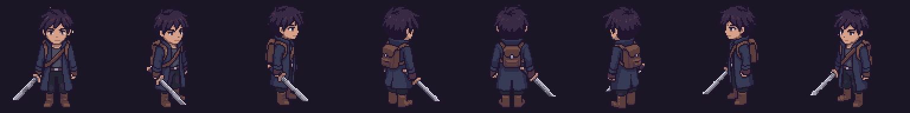

| Campo | Dato |
| --- | --- |
| Edad | 22 en la expedición (17 en 2030) |
| Rol | Jugable en el tutorial; autor de las hojas del diario; jefe final como La Sombra |
| Oficio | Cazador del abismo |
| Apariencia | Abrigo azul marino, espada; mide `1,45 m` en el juego |
| Qué quiere | Pagar las deudas y que Abby siga estudiando |
| Arco | Sale solo del piso 20 con "algo negro en el brazo". Regresa piso por piso mientras olvida: *"Se me olvida cómo era tu voz."* |

### La Sombra

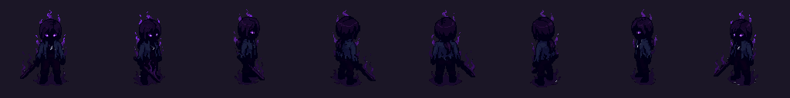

Lo que queda de Dante al llegar a la cima. No se mueve hasta que Abby llega: *"me está esperando"*. Usa el combo de Abby. Al caer, dice su nombre: *"Abby…"*.

### Angelo

Padre de ambos. Murió en 2030 cumpliendo su deber cuando apareció la torre. No aparece en pantalla; su colgante sí.

### Capitán Elías Vargas

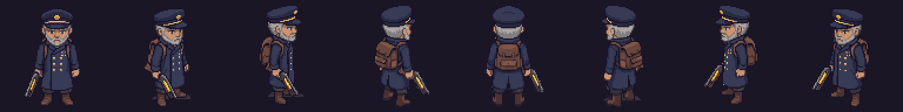

Líder de la expedición de 2035. Da el discurso de la intro. En el piso 20 empuja a Dante hacia las escaleras; no se le vuelve a ver.

### El Coloso

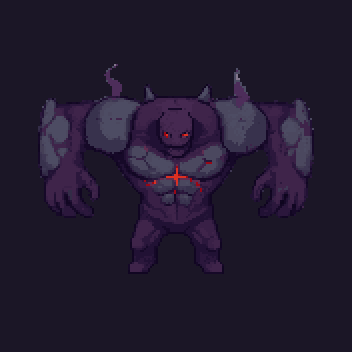

La criatura del piso 20. Solo aparece en la cinemática del tutorial: ruge, da un zarpazo y el golpe corta a negro. No se muestra qué le hizo a la expedición.

### Secundarios

| Personaje | Aparece en | Sprite |
| --- | --- | --- |
| Cazadores y soldados de la expedición | Tutorial e intro | 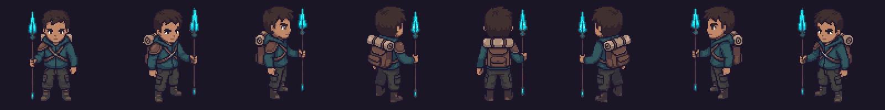 |
| Gente del pueblo, invitadas del funeral | Intro | 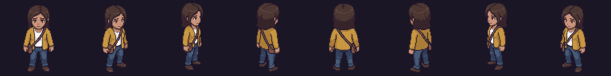 |

## Diálogos y narrativa

Textos tal como están en el juego (`Historia.cs`, `ExpedicionPiso20.cs`, `EscenaFinal.cs` y las notas de cada escena).

### Cómo se cuenta

| Recurso | Uso |
| --- | --- |
| Intro en imágenes | 14 imágenes fijas de 256×144 con paneo lento y texto; se salta manteniendo `Esc` |
| Cuadro de narración | Caja de texto que crece con el contenido; nombre de quien habla arriba |
| Relato del piso | Abby comenta al entrar, a la mitad de las hordas y al abrirse la salida (`RelatoPiso.cs`) |
| Notas | Objetos con destello que se leen con `E`: diario, placa, registro, nota |
| Escena final | 11 planos de cámara, recuerdos con imágenes de la intro y créditos |

### Intro

| Imagen | Texto |
| --- | --- |
| 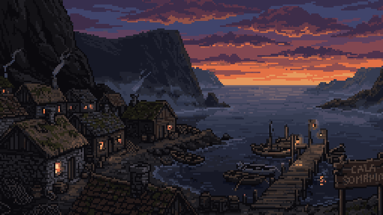 | "En el año 2030, en medio del pueblo de Cala Sombría se materializó una torre misteriosa de gran tamaño." |
| 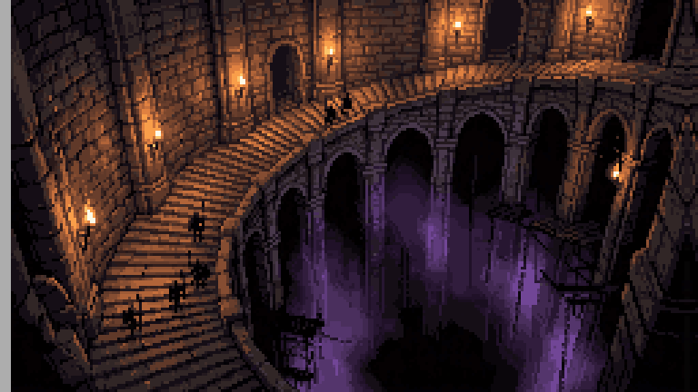 | "Cuando el ejército ingresó a la torre, descubrieron unas enormes escaleras que llevaban a un abismo oscuro." |
| 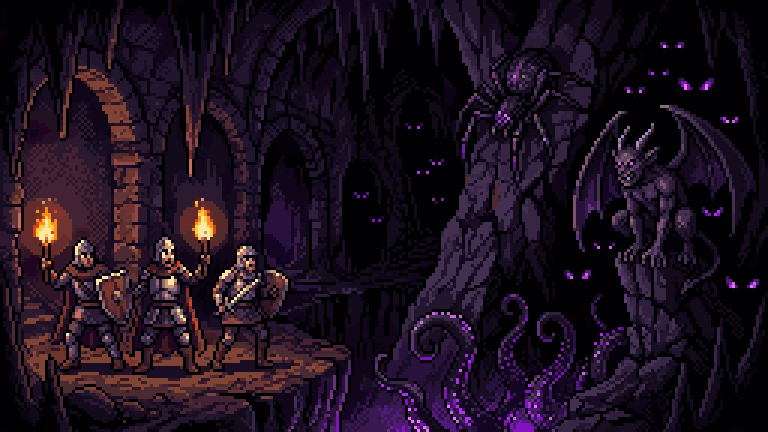 | "Al adentrarse en él descubrieron que ahí habitaban criaturas que solo existían en nuestras pesadillas…" |
| 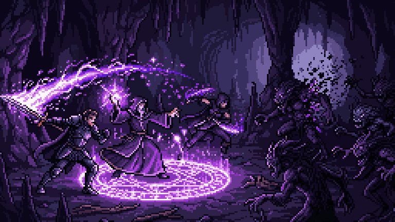 | "Junto con la torre empezaron a aparecer personas con la capacidad de canalizar la extraña energía que emana la torre…" |
| 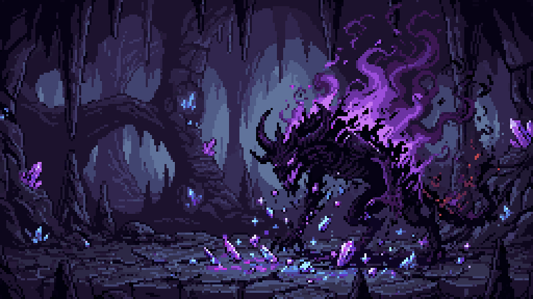 | "Al morir, las criaturas dejaban caer minerales raros nunca antes vistos en la Tierra…" |
| 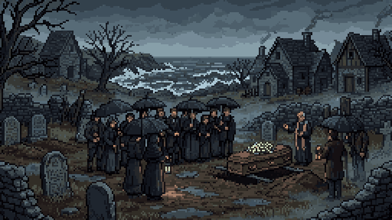 | **Invitada 1:** "Pobrecitos. Huérfanos a tan corta edad..." **Invitada 2:** "Su padre murió cumpliendo su deber cuando apareció esa misteriosa torre." |
| 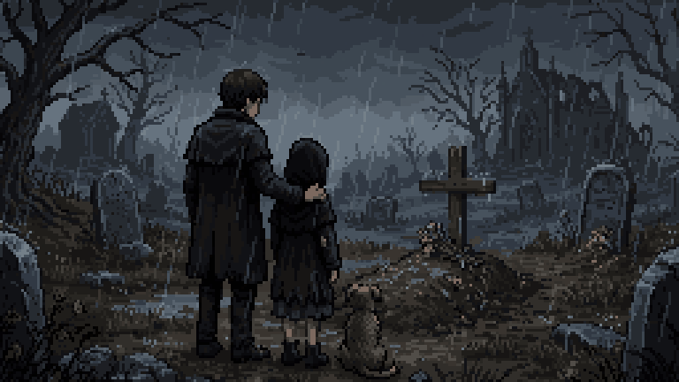 | **Invitada 1:** "Dante solo tiene 17. ¿Cómo va a mantener a su hermana ahora que su padre no está? Y Abby solo tiene 12 años." |
| 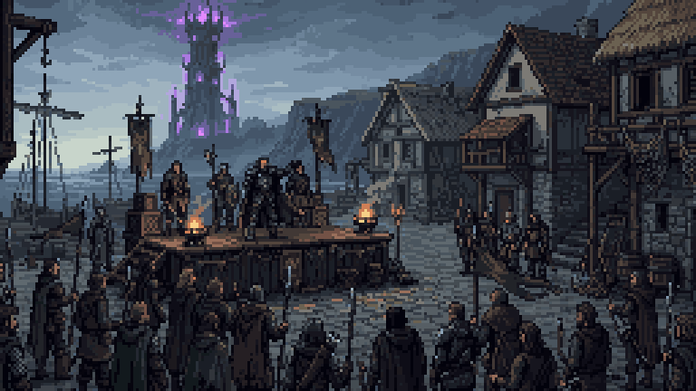 | Tarjeta **Año 2035**. **Capitán Elías Vargas:** "Escuchen todos. Han pasado 5 años desde que la torre del abismo apareció…" |
| 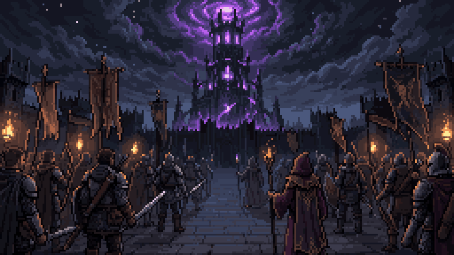 | "Entonces la humanidad aprendió a usar la misma energía de la torre contra ella. Desde entonces hemos llegado hasta el piso 15." |
| 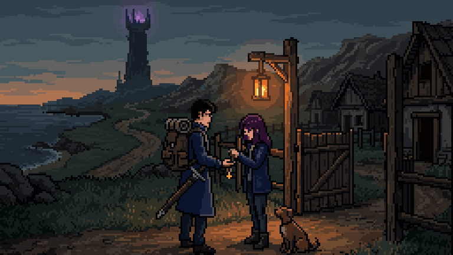 | **Abby:** "Hermano, no te vayas, no tienes que ser un cazador del abismo…" **Dante:** "¡No, Abby! No puedes abandonar tus estudios… Volveré..." |
| 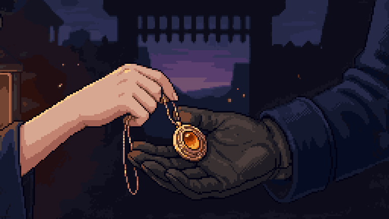 | **Abby:** "Entonces llévate esto. Era de papá. Me lo devuelves cuando vuelvas." **Dante:** "Te lo devuelvo en persona. Te lo prometo." |

### Tutorial (piso 20)

- "Piso 20. Ninguna expedición había bajado tanto."
- **Capitán:** "Mantengan la formación. Lo que encontremos aquí abajo, lo enfrentamos juntos."
- **Dante:** "Todavía traigo tu colgante, Abby. Te lo voy a devolver."
- "¿Qué es eso...?" · "¡Retirada! ¡Todos atrás!" · "La expedición nunca regresó."

### Relato de Abby por piso

| Lugar | Al entrar | A la mitad | Al abrirse la salida |
| --- | --- | --- | --- |
| Cala Sombría | "Hace tres meses que la expedición entró. A las dos semanas dejaron de buscarla." "Nadie va a entrar por él. Entonces entro yo." | — | — |
| Piso 1 | "Un pueblo entero, con las puertas abiertas. Y nadie." | "Cuando papá entró, en 2030, dijo que volvería para la cena." | "Ni rastro de él todavía. Sigo." |
| Biblioteca | "Libros, en un lugar donde nadie lee." | — | "Dante me hacía repasar en voz alta antes de irse a trabajar. Yo fingía que no me importaba." |
| Piso 2 | "El mar, otra vez. Papá nos traía a ver los barcos antes de la torre." | "El colgante de papá. Se lo di el día que se fue…" | "Todavía me lo debe." |
| Piso 3 | "Me hizo prometer que seguiría estudiando." | "Dejé la escuela el día que cerraron la búsqueda. Si me viera, se enojaría." | "Que se enoje. Pero que me lo diga en la cara." |
| Piso 4 | "Hay huellas en la piedra. Muchas botas, y todas van hacia adentro." | "Aquí hay otras, encima de las primeras. Las mismas botas..." | "...pero estas vienen de regreso. Y son de una sola persona." |
| Piso 5 | "Estos minerales pagaron nuestra casa. Nunca pregunté de dónde salían." | "Hay una mano marcada en el cristal. Negra, como quemada." | "Alguien se apoyó aquí para poder seguir caminando." |
| Piso 6 | "Todo está en calma. Es lo primero que me da miedo en esta torre." | "En el agua se ve mi cuarto. Con la luz prendida, como él la dejaba." | "Por un momento vi a alguien detrás de mí, en el reflejo. Llevaba su abrigo." |
| Piso 7 | "Las ventanas están prendidas, pero adentro no hay nadie." | "Una fogata apagada y una sola manta. Nadie duerme así si viaja con otros." | "Dante, ¿qué te pasó allá abajo?" |
| Piso 8 | "Aquí se acaban las huellas." | "Hay algo más adelante. Lo siento desde que entré. No se mueve... me está esperando." | — |

### Hojas del diario de Dante

| Piso | Título | Texto |
| --- | --- | --- |
| 1 | Diario de la expedición — día 1 | "Abby: entramos hoy. El piso 1 parece un pueblo de verdad, con río y casas, pero no hay nadie. El capitán dice que la torre copia lugares… Voy a ir dejando estas hojas." |
| 2 | día 2 | "El piso 2 tiene mar. Barcos amarrados, gaviotas que vuelan en círculos y ni una persona. Traigo el colgante de papá debajo de la camisa, Abby. Lo voy a cuidar. Es tuyo." |
| 3 | día 4 | "Aquí no se oye la torre, solo el agua… Pensé en ti, Abby. Te gustaría este lugar." |
| 4 | día 6 | "En este piso el sol nunca termina de ponerse… Cuando su sombra cae al suelo, hay que moverse. Eso me salvó hoy. Te lo apunto por si acaso. Aunque no vas a venir, ¿verdad?" |
| 5 | día 9 | "…Con lo de este piso pagaríamos todas las deudas, Abby. Todas. Los canalizadores dicen que no hay que tocarlos con la mano desnuda. Que la energía se queda." |
| 6 | día 12 | "Me asomé al lago y vi nuestra casa, Abby. La ventana de tu cuarto, con la luz prendida…" |
| 7 | Hoja sin fecha | "Ya no cuento los días. Del piso 20 salí solo. Esa cosa nos alcanzó a todos. El capitán me empujó hacia las escaleras y no volví a verlo. Me quedó algo negro en el brazo y no se quita… Voy de regreso, Abby. Te dije que volvería." |
| 8 | La última hoja | "Se me olvida cómo era tu voz. La letra ya casi no me sale. Traigo el colgante en la mano para acordarme de a dónde voy… Si ves algo en el camino, no le tengas miedo. Pero no te acerques. Volveré." — D. |

Las placas y registros de cada piso están en *Objetos y Coleccionables*.

### Final

1. **La Sombra:** "Abby…"
2. **Abby:** "¿Quién... eres?" · "Este colgante..." · "Era de papá. Yo te lo di."
3. Recuerdos (imágenes 12, 13 y 14): "Volveré..." · "Te lo devuelvo en persona. Te lo prometo." · "Voy de regreso, Abby. Te dije que volvería."
4. **Abby:** "Las huellas. Las hojas." · "Venías de regreso... todo este tiempo." · "Estabas a unos escalones."
5. **Dante:** "Volví."
6. **Continuará…**
7. Créditos sobre una casa en la nieve: "Para los que todavía dejan una luz prendida." · "Gracias por jugar".


---

# 04 - Contenido

## Estructura del contenido

### Escenas del build (orden de `EditorBuildSettings.asset`)

| # | Escena | Rótulo de carga | Contenido | Sigue a |
| ---: | --- | --- | --- | --- |
| 0 | `Menu` | MENÚ PRINCIPAL | Menú sobre paisajes del juego | `Expedicion` |
| 1 | `Expedicion` | PISO 20 · La expedición | Tutorial con Dante, 2 encuentros, 1 fuente, cinemática del Coloso | `Intro` |
| 2 | `Intro` | PRÓLOGO · Cala Sombría, 2030 | 14 imágenes | `Exterior` |
| 3 | `Exterior` | CALA SOMBRÍA · Al pie de la torre | Caminata sin combate | `Diorama` |
| 4 | `Diorama` | PISO 1 · El Pueblo del Risco | 4 hordas, 1 fuente, 2 notas | `CuartosA` |
| 5 | `CuartosA` | CUARTOS · Pereza · La Biblioteca Dormida | 1 horda, 1 fuente, 1 nota | `Puerto` |
| 6 | `Puerto` | PISO 2 · El Puerto de las Mareas | 4 hordas, 1 fuente, 2 notas | `Cascadas` |
| 7 | `Cascadas` | PISO 3 · El Valle de las Cascadas | 4 hordas, 1 fuente, 2 notas | `Acantilado` |
| 8 | `Acantilado` | PISO 4 · El Sendero del Acantilado | 4 hordas, 2 fuentes, 2 notas | `Cueva` |
| 9 | `Cueva` | PISO 5 · La Gruta de Cristal | 4 hordas, 2 fuentes, 2 notas | `Lago` |
| 10 | `Lago` | PISO 6 · El Lago de los Espejos | 4 hordas, 1 fuente, 2 notas | `Nevado` |
| 11 | `Nevado` | PISO 7 · La Aldea de la Nieve Eterna | 4 hordas, 1 fuente, 3 notas | `Cima` |
| 12 | `Cima` | PISO 8 · El borde del abismo | 4 hordas, Dante, 1 fuente, 2 notas | `Final` |
| 13 | `Final` | — | Escena final y créditos | `Menu` |

Los conteos se leyeron de cada archivo `.unity` (componentes `RoomEncounter`, `HealingShrine`, `LoreNote` y `FloorExit.nextScene`).

### Totales

| Elemento | Cantidad |
| --- | ---: |
| Pisos jugables de la torre | 8, más la Biblioteca |
| Hordas en la ruta | 33 |
| Enemigos de horda en la ruta | 166 |
| Tipos de enemigo en la ruta | 6 |
| Jefes | 1 |
| Fuentes de curación | 12 |
| Notas legibles | 18 |
| Imágenes de la intro | 14 |

### Contenido en el proyecto que no entra a la demo

| Contenido | Estado |
| --- | --- |
| Jefes Guardián de las Ruinas, Capitán sin Barco, Señor del Torrente y Gárgola del Faro Roto | Con sprites y animaciones; no aparecen. El único jefe es Dante |
| Enemigos Arquero y Torbellino | Con lógica, sin sprite; fuera de las listas |
| Escenas `Templo`, `Montana`, `Nivel1` a `Nivel9`, `SampleScene` | Ruta de prueba anterior; apagadas en el build |
| Cuartos de Gula, Avaricia y Envidia | Con rótulo de carga; sin escena en el build |
| Mercader, cofres y fragmentos | Código presente, apagado en la ruta |

## Niveles

Todos los pisos de la torre comparten reglas: 4 hordas sobre el camino, guía de luz morada, al menos una fuente y una salida que se abre al final. Cambia el paisaje, la mezcla de enemigos y la vida de estos. Los mapas se generan con `DioramaBuilder` (uno por piso) y se guardan en la escena.

### Tutorial · Piso 20 (`Expedicion`)

| Dato | Valor |
| --- | --- |
| Personaje | Dante humano |
| Escenario | Gruta de roca natural, runas en el suelo plano, abismo al fondo (`DioramaBuilder.ExpedicionCueva.cs`) |
| Encuentros | `Entrenamiento`: 3 Larvas · `La oleada`: 6 enemigos (Larva, Bruto, Larva, Acechador…) |
| Vida de enemigos | `×0,8` |
| Regla especial | La vida de Dante no baja de `1` |

Pasos guiados, en orden y con su texto en pantalla:

1. `WASD / stick izquierdo: moverte`
2. `Espacio: saltar. Sube al escalón`
3. `Sigue a la expedición`
4. `Clic izquierdo: atacar · tres clics seguidos: combo (el tercer golpe pega más)`
5. `Las fuentes de curación restauran toda tu vida. Acércate y presiona E (cada fuente sirve una vez)`
6. `Clic derecho sostenido: bloquear. Recibes solo el 8 % del daño, pero gasta stamina. Las sombras rojas del suelo avisan cada ataque`
7. `Bien hecho. Sigamos hasta el borde.` → `Acércate al borde del abismo` → cinemática del Coloso.

### Cala Sombría (`Exterior`)

Pueblo costero de noche: 73 casas, Calle Mayor, plaza del mercado, campamento y la torre al fondo, a `217 m` del punto de inicio. Lo único con color es el fuego y el aura morada de la torre. Sin enemigos. A `5 m/s` son unos 45 segundos de caminata hasta el portal.

### Pisos de la torre

| Piso | Escena | Paisaje y recorrido | Arquitectura | Hordas (enemigos) | Fuentes | Notas |
| --- | --- | --- | --- | --- | ---: | ---: |
| 1 | `Diorama` | Pueblo con río; camino de tierra hasta la plaza | Casas de entramado | 4 (5·5·5·5) | 1 | 2 |
| — | `CuartosA` | Biblioteca cerrada; arena de `24 × 18 m` | Libreros y salas | 1 (5) | 1 | 1 |
| 2 | `Puerto` | Plaza, cabo del faro y punta del muelle; bancales bajos | Casas de pescador encaladas, escaleras de madera | 4 (5·5·4·5) | 1 | 2 |
| 3 | `Cascadas` | Río que baja cuatro bancales; se sube contra la corriente | Piedra con techo de paja, puentes | 4 (5·5·5·5) | 1 | 2 |
| 4 | `Acantilado` | Prado, escalinata a la playa con barco naufragado, isla, puente largo y faro | Pizarra; hecho en cubos | 4 (5·5·5·5) | 2 | 2 |
| 5 | `Cueva` | Caverna inundada: lago turquesa, cuatro islas y puentes | Pueblo minero, bosque de cristal, techo con cristales | 4 (5·5·5·5) | 2 | 2 |
| 6 | `Lago` | Orilla de un lago en calma con pueblo de pescadores | Casas bajas junto al agua | 4 (5·5·5·5) | 1 | 2 |
| 7 | `Nevado` | Calle de una aldea nevada con las luces prendidas | Posada y casas con nieve | 4 (5·5·5·5) | 1 | 3 |
| 8 | `Cima` | Islas sobre el abismo, de la isla de inicio a la arena final | Ruinas de piedra | 4 (5·6·5·6) + Dante | 1 | 2 |

Arena estándar: `12 × 9 m`. Arena de Dante: `20 × 18 m`.

### Final (`Final`)

Un pedazo de torre sobre el abismo, sin enemigos (`DioramaBuilder.Final.cs`, `EscenaFinal.cs`): escalinata con un descanso plano donde yace Dante, una puerta que se abre y, detrás, el pueblo y una casa en la nieve con los créditos.

### Límites y seguridad del mapa

- El borde jugable se ve distinto en cada piso (agua, risco, muro, vacío); la colisión es la misma.
- Caer bajo `Y = -3` reaparece a Abby en el último suelo firme.
- Si queda atrapada bajo el terreno más de `0,35 s`, vuelve al camino sin daño: `¡De vuelta al camino!`.

> **Pendiente:** una captura por piso en `Media/Capturas/`.

## Enemigos y NPC

Seis tipos de horda y un jefe. Valores base de `TowerEnemy.cs` y `TowerEnemy.Variantes.cs` en modo Normal, antes del multiplicador del piso.

| Enemigo | Tipo en código | Vida | Velocidad | Daño (el que recibe Abby) | Alcance | Aviso | Recuperación | Aguante | Empuje recibido |
| --- | --- | ---: | ---: | ---: | ---: | ---: | ---: | ---: | ---: |
| Larva del Abismo | `Sombra` | 40 | 3,3 m/s | 10 | 3 m | 0,55 s | 0,75 s | 0 | 1 |
| Acechador | `Saltador` | 55 | 3,2 m/s | 14 | 7,5 m | 0,45 s | 0,95 s | 12 | 0,8 |
| Bruto | `Bruto` | 120 | 2,1 m/s | 20 (**15**) | 3,2 m | 0,85 s | 1,1 s | 25 | 0,35 |
| Embestidor | `Embestidor` | 70 | 2,3 m/s | 13 | 10 m | 0,85 s | 1,25 s | 18 | 0,6 |
| Guardián | `Escudero` | 95 | 2,1 m/s | 16 (**15**) | 3 m | 0,7 s | 1 s | 30 | 0,4 |
| Espectro | `Hechicero` | 45 | 2,2 m/s | 12 | 12 m | 0,6 s | 1,1 s | 0 | 1 |
| **Dante, La Sombra** | `Dante` | 480 | 3,3 m/s | 12 | 4,2 m | 0,55–0,7 s | 0,85 s | inmune | 0,12 |

El daño entre paréntesis es el que llega a Abby después del ajuste al rango `8–15` de *Mecánicas*. Pausa entre ataques de los enemigos de horda: de `0,6` a `1,4 s` (el Acechador y el Espectro, de `1,6` a `2,4 s`).

### Vida por piso (base × multiplicador)

| Enemigo | P1 | P2 | P3 | P4 | P5 | P6 | P7 | P8 |
| --- | ---: | ---: | ---: | ---: | ---: | ---: | ---: | ---: |
| Larva | 40 | 46 | 52 | 58 | — | 70 | — | — |
| Acechador | — | 63 | 72 | 80 | 88 | — | 113 | 88 |
| Bruto | — | 138 | 156 | 174 | 192 | — | 246 | 192 |
| Embestidor | — | — | 91 | 102 | 112 | 123 | — | 112 |
| Guardián | — | — | — | 138 | 152 | 166 | 195 | 152 |
| Espectro | — | — | — | — | — | 79 | 92 | 72 |

### Larva del Abismo

| Reposo | Caminar | Atacar |
| --- | --- | --- |
| 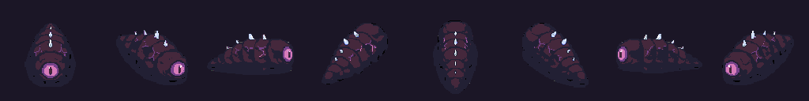 | 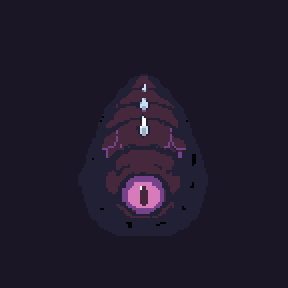 |  |

Rápida y frágil. Marca una franja roja y embiste a `12 m/s` durante `0,22 s`. Cualquier tajo la interrumpe. Es la masa de las hordas y la única del piso 1.

### Acechador

| Caminar | Atacar |
| --- | --- |
| 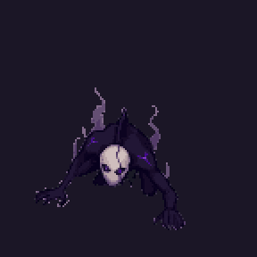 | 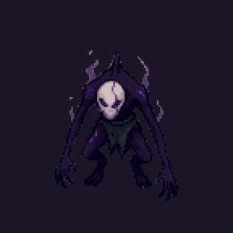 |

Salta desde lejos y cae en un círculo naranja de `2,4 m` de radio que marca el punto de caída. No salta al agua ni dentro de muros. Se castiga al aterrizar.

### Bruto

| Caminar | Atacar |
| --- | --- |
| 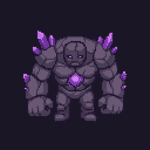 | 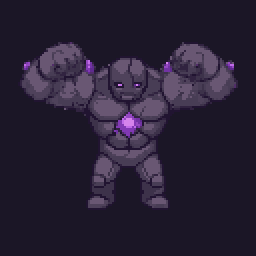 |

Lento y pesado. Solo lo frena el tercer tajo (aguante `25`). Su golpe es el más fuerte de las hordas: conviene bloquearlo o salir de la franja.

### Embestidor

| Caminar | Atacar |
| --- | --- |
| 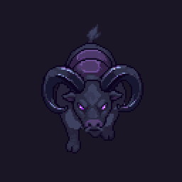 | 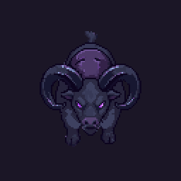 |

Ataca desde `10 m`: marca una franja larga y carga a `21 m/s` durante `0,45 s`, unos `9,5 m`. Queda `1,25 s` expuesto después.

### Guardián

| Caminar | Atacar |
| --- | --- |
| 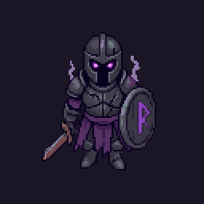 | 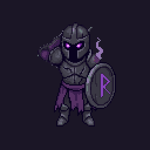 |

Lleva escudo: **para de frente** todo golpe que no rompa la guardia. La rompen el tercer tajo y el tajo de impulso; por la espalda recibe daño normal.

### Espectro

| Caminar | Atacar | Proyectil |
| --- | --- | --- |
| 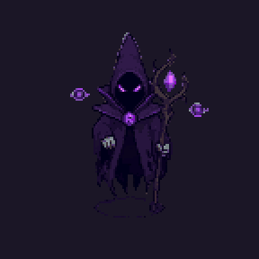 | 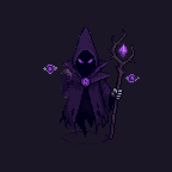 |  |

Único enemigo a distancia. Apunta el bastón y lanza una esfera. Cada tercer ataque hace caer tres golpes alrededor de Abby (`2,2 m` de radio, `1 s` de aviso). Si Abby se acerca a menos de `3,5 m`, desaparece y reaparece lejos.

### Dante, La Sombra (jefe final)

| Reposo | Caminar | Atacar |
| --- | --- | --- |
|  | 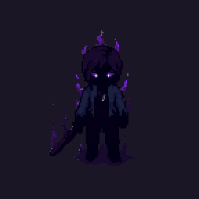 |  |

| Dato | Valor |
| --- | --- |
| Vida | `480` base × `1,6` del piso = **`768`** en Normal |
| Aparece | En su arena de `20 × 18 m`, solo con las 4 hordas derrotadas |
| Tamaño | `1,18` veces la altura de Abby; luz morada de `7 m` |
| Interrupción | No se le interrumpe; retrocede `12 %` |
| Música | Pista `Jefe`, 124 bpm |

| Patrón | Cuándo | Aviso | Golpe | Daño a Abby |
| --- | --- | --- | --- | ---: |
| Embestida | Abby a más de `4,5 m` | Franja larga, `0,7 s` | `22 m/s` durante `0,42 s` (unos `9,2 m`) | 12 |
| Golpe de área | Cada tercer ataque | Anillo morado de `4,6 m`, `1,05 s` | Salta y cae | 15 |
| Combo de 3 | El resto | Franja, `0,55 s` | Tres embestidas cortas de `11 m/s` × `0,18 s` | 12 c/u |

**Fase 2** al `50 %` de vida: aparece `¡FURIA!`, la cámara se sacude y todas sus pausas y el aviso del golpe de área bajan al `75 %`. A diferencia de los otros jefes del código, Dante no invoca refuerzos.

**Al llegar a 0 no muere:** cae, y `DanteFinal` lleva a la escena `Final`.

### Reglas comunes

- Aparecen desde una grieta y no dañan hasta salir.
- La primera mitad de la animación de ataque es la carga y la segunda es el golpe (`FaseAtaque()`): el dibujo y el daño van juntos.
- Miran hacia donde van a atacar; la franja roja y el sprite coinciden.
- Al recibir daño tiemblan y muestran el número; al morir se deshacen en sombra.

### NPC

| NPC | Dónde | Función |
| --- | --- | --- |
| Capitán Elías Vargas y expedición | `Expedicion`, intro | Acompañan a Dante en el tutorial; sin combate propio |
| El Coloso | `Expedicion` | Cinemática: `Rugido`, `Zarpazo`, `Golpe` |
| Gente del pueblo | Intro | Solo imagen |

## Objetos y coleccionables

No hay inventario. Los únicos objetos de la ruta son las **fuentes de curación** y las **notas**.

### Fuente de curación

Santuario con un cristal que flota y gira, y una luz que se ve de lejos. `E` a menos de `2,4 m`: cura el 100 %, suena `Fuente` y muestra `FUENTE DE CURACIÓN · Tu vida se ha restaurado`. Después queda apagada. Detalle en *Mecánicas*; cantidad por piso en *Economía y Recursos*.

### Notas

Objetos con destello que se leen a `1,6 m`. Cuatro tipos (`LoreNote.Kind`): Libro, Nota, Inscripción y Diario. El menú de pausa cuenta cuántas se han encontrado (`N notas encontradas`). Son opcionales: no bloquean el avance.

Las hojas del diario de Dante están transcritas en *Diálogos y Narrativa*. El resto:

| Piso | Título | Tipo | Texto |
| --- | --- | --- | --- |
| 1 | Placa a la entrada del piso 1 | Inscripción | "PISO 1. Asegurado por el ejército en 2031. Las criaturas de este piso son las más débiles de la torre…" |
| Biblioteca | Detrás del muro | Diario | "Último escondite. Lo que hay en el cofre es para pagar las deudas cuando salgamos. Los dos." — A. |
| 2 | Registro del puerto | Libro | "Registro militar, piso 2. Los barcos no zarpan: más allá de la bahía el mar no lleva a ningún lado. Primer piso donde la pólvora dejó de servir. Desde aquí, solo armas canalizadas." |
| 3 | Piedra del valle | Inscripción | "Piso 3. El río baja cuatro bancales desde las cascadas del fondo… la salida está donde el agua cae más fuerte." |
| 4 | Placa del faro | Inscripción | "Este faro alumbra un mar que no existe afuera de la torre. Nadie sabe quién lo encendió. Se apaga cuando una criatura fuerte anda cerca." |
| 5 | Grabado en la piedra | Inscripción | "Al fondo de la gruta, una piedra que late como un corazón. Los canalizadores dicen que la energía de la torre sale de aquí, o pasa por aquí." |
| 6 | Piedra de los pescadores | Inscripción | "Piso 6. El lago refleja un cielo que no es el de afuera. Los que se asoman dicen ver su casa. Mejor no quedarse mucho tiempo mirando." |
| 7 | Bienvenidos a la aldea | Inscripción | "Piso 7. Aquí siempre es la última noche del invierno. Hay posada en la plaza. Las luces no se apagan nunca." |
| 7 | Nota de un cazador | Nota | "Salí a revisar las trampas. Si llegaste hasta aquí, sírvete de la fogata…" |
| 8 | Grabado en la piedra | Inscripción | "Nadie sabe qué es esta torre, de dónde proviene o por qué apareció…" |

Siete notas toman su texto final de `Historia.Notas` al leerse, sin regenerar la escena; el texto guardado en la escena es anterior.

### El colgante

No es un objeto que se recoja: es un elemento de la historia. Aparece en la imagen 13 de la intro y en la escena final.

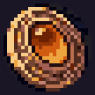

## Misiones y desafíos

No hay misiones secundarias. Cada escena tiene un objetivo único, que el HUD comunica con un rótulo.

| Escena | Objetivo | Rótulos del HUD |
| --- | --- | --- |
| `Expedicion` | Completar los pasos del tutorial y llegar al borde | `Sigue a la expedición` · `Acércate al borde del abismo` |
| `Exterior` | Llegar al portal de la torre | — |
| Pisos 1 a 7 | Derrotar 4 hordas y cruzar la salida | `Faltan N hordas: sigue la luz morada` · `HORDA N DE 4 DERROTADA` · `¡PISO DESPEJADO! · Sigue la luz hasta la salida` |
| `CuartosA` | Derrotar la horda de la sala | `Sala de la Horda I` |
| `Cima` | 4 hordas y vencer a Dante | `¡HORDAS DERROTADAS! · Sigue la luz: algo te espera` · `AÚN NO · Quedan hordas por derrotar en este piso` |

### Resumen al terminar un piso

`¡PISO N SUPERADO!` · `Tiempo m:ss` · `Enemigos derrotados N` · `Enter / Espacio para continuar`.

### Desafíos opcionales

| Desafío | Recompensa |
| --- | --- |
| Encontrar las 18 notas | Contador en el menú de pausa; la historia completa de Dante |
| Esquiva perfecta | Cámara lenta y un tajo crítico `×2` |
| Modos Difícil y Pesadilla | Enemigos con `×1,35` y `×1,8` de vida, más rápidos y con menos pausa |
| Terminar un piso sin usar la fuente | Solo el reto: el juego no lo registra |


---

# 05 - Arte y Audio

## Dirección de arte

### Estilo

**Sprites de pixel art en escenarios 3D tipo maqueta** (estilo HD-2D). Los personajes son sprites que siempre miran a la cámara; el mundo es geometría 3D con texturas de baja resolución, luz real y posproceso (bloom, color y viñeta).

| Elemento | Decisión |
| --- | --- |
| Personajes | Pixel art en 8 direcciones, generado con PixelLab y corregido a mano |
| Escenarios | Mallas generadas por código (`DioramaBuilder`), en cubos y terreno con ruido |
| Luz | Atardecer en los pisos (`AmbienteHistoria.cs`): sol bajo naranja, cielo morado, bruma cálida, faroles encendidos |
| Noche | Solo Cala Sombría: desaturada, con color únicamente en el fuego y el aura de la torre |
| Sombras | Proyectadas de frente al sol (`SombraAlSol.cs`); se usan para leer la posición de los enemigos |
| Color del peligro | Rojo para avisos de ataque; morado para la torre, las grietas y Dante; azul claro para el bloqueo; verde para la curación |

### Paleta

Colores dominantes del sprite de Abby (15 colores en total):

| Uso | Colores |
| --- | --- |
| Contorno y sombra | `#20182e` · `#38333e` |
| Cabello | `#59365b` · `#412447` |
| Chaqueta | `#424a6a` · `#2f3356` |
| Pantalón y botas | `#4c4951` · `#636477` |
| Piel | `#d9a690` · `#bc8971` · `#936a66` |
| Espada | `#8d8c99` |

Colores de interfaz (de `FloorDirector.cs` y `PauseMenu.cs`): dorado de títulos `(1, 0.9, 0.65)`, vida de verde `(0.45, 1, 0.6)` a rojo `(1, 0.25, 0.3)`, stamina azul `(0.45, 0.75, 1)`.

> **Cambio respecto al GDD 0.6.0:** el plan era la paleta DawnBringer 32. La revisión del 5 de noviembre midió 0 % de píxeles exactos de DB32 en Abby, Dante, el Coloso y las imágenes de la intro; forzarla cambiaría todo el arte. Queda registrado en *Registro de Decisiones*.

### Tamaños

| Recurso | Lienzo | Altura en el juego |
| --- | --- | --- |
| Abby | 128×128 px | `1,31 m` sin la espada |
| Dante humano | 96×96 px | `1,45 m` |
| La Sombra | 128×128 px | `1,18` veces Abby |
| Enemigos de horda | 96 a 128 px | Según su radio (`0,45` a `0,8 m`) |
| Animaciones de enemigos | 176×176 px | — |
| Coloso | 176 a 192 px | Solo cinemática |
| Imágenes de la intro | 256×144 px, ampliadas ×4 a 1024×576 | Pantalla completa |

El importador (`PixelLabImporter.cs`) calcula los píxeles por unidad para que cada personaje mida lo mismo en todas sus poses.

### Tipografía

| Uso | Fuente | Licencia |
| --- | --- | --- |
| Texto de juego, HUD y diálogos | Inter SemiBold | OFL |
| Logo | Press Start 2P | OFL |

### Logo


## Personajes y animación

Sprites del proyecto en el commit `bf6203d`. Los GIF se armaron directo de los cuadros de `Assets/`, ampliados sin suavizado.

### Catálogo

| Personaje | Carpeta | Lienzo | Reposo | Caminar | Atacar | Otros |
| --- | --- | --- | --- | --- | --- | --- |
| Abby | `sprites/Abby`, `Resources/AbbyAnim` | 128 px (tajos 144 px) | 8 dir. | 8 dir. × 8 cuadros | 3 tajos × 5 dir. × 4–5 cuadros | Impulso 8 dir. × 9; poses Golpe, Guardia, Rodilla, Tendida |
| Dante humano | `Resources/DanteHumano` | 96 px | 8 dir. | 5 dir. × 6 | 5 dir. × 4–5 | Tendido (8 dir. y de lado) |
| La Sombra | `Resources/Personajes/Dante`, `EnemigosAnim/Dante` | 128 / 176 px | 8 dir. | 5 dir. × 6 | 5 dir. × 8 | — |
| Larva | `EnemigosSprites/Sombra`, `EnemigosAnim/Sombra` | 128 / 176 px | 8 dir. | 5 dir. × 8 | 5 dir. × 8 | — |
| Acechador | `…/Saltador` | 104 / 176 px | 8 dir. | 5 dir. × 6 | 5 dir. × 8 | — |
| Bruto | `…/Bruto` | 96 / 176 px | 8 dir. | 5 dir. × 6 | 7 dir. × 8 | — |
| Embestidor | `…/Embestidor` | 96 / 176 px | 8 dir. | 5 dir. × 8 | 5 dir. × 8 | — |
| Guardián | `…/Escudero` | 96 / 176 px | 8 dir. | 5 dir. × 6 | 5 dir. × 8 | — |
| Espectro | `…/Hechicero` | 104 / 176 px | 8 dir. | 5 dir. × 8 | 5 dir. × 8 | Proyectil × 4 |
| Coloso | `Resources/ColosoAnim` | 176–192 px | — | — | — | Rugido × 6, Zarpazo × 6, Golpe × 8 |
| Capitán, cazador, soldado, civil | `Resources/Personajes` | — | 8 dir. | — | — | — |

Las animaciones se dibujan en 5 direcciones (sur, sureste, este, noreste, norte); las del oeste se obtienen **espejando por escala**, porque el material `SpriteLit3D` ignora `flipX`.

### Abby


| Caminar (sur) | Caminar (este) | Caminar (norte) |
| --- | --- | --- |
| 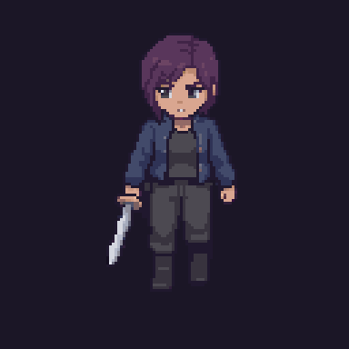 | 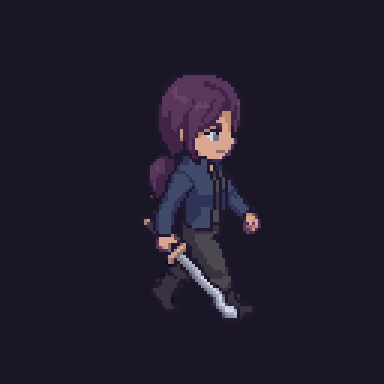 | 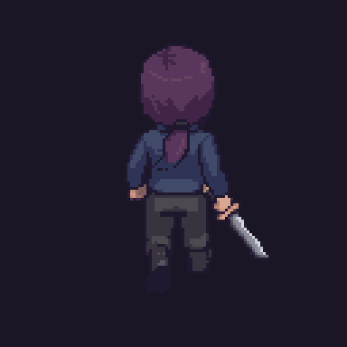 |

| Tajo 1 | Tajo 2 | Tajo 3 |
| --- | --- | --- |
| 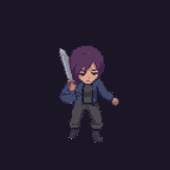 | 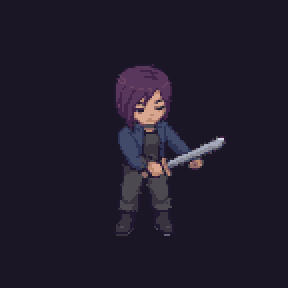 |  |
| 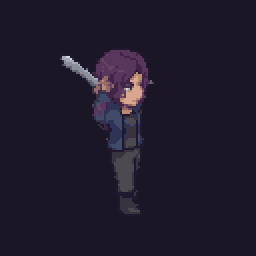 | 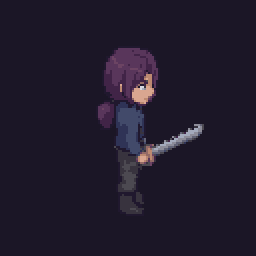 | 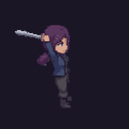 |

| Impulso (sur) | Impulso (este) |
| --- | --- |
| 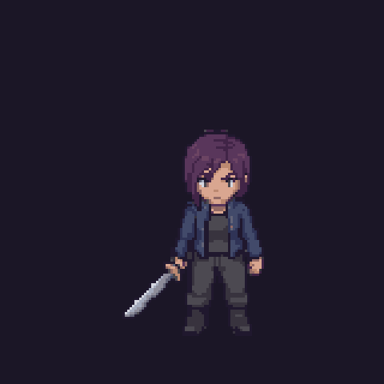 |  |

**Poses** (un cuadro por dirección):

| Golpe | Guardia |
| --- | --- |
| 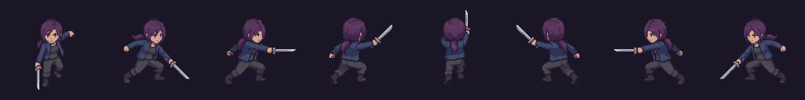 |  |

| De rodillas | Tendida |
| --- | --- |
|  |  |

Reglas de animación (`AbbySpriteAnimator.cs`):

- El ritmo de los pasos sigue la velocidad real de Abby.
- Cada tajo del combo reinicia su animación (`AbbyAttack.Swings`).
- El **bloqueo es una pose** de guardia con tinte azulado, sin animación.
- El **golpe recibido** es un tinte rojo de `0,15 s` con sacudida; no tiene cuadros propios.
- Al norte y al sur corre con los cuadros de caminar, porque la carrera perdía la espada en la mitad de los cuadros.
- La espada va siempre en la mano derecha.

### Dante humano


| Caminar | Atacar | Tendido |
| --- | --- | --- |
|  |  |  |

Solo se usa en el tutorial y tendido en el final. No tiene impulso, bloqueo ni golpe recibido propios: reutiliza caminar, reposo y el tinte rojo.

### La Sombra


| Caminar | Atacar (sur) | Atacar (este) |
| --- | --- | --- |
|  |  |  |

### Enemigos de horda

| Enemigo | Reposo en 8 direcciones | Caminar (este) | Atacar (este) |
| --- | --- | --- | --- |
| Larva |  |  |  |
| Acechador |  |  |  |
| Bruto |  |  |  |
| Embestidor |  |  |  |
| Guardián |  |  |  |
| Espectro |  |  |  |

Además del dibujo, los enemigos se mueven por código: respiran, rebotan al caminar, se agachan al avisar, se estiran al lanzarse y tiemblan al recibir.

### El Coloso

| Rugido | Zarpazo | Golpe |
| --- | --- | --- |
|  |  |  |

### Jefes dibujados que no aparecen en la demo

| Guardián de las Ruinas | Capitán sin Barco | Señor del Torrente | Gárgola del Faro Roto |
| --- | --- | --- | --- |
|  |  |  |  |

### Tabla de personajes del proyecto


> **Pendiente:** bocetos a mano y archivos fuente de Pixelorama, si el equipo quiere incluirlos en `Media/ConceptArt/`.

## Entornos

### Cómo se construyen

Los mapas no se modelan a mano: los genera `DioramaBuilder` (30 archivos parciales, uno por piso o por tipo de pieza) y `ExteriorBuilder` para Cala Sombría. El resultado se guarda en la escena. Cambiar un mapa implica regenerarlo desde el menú `Abby/…` del editor y guardar.

| Pieza | Archivo | Detalle |
| --- | --- | --- |
| Terreno | `DioramaBuilder.Terrain.cs` | Malla con ruido; escenas 3 veces más ligeras al fusionar el terreno |
| Caminos | `DioramaBuilder.Caminos.cs` | Una sola malla por material: tierra, empedrado y grava, sin parpadeo en esquinas |
| Casas | `DioramaBuilder.Casas.cs` | Un estilo por piso, con techo real |
| Vegetación | `DioramaBuilder.Plants.cs` | Árboles y plantas; se quitan los que tapan la cámara |
| Estructuras | `DioramaBuilder.Estructuras.cs` | Fogatas y braseros con partículas, carpas, pozo, puestos, faro roto, santuario |
| Agua | `AbbyWater.shader`, `AbbyWaterfall.shader` | Olas, espuma y corriente por vértice en los ríos |
| Cielo | `AbbySky.shader`, `AbbySkyNoche.shader`, `AbbyAurora.shader` | Cielo propio por piso |
| Cristales | `AbbyCristalFacetado.shader` | Gruta de Cristal |

### Identidad de cada piso

| Piso | Materiales y arquitectura | Luz |
| --- | --- | --- |
| Cala Sombría | 73 casas, calles anchas, plaza y campamento | Noche (`ExteriorProfile_Noche`) |
| Piso 20 | Roca natural con columnas y peñascos; runas de neón en el suelo | Baja, con luz de sala |
| 1 · Pueblo | Entramado de madera, camino de tierra, río | Atardecer |
| 2 · Puerto | Encalado de pescador, tejas, muelle y escaleras de madera con barandal | Atardecer |
| 3 · Cascadas | Piedra con paja, bancales anchos, cascadas curvas con bruma | Atardecer, más claro |
| 4 · Acantilado | Pizarra, en cubos; playa, barco, puente, faro, arcos y farallones | Sol que no termina de ponerse |
| 5 · Gruta | Bloques de roca, lago turquesa, cristales en el techo | Cerrada, luz de cristal |
| 6 · Lago | Agua en calma, sierra continua al fondo | Atardecer |
| 7 · Aldea nevada | Nieve, posada, ventanas encendidas | Última noche del invierno |
| 8 · Cima | Islas de piedra sobre el vacío | Cielo abierto, sin franja en el horizonte |
| Final | Escalinata, puerta, casa en la nieve | Propia |

### Texturas

Generadas con `Tools/texgen/texgen.py` y `pixel_diorama.py`, a baja resolución para que combinen con el pixel art.

### Posproceso

Perfiles de volumen por tipo de escena: `DioramaProfile`, `ExteriorProfile`, `ExteriorProfile_Noche` y `ExpedicionProfile`. Incluyen bloom, ajuste de color y viñeta; el enfoque tipo maqueta lo hace `TiltShiftFocus.cs`.

## Interfaz visual

Toda la interfaz se dibuja por código con `OnGUI` (`FloorDirector.cs`, `PauseMenu.cs`, `MenuPrincipal.cs`, `Cargador.cs`, `CuadroNarracion.cs`). Las medidas usan una unidad `u` proporcional a la pantalla, así que escala con la resolución.

### HUD en juego

```
┌───────────────────────────────────────────────────────────────┐
│ [retrato] ABBY                                   Enemigos: 3  │
│           ██████████ VIDA 100 / 100                           │
│           ███████ STAMINA                                     │
│                                                               │
│                 ¡PISO DESPEJADO!                              │
│            Sigue la luz hasta la salida                       │
│                                                               │
│             E · Usar la fuente de curación                    │
│                    LA SOMBRA · FURIA                          │
│              ███████████████░░░░░░░░                          │
│ WASD Mover  Clic izq. Atacar  Clic der. Bloquear  Espacio ... │
└───────────────────────────────────────────────────────────────┘
```

| Elemento | Posición | Comportamiento |
| --- | --- | --- |
| Retrato de Abby | Arriba a la izquierda | Recorte del sprite centrado en la cabeza; destella en azul al bloquear |
| Nombre | Junto al retrato | `ABBY`; en el tutorial, `DANTE` |
| Barra de vida | Bajo el nombre | Texto `VIDA 100 / 100`; va de verde a rojo; una franja dorada muestra la vida recién perdida; **parpadea por debajo del 30 %** |
| Barra de stamina | Bajo la vida, al 80 % de su ancho | Azul; **naranja** con menos de `40`; **roja** con menos de `20`; el marco parpadea si se intenta bloquear sin stamina |
| Enemigos restantes | Arriba a la derecha | `Enemigos: N`, solo durante una horda |
| Barra del jefe | Abajo al centro, 55 % del ancho | Nombre en mayúsculas; al enfurecerse añade `· FURIA` y cambia a rojo vivo |
| Cartel central | Tercio superior | Título grande y subtítulo en cursiva sobre banda oscura; entra deslizándose |
| Aviso de fuente | Sobre la barra de controles | `E · Usar la fuente de curación`, parpadeante |
| Barra de controles | Borde inferior | Siempre visible |
| Números flotantes | Sobre los personajes | Daño en rojo, bloqueo en azul, curación en verde |

### Textos flotantes de combate

`BLOQUEO` · `¡ESQUIVA PERFECTA!` · `¡CRÍTICO!` · `¡Tajo de impulso!` · `¡FURIA!` · `Vida al máximo` · `¡Caíste al vacío!` · `¡De vuelta al camino!`

### Pantallas

| Pantalla | Contenido |
| --- | --- |
| Carga | Título del piso, subtítulo, barra, `Cargando...` y un consejo |
| Caída | `Abby cayó.` · `Enter · Reintentar el piso` · `Esc · Menú principal` |
| Piso superado | `¡PISO N SUPERADO!` · tiempo · enemigos derrotados · `Enter / Espacio para continuar` |
| Narración | Cuadro que crece con el texto; achica la letra si no cabe (`CuadroNarracion.Cabe`) |

Menús completos en *UI y Menús*.

### Señales en el mundo

| Señal | Significado |
| --- | --- |
| Franja o anillo rojo en el suelo | Zona donde va a caer un ataque |
| Anillo naranja | Punto de caída del Acechador |
| Anillo morado | Golpe de área de Dante |
| Haz de luz morada con runas | Siguiente horda |
| Grieta negra con borde morado | Va a salir un enemigo |
| Cristal verde que flota | Fuente disponible; apagada si ya se usó |
| Destello sobre un objeto | Nota legible |

> **Pendiente:** capturas reales del HUD, la pausa, la carga y la pantalla de caída.

## Audio y música

**Todo el audio de `bf6203d` se sintetiza por código** al abrir el juego, a `22 050 Hz` (`Musica.cs`, `Sonido.cs`). El proyecto no contiene archivos de audio. La música se compone en otro hilo para no trabar el arranque de las hordas.

El sistema está preparado para reemplazo: si existe `Assets/Resources/Audio/Musica_<Pista>` o `Assets/Resources/Audio/<Efecto>`, se usa ese archivo en lugar del sintetizado.

### Música

| Pista | Tempo | Progresión | Dónde suena |
| --- | ---: | --- | --- |
| `Menu` | 64 bpm | La m · Fa · Do · Mi | Menú, intro y créditos |
| `Paisaje` | 78 bpm | Re · La · Si m · Sol | Exploración en los pisos con agua y al terminar cada horda |
| `Combate` | 92 bpm | Re m · Si♭ · Fa · La | Al empezar cada horda; de fondo en la Cima, el tutorial y la Biblioteca |
| `Jefe` | 124 bpm | La m · Sol · Fa · Mi | Dante |
| `Vacia` | 116 bpm | Caja de música en chiptune | Piso 7, la aldea vacía |
| `Final` ("Despedida") | 58 bpm | Piano solo; el violín entra cuando Abby lo encuentra | Escena final |

La pista cambia sola (`Musica.cs`): al cargar una escena, al empezar una horda y al terminarla.

El cambio entre pistas es un cruce suave: la que sale baja despacio mientras entra la siguiente.

### Efectos

| Efecto | Cuándo suena |
| --- | --- |
| `Espada` | Cada tajo; sube de tono con el número de golpe del combo |
| `Bloqueo` | Golpe bloqueado |
| `Dano` | Abby recibe daño |
| `Impulso` | Al impulsarse, con variación de tono |
| `Fuente` | Al usar una fuente |
| `Muerte` | Abby cae |
| `Alerta` | Aviso de ataque de un enemigo; momentos de alerta en el tutorial y la cinemática |
| `Paso` | Pasos de Abby (`Pasos.cs`) |
| `Clic` | Navegación de menús |
| `Destello` | Destellos de enemigos y de la cinemática |
| `Rugido`, `Temblor`, `Impacto` | Cinemática del Coloso |
| `Latido`, `Colgante`, `Ventana` | Escena final |

### Mezcla

| Canal | Valor inicial |
| --- | ---: |
| General | 80 % |
| Música | 70 % |
| Efectos | 90 % |

Se ajustan en pasos de 10 % desde Configuración y se guardan entre sesiones.

### Estado

El audio sintetizado es **provisional**. El plan de audio final es teclado, órgano y violín con 7 efectos grabados, a cargo de Francisco Uc.

> **Pendiente:** herramientas, proceso y créditos de la música final, y confirmar si entra antes del 20 de noviembre.

## Registro visual

Efectos del juego, definidos en `CombatFx.cs` salvo que se indique.

| Efecto | Descripción | Color | Se dispara en |
| --- | --- | --- | --- |
| Tajo | Arco de luz frente a Abby; más grande en el tercer golpe | Celeste; dorado en el 3.º; cian en tajo de impulso; rosa en crítico | `AbbyAttack` |
| Estela de impulso | Copias del sprite que se desvanecen en `0,22 s` | Cian translúcido | `AbbyDash` |
| Anillo de guardia | Aro al cubrirse y al bloquear | Azul claro | `AbbyBlock` |
| Chispas de bloqueo | 18 partículas | Azul claro | `AbbyBlock.TryBlock` |
| Chispas de daño | 14 partículas y tinte rojo del sprite | Rojo | `PlayerHealth` |
| Curación | 30 partículas que suben | Verde | `PlayerHealth.Heal` |
| Esquiva perfecta | 25 partículas y cámara lenta | Rosa | `AbbyAttack.OnPerfectDodge` |
| Caída de Abby | 50 partículas y sacudida fuerte | Lila | `PlayerHealth.Die` |
| Grieta del abismo | Pozo negro, borde morado, humo y luz | Morado | Aparición de enemigos |
| Franja de aviso | Rectángulo en el suelo hacia donde embiste | Rojo | `TowerEnemy` |
| Anillo de aviso | Círculo donde cae un golpe de área | Rojo, naranja o morado | Acechador, Espectro, Dante |
| Furia | 80 partículas y sacudida | Color de ojos del jefe | Fase 2 de Dante |
| Baliza de horda | Haz de luz, resplandor en el suelo, aros y runas que giran | Morado | `GuiaHordas` |
| Fuente | Cristal que flota y gira; luz que late | Verde | `HealingShrine` |
| Llamas | Partículas en fogatas y braseros | Naranja | Entornos |
| Parpadeo de antorchas | Variación de intensidad | Cálido | `LightFlicker` |

### Cámara

| Efecto | Uso |
| --- | --- |
| Sacudida (`CameraShake`) | `0,05` al impulsarse, `0,08` al bloquear, `0,22` al recibir daño, `0,35` en furia, `0,4` al caer |
| Congelación (`HitStop`) | `0,035 s` por tajo, `0,07 s` en el tercero, tajo de impulso y crítico |
| Toma de entrada | Aérea, baja hasta Abby; valores por piso en `ZonasCamara.Aperturas` |
| Planos (`CameraShot`) | 11 planos en la escena final; contrapicado con lente abierto en la cinemática del Coloso |

### Capturas

> **Pendiente:** el equipo graba una partida y deja en `Media/Capturas/` una imagen por fila de esta tabla y por piso. Lista mínima: HUD en combate, bloqueo, esquiva perfecta, grieta, baliza, fuente, pantalla de carga, pausa, opciones, caída, piso superado, Dante en fase 2 y créditos.


---

# 06 - Experiencia

## UX y flujo del jugador

### Primer minuto

1. Al abrir el juego **sin partida guardada**, se va directo a la tarjeta de título y al tutorial; el menú no estorba la primera vez.
2. El tutorial enseña un control por paso, con el texto en pantalla y sin posibilidad de perder.
3. La cinemática del Coloso corta a negro y da paso a la intro en imágenes.

Con partida guardada, lo primero que aparece es el menú con `Continuar · Piso N`.

### Flujo completo


### Decisiones de experiencia

| Problema | Solución en el juego |
| --- | --- |
| No saber a dónde ir | Baliza morada en la siguiente horda y texto con las que faltan |
| No ver venir los golpes | Aviso en el suelo antes de cada ataque |
| Fallar el golpe por unos grados | Asistencia de apuntado a `4,2 m` y `70°` |
| La cámara tapa a Abby | Las casas y árboles que la cubren dejan de dibujarse; la cámara no atraviesa el terreno |
| Caer al vacío | Reaparece en el último suelo firme con `10` de daño, sin reiniciar |
| Repetir todo el piso por morir con el jefe | Reintento directo frente a la arena de Dante |
| Textos que no caben | El cuadro de narración crece y, si hace falta, reduce la letra |
| Una falla en plena presentación | `Continuar` retoma desde el último piso guardado |
| Quedarse quieto mirando | A los `6 s` la cámara se abre y muestra el paisaje |

### Ritmo previsto de la demo

| Tramo | Duración estimada |
| --- | ---: |
| Tutorial e intro | 3 min |
| Cala Sombría | 1 min |
| Pisos 1 a 7 y Biblioteca | 9 min |
| Cima y Dante | 2 min |
| Final y créditos | 1–2 min |

> **Pendiente:** tiempos medidos en una partida completa con una persona ajena al equipo. Con 8 pisos, la meta de 15 minutos del GDD 0.6.0 (pensada para 5) debe confirmarse.

## UI y menús

Textos literales de `MenuPrincipal.cs` y `PauseMenu.cs`.

### Menú principal

Fondo: paisajes del juego (puerto, cascadas, acantilado y cima) con paneo lento y fundido a negro entre uno y otro; la música cambia con cada paisaje.

- Título: `ABBY'S TOWER` · `La torre del abismo`
- Opciones:
  - `Continuar · Piso N` (solo con partida guardada)
  - `Nueva partida`
  - `Configuración`
  - `Créditos`
- La opción elegida se marca con `◆`.
- Pie: `↑ ↓ elegir · Enter aceptar · ← → ajustar volumen · Esc regresar`

#### Configuración

| Opción | Formato |
| --- | --- |
| Volumen general | `Volumen general < 80 % >` |
| Volumen de música | `Volumen de música < 70 % >` |
| Volumen de efectos | `Volumen de efectos < 90 % >` |
| Pantalla completa | `Pantalla completa: Sí / No` |

#### Salir

`¿Salir del juego?` → `No, quedarme` · `Sí, salir del juego`

#### Créditos

| Rol | Persona |
| --- | --- |
| Dirección y programación | Rodrigo Herrera |
| Programación y arte | Gabriel García |
| Música y sonido | Francisco Uc |
| Experiencia de usuario | Ricardo Cetina |
| Pruebas y experiencia de usuario | Karla Damaris |

`Un proyecto de Estudio 02` · `Integradora · IDYGS103` · `Universidad Tecnológica de Cancún`

### Pausa (`Esc`)

- Encabezado: `P A U S A` · `ABBY'S TOWER · <piso>` · `N notas encontradas`
- `Continuar`
- `Opciones`
- `Reiniciar piso` (en Cala Sombría: `Reiniciar exterior`)
- `Salir al menú` → al pulsarlo cambia a `¿Seguro? Pulsa otra vez` durante `3 s`
- Pie: `↑ ↓ elegir · Enter / A aceptar · Esc / B continuar`

#### Opciones → `M O D O   D E   J U E G O`

Cuatro tarjetas con nombre, descripción y color:

| Modo | Descripción en pantalla |
| --- | --- |
| FÁCIL | Para disfrutar la historia. Recibes la mitad de daño. |
| NORMAL | La experiencia pensada para el juego. |
| DIFÍCIL | Enemigos más duros y agresivos. Curarte rinde menos. |
| PESADILLA | Triple de daño y enemigos implacables. Solo para quien ya conoce la torre. |

Bajo las tarjetas, un resumen: `Daño recibido x… · Vida enemigos x… · Curación x… · Al morir pierdes …`. Efecto real de cada modo en *Sistemas*.

### Pantalla de carga

Título y subtítulo del piso, barra de progreso, `Cargando...` y un consejo al azar:

- "Clic derecho sostenido: bloquear. Recibes solo el 8 % del daño, pero gasta stamina."
- "Las sombras rojas del suelo avisan cada ataque."
- "Shift: impulso. Atraviesa las barreras de energía."
- "Las fuentes de curación restauran toda tu vida, pero cada una sirve una vez."
- "Tres clics seguidos hacen un combo: el tercer golpe pega más."

La carga es asíncrona: la escena siguiente se prepara en segundo plano y entra al llegar al 90 %.

### Navegación

Todos los menús funcionan con mouse, teclado y mando. Atajos en *Controles*.

## Accesibilidad

Solo lo que existe en `bf6203d`.

### Implementado

| Área | Función |
| --- | --- |
| Dificultad | Cuatro modos; Fácil baja la vida de los enemigos al 70 %, su velocidad al 90 % y alarga sus pausas un 30 % |
| Tutorial | No se puede perder; un control por paso |
| Apuntado | Asistencia que gira el golpe hacia el enemigo cercano |
| Lectura de ataques | Aviso visual en el suelo para todo ataque; no depende del sonido |
| Señales redundantes | La stamina baja cambia de color **y** parpadea; el jefe en furia cambia de color **y** añade el texto `FURIA` |
| Texto | Fuente Inter para lectura; diálogos grandes con interlineado amplio; el cuadro se ajusta al texto |
| Controles en pantalla | Barra permanente con todas las teclas |
| Entrada | Teclado y mouse, o mando; ataque también en `J` y movimiento en flechas |
| Volumen | General, música y efectos por separado |
| Cámara | `F6` inclina 5° más la vista; `F3` da cámara libre |
| Ritmo | Intro saltable manteniendo `Esc`; los cuadros de texto avanzan cuando el jugador quiere |
| Errores | Caer al vacío no reinicia el piso; `Continuar` conserva el avance |

### No implementado

| Función | Estado |
| --- | --- |
| Reasignar teclas | No |
| Modo para daltonismo | No; el aviso rojo sobre pasto verde es el caso a revisar |
| Subtítulos de efectos de sonido | No |
| Tamaño de texto ajustable | No |
| Interactuar con la fuente desde el mando | No; ver *Bugs y Seguimiento* |
| Otros idiomas | Solo español |

## Guardado y configuración

Todo se guarda con `PlayerPrefs` de Unity (en Windows, el registro del usuario). No hay archivos de guardado.

### Qué se guarda

| Clave | Contenido | Se escribe | Archivo |
| --- | --- | --- | --- |
| `progreso_escena` | Nombre de la última escena de la ruta | Al cargar una escena de la ruta | `Progreso.cs` |
| `abby.difficulty` | Modo de juego (0 a 3) | Al cambiarlo en Opciones | `Difficulty.cs` |
| `vol_general`, `vol_musica`, `vol_efectos` | Volúmenes de 0 a 1 en pasos de 0,1 | Al ajustarlos | `MenuPrincipal.cs` (`Ajustes`) |
| Estilo e inclinación de cámara | Vista elegida con `F5` / `F6` | Al cambiarla | `MouseOrbitCamera.cs` |

### Continuar partida

- Al entrar a un lugar de la ruta se anota su escena. El menú muestra `Continuar · Piso N`.
- `Continuar` carga esa escena desde el principio, con vida completa.
- Al terminar el juego (final con Dante) el guardado **se borra**.
- `Nueva partida` empieza en el tutorial.

> **Limitación conocida:** la lista de escenas que se guardan es `Exterior, Diorama, CuartosA, Puerto, Cascadas, Acantilado, Cima`. **No incluye `Cueva`, `Lago` ni `Nevado`** (pisos 5, 6 y 7, agregados el 5 de noviembre). Si la partida se interrumpe en esos pisos, `Continuar` regresa al piso 4. Ver *Seguridad y Riesgos Técnicos*.

### Qué no se guarda

| Dato | Comportamiento |
| --- | --- |
| Vida entre pisos | Vive en memoria (`RunState.SavedHealth`); se pierde al cerrar el juego |
| Hordas derrotadas dentro de un piso | No; el piso empieza de cero |
| Notas encontradas | Solo durante la sesión |
| Fuentes usadas | Se restablecen al reiniciar el piso |

### Configuración disponible

Volumen general, de música y de efectos; pantalla completa; modo de juego. Detalle en *UI y Menús*.

### Cambio respecto al GDD 0.6.0

El GDD decía "sin guardado". Se añadió `Continuar` para que una falla en la presentación no obligue a empezar de cero. Registrado en *Registro de Decisiones*.


---

# 07 - Tecnología

## Arquitectura técnica

Unas 34 000 líneas de C# en 171 scripts dentro de `Assets/scripts`, organizados por carpeta.

| Carpeta | Responsabilidad | Scripts clave |
| --- | --- | --- |
| raíz | Entrada, movimiento y golpe base | `PlayerInputReader`, `PlayerMotor`, `Hitbox`, `HitStop`, `LimiteFPS` |
| `Nivel/` | Combate, enemigos, hordas, HUD y pausa | `AbbyAttack`, `AbbyBlock`, `AbbyDash`, `PlayerHealth`, `TowerEnemy` (5 parciales), `RoomEncounter`, `FloorDirector`, `PauseMenu`, `Difficulty`, `RunState` |
| `Diorama/` | Generación de los pisos | `DioramaBuilder` (30 parciales), `AmbienteHistoria` |
| `Exterior/` | Cala Sombría | `ExteriorBuilder` (4 parciales), `ExteriorNoche`, `ExteriorIntro` |
| `Historia/` | Menú, intro, tutorial, final, carga, guardado y textos | `MenuPrincipal`, `IntroImagenes`, `ExpedicionPiso20`, `EscenaFinal`, `DanteFinal`, `Cargador`, `Progreso`, `Historia`, `RelatoPiso` |
| `Camara/` | Cámara y sombras de sprites | `MouseOrbitCamera`, `ZonasCamara`, `CameraShot`, `SombraAlSol` |
| `Audio/` | Síntesis de música y efectos | `Musica`, `Sonido`, `Pasos` |
| `Editor/` | Herramientas del editor | `PixelLabImporter`, `PixelLabClips`, `DioramaRoute`, `HoleAudit`, `TreeAudit` |

### Abby (prefab `Abby.prefab`)


- **`IHittable`** es el contrato de daño: lo implementan Abby y los enemigos. El golpe viaja en un `HitInfo` (daño, empuje, congelación, origen, atacante).
- **`Hitbox`** usa `OverlapBox`, sin triggers ni `Rigidbody`, orientado hacia donde mira el personaje.
- **`IMoveInput`** separa la lectura de controles del movimiento, lo que permite mover a Dante en el tutorial y a Abby en las cinemáticas.

### Un piso


- Los enemigos **no usan prefabs**: `TowerEnemy.Create` arma cada uno por código y carga sus sprites de `Resources`.
- Los enemigos se mueven sin físicas, dentro de los límites de su arena.

### Entre escenas

| Mecanismo | Uso |
| --- | --- |
| `Cargador.Ir(escena)` | Carga asíncrona con pantalla de carga |
| Clases estáticas (`RunState`, `Difficulty`, `Progreso`, `Historia`) | Estado y datos que sobreviven al cambio de escena |
| `DontDestroyOnLoad` | `HitStop`, música y sonido |
| `PlayerPrefs` | Persistencia; ver *Datos y Persistencia* |

### Render

URP con el perfil `PC_RPAsset`: MSAA ×2, escala de render `1`, sombra del sol a `2048`, distancia de sombras `150 m`. Sprites con el material `SpriteLit3D` (Shader Graph) para que reciban luz. Once shaders propios en `Assets/Shaders` (agua, cascada, cielo, aurora, cristal, energía, partículas, destellos).

### Interfaz

`OnGUI` (IMGUI), sin Canvas ni prefabs de UI. Ventaja: todo el HUD está en código y bajo control de versiones. Costo: no hay editor visual.

## Motor y herramientas

### Motor

| Componente | Versión |
| --- | --- |
| Unity | `6000.6.4f1` |
| Universal Render Pipeline | `17.6.0` |
| Input System | `1.20.0` |
| AI Navigation | `2.0.14` |
| Timeline | `6.6.0` |
| uGUI | `2.6.0` |
| Test Framework | `1.8.0` |
| Visual Scripting | `1.9.12` (sin uso en el juego) |

Fuente: `ProjectVersion.txt` y `Packages/manifest.json`.

### Herramientas

| Herramienta | Uso |
| --- | --- |
| C# con Visual Studio / Rider | Programación |
| Git y GitHub | Control de versiones; repositorio `Gabriel-Garcia69/AbbysTower` |
| PixelLab | Generación de sprites en 8 direcciones y animaciones (Skeleton v3) |
| Pixelorama | Retoque de sprites |
| Python (`Tools/texgen`) | Generación de texturas de los escenarios |
| Obsidian | Este GDD |
| Figma | Diseño de la app complementaria |
| Asistente de IA para programación | Apoyo en código, pruebas automáticas y documentación |

### Herramientas propias del editor

| Menú o script | Función |
| --- | --- |
| `PixelLabImporter` | Importa sprites de PixelLab y calcula el tamaño para que el personaje mida igual en todas las poses |
| `PixelLabClips` | Arma los clips de animación |
| `Abby/Exterior/Hora: Noche` | Regenera Cala Sombría de noche |
| `Abby/Separar superficies encimadas` | Corrige caras en el mismo plano; **hay que correrlo de nuevo si se regenera un mapa** |
| `HoleAudit`, `TreeAudit` | Buscan huecos en el terreno y árboles que tapan la cámara |
| `DioramaRoute` | Salta al siguiente piso para probar |

### Recursos de terceros

| Recurso | Licencia | Uso |
| --- | --- | --- |
| Inter SemiBold | OFL | Texto del juego |
| Press Start 2P | OFL | Logo |
| Kenney Impact Sounds | CC0 | Referencia para los efectos; en `References/`, fuera del build |

### Compilación

Ejecutable de Windows `AbbysTower.exe`, unos 330 MB, con las 14 escenas de la ruta. El recorte de shaders de posproceso de URP está desactivado para que bloom, color y viñeta funcionen en el ejecutable.

## Requisitos técnicos

### Metas

| Meta | Valor |
| --- | --- |
| Cuadros por segundo | 60, con sincronía vertical (`LimiteFPS.cs`) |
| Resolución | 1920×1080 |
| Tiempo de carga entre pisos | Menos de 1 s |
| Errores en consola | 0 en toda la ruta |

### Mediciones (4 de noviembre de 2026)

Ejecutable en la laptop de desarrollo (RTX 5050, 1920×1080), cada escena sin combate:

| Medida | Resultado |
| --- | --- |
| Cuadros por segundo sin límite | De 93 a 346 según la escena |
| Tiempo de carga | De 0,2 a 0,6 s |
| Memoria reservada | 1 089 MB |
| En el editor, con 6 enemigos | Unos 57 FPS en los 6 pisos medidos |

Fuente: `PENDIENTE_GDD.md` del repositorio.

### Tamaños

| Elemento | Tamaño |
| --- | --- |
| Ejecutable | Unos 330 MB |
| Escena más pesada | `Cascadas.unity`, 58 MB |
| Escena más ligera | `Menu.unity`, 5 KB (carga los paisajes de otras escenas) |

### Requisitos estimados

| | Mínimo estimado | Equipo de presentación |
| --- | --- | --- |
| Sistema | Windows 10 de 64 bits | Windows 11 |
| Gráficos | Tarjeta dedicada compatible con DirectX 11 | RTX 5050 |
| Memoria | 8 GB | — |
| Disco | 1 GB libre | — |

> **Pendiente:** medir el ejecutable **en combate** y en una PC más modesta; completar las características de la laptop de presentación. El mínimo es una estimación, no una medición.

## Datos y persistencia

### Dónde viven los datos del juego

El proyecto no usa ScriptableObjects ni archivos de datos externos. Los valores están en tres lugares:

| Lugar | Qué contiene | Ejemplo |
| --- | --- | --- |
| Constantes y campos en código | Reglas de combate y enemigos | `AbbyBlock.DanoRecibido = 0.08f`; el `switch` de `TowerEnemy.Configure` |
| Prefab | Valores de Abby y su cámara | `Abby.prefab`: `speed: 5`, `jumpHeight: 1.2` |
| Escena | Hordas, salidas, fuentes y notas colocadas | `RoomEncounter.healthMultiplier`, `FloorExit.nextScene` |

### Tablas de datos en código

| Tabla | Archivo | Contenido |
| --- | --- | --- |
| `Difficulty.Presets` | `Difficulty.cs` | 4 modos |
| `DioramaBuilder.Info` | `DioramaBuilder.Level.cs` | Título, subtítulo, siguiente escena y multiplicador de vida por piso |
| `DioramaBuilder.Roster` | `DioramaBuilder.Level.cs` | Lista de enemigos por piso |
| `Historia.Relato` | `Historia.cs` | Comentarios de Abby por escena |
| `Historia.Notas` | `Historia.cs` | Texto final de 7 notas, por identificador |
| `ZonasCamara.Aperturas` | `ZonasCamara.cs` | Toma de entrada por piso |
| `IntroImagenes.Guion` | `IntroImagenes.cs` | Imagen, duración y texto de cada paso de la intro |

Una sola fuente para los nombres propios: `Historia.Ciudad`, `Historia.Hermano`, `Historia.CapitanNombre`, `Historia.Padre`. Cambiar una constante cambia el nombre en todo el juego.

### Recursos cargados en tiempo de ejecución (`Resources`)

| Ruta | Contenido |
| --- | --- |
| `AbbyAnim/Tajo1..3/<dirección>` | Cuadros del combo |
| `EnemigosSprites/<Tipo>/<dirección>` | Reposo de enemigos |
| `EnemigosAnim/<Tipo>/<Caminar\|Atacar>/<dirección>` | Animaciones de enemigos |
| `DanteHumano/…`, `ColosoAnim/…`, `Personajes/…` | Personajes de la historia |
| `Intro/NN_nombre` | Imágenes de la intro, ordenadas por su número |
| `Fuentes/` | Inter y Press Start 2P |
| `Audio/Musica_<Pista>`, `Audio/<Efecto>` | Opcional: reemplaza al audio sintetizado |

Convención de direcciones: `south`, `south-east`, `east`, `north-east`, `north`, `north-west`, `west`, `south-west`.

### Persistencia

Solo `PlayerPrefs`: progreso, modo de juego, volúmenes y vista de cámara. Claves y reglas en *Guardado y Configuración*.

### Estado en memoria

| Dato | Clase | Vida |
| --- | --- | --- |
| Vida entre pisos | `RunState.SavedHealth` | Hasta morir o cerrar el juego |
| Notas encontradas | `SecretTracker` | La sesión |
| Enemigos vivos | `TowerEnemy.All` | El piso |

## Seguridad y riesgos técnicos

### Seguridad

El juego no se conecta a internet, no pide datos personales y no escribe fuera de `PlayerPrefs`. No hay superficie de ataque relevante.

### Riesgos para la presentación

| # | Riesgo | Impacto | Mitigación |
| ---: | --- | --- | --- |
| 1 | `Continuar` no registra los pisos 5, 6 y 7 (`Progreso.Ruta` no los lista) | Tras una falla en esos pisos se vuelve al piso 4 | Conocido. Si pasa en la demo, usar `Continuar` y avisar; corregirlo es añadir tres nombres a la lista |
| 2 | Nadie ha jugado la partida completa de corrido | Un fallo entre escenas podría aparecer en vivo | Partida completa por alguien ajeno al desarrollo antes del 20; ver *Pruebas* |
| 3 | Rendimiento en combate sin medir en el ejecutable | Caídas de cuadros con 4 enemigos y partículas | Medir en la laptop de presentación; el editor dio 57 FPS con 6 enemigos |
| 4 | Con 8 pisos la demo puede pasar de 15 minutos | Fila en el stand | Medir; como respaldo, empezar con `Continuar` en un piso avanzado |
| 5 | La fuente solo responde a `E` | Quien juegue con mando no puede curarse | Tener el teclado a la mano o presentar con teclado y mouse |
| 6 | Audio final sin integrar | Suena el sintetizado | Es funcional; el reemplazo es automático al copiar los archivos |
| 7 | La laptop de presentación falla | Sin demo | Copia del ejecutable en una segunda máquina y en USB |

### Inconsistencias conocidas en `bf6203d`

| Tema | Detalle |
| --- | --- |
| Modos de juego | Las tarjetas anuncian "Daño recibido" y "Curación", pero `Difficulty.damageTaken` y `healing` no se usan en ningún script. El modo sí cambia vida, velocidad y pausa de los enemigos |
| Daño enemigo | Los valores de `damage` por encima de `15` (Bruto `20`, Guardián `16`, golpe de área `28`) se recortan a `15` en `PlayerHealth` |
| Textos de "bajar" | Varias notas y la intro hablan de bajar pisos; el juego es de subir |
| Consejo de carga | Uno menciona al mercader y los minerales, que no están en la ruta |
| Rótulos sin usar | `DioramaBuilder.Info` conserva nombres de jefes por piso que no aparecen |

### Riesgos del entorno de desarrollo

| Problema | Qué hacer |
| --- | --- |
| Ventana "Connect to server" al abrir Unity | Es Plastic: `Cancel`, sin meter datos |
| Unity se queda en "Reloading Domain" con CPU casi en cero | Está colgado: cerrar y volver a abrir |
| Disco lleno por `Editor.log` (aviso "Layout update failed" repetido) | Borrar `%LOCALAPPDATA%\Unity\Editor\Editor.log` con Unity cerrado |
| El juego no avanza con Unity minimizado | Las pruebas usan `Application.runInBackground = true` |
| Regenerar un mapa deshace correcciones | Volver a correr `Abby/Separar superficies encimadas` y guardar la escena |

### Deuda técnica

- `PlayerController.cs` y `CombatInputReader.cs` son el primer sistema de combate (con parry); el juego usa `AbbyAttack`, `AbbyBlock` y `AbbyDash`. Conviene retirarlos.
- Escenas `Nivel1` a `Nivel9`, `Templo`, `Montana` y `SampleScene` siguen en el proyecto, apagadas en el build.
- Las herramientas temporales de `Assets/Editor` no van en Git ni en el ejecutable, pero hay que borrarlas de la carpeta antes de entregar el proyecto.


---

# 08 - Producción

## Alcance

### Dentro de la demo

| Área | Entregado |
| --- | --- |
| Personaje jugable | Abby: mover, saltar, combo de 3, bloqueo con stamina, impulso |
| Tutorial | Prólogo jugable con Dante en el piso 20 |
| Historia | Intro de 14 imágenes, relato por piso, 18 notas, escena final |
| Pisos | 8 pisos con 4 hordas, la Biblioteca y Cala Sombría |
| Enemigos | 6 tipos de horda con sprites y animaciones |
| Jefe | Dante, con 3 patrones y 2 fases |
| Interfaz | HUD, menú principal, pausa, opciones, carga, caída y piso superado |
| Audio | 6 pistas y 16 efectos sintetizados |
| Sistema | Guardado de progreso, 4 modos de juego, teclado, mouse y mando |
| Entrega | Ejecutable de Windows |

### Fuera de la demo (decidido)

| Elemento | Motivo |
| --- | --- |
| Armas a distancia y armas futuristas | Un solo sistema de combate bien terminado |
| Enemigos humanos | Costo de sprites |
| Mercader, cofres, minerales y mejoras | El GDD 0.6.0 pide "solo notas" |
| Jefes de piso (4 con sprites listos) | El GDD pide un único jefe: Dante |
| Arquero y Torbellino | Sin sprite |
| Cuartos de Gula, Avaricia y Envidia | Tiempo; queda la Biblioteca |
| Parry | Se sustituyó por la esquiva perfecta |
| Animación propia de bloqueo y de golpe recibido | Se resuelven con pose y tinte |
| Paleta DawnBringer 32 | El arte final no la sigue |
| Reasignación de teclas, otros idiomas | Tiempo |

### Cambios de alcance respecto al GDD 0.6.0

| Tema | GDD 0.6.0 | Demo |
| --- | --- | --- |
| Pisos | 5 | 8 |
| Guardado | Sin guardado | `Continuar` |
| Orden del inicio | Cinemática → Tutorial | Tutorial → Cinemática |
| Movimiento | Sin salto ni impulso | Con salto e impulso (el impulso gasta `20` de stamina) |
| Lugares | Solo pisos | Además Cala Sombría y la Biblioteca |
| Final | En el piso del jefe | Escena propia |
| Cámara | Fija | Fija, con tomas de entrada y cámara libre `F3` |

Motivo de cada uno en *Registro de Decisiones*.

### Entregables del proyecto, además del juego

| Entregable | Estado |
| --- | --- |
| GDD | Esta versión |
| Tráiler de 40 s máximo | En storyboard |
| App móvil complementaria | En desarrollo |
| PWA del torneo (UT Game Showcase) | En desarrollo |

## Roles y responsabilidades

Estudio 02 · cinco integrantes.

| Integrante | Rol | Responsabilidades |
| --- | --- | --- |
| **Rodrigo Herrera** | Dirección y programación | Líder del equipo; coordinación y alcance; Cala Sombría y la Biblioteca; revisión de PR; GDD |
| **Gabriel García** | Programación y arte | Dueño del repositorio; sistemas de combate, enemigos y hordas; generación de pisos; sprites y animaciones; ejecutable |
| **Francisco Uc** | Música y sonido | Programación; música y efectos finales |
| **Ricardo Cetina** | Experiencia de usuario | Flujo del jugador, HUD y menús; pruebas con usuarios |
| **Karla Damaris** | Pruebas y experiencia de usuario | Plan de pruebas, registro de bugs y criterios de aceptación |

### Matriz por área

R = responsable · A = apoya

| Área | Rodrigo | Gabriel | Francisco | Ricardo | Karla |
| --- | :-: | :-: | :-: | :-: | :-: |
| Dirección y alcance | R | A | | | |
| Historia y guion | R | A | | | |
| Combate y enemigos | A | R | | | |
| Pisos y entornos | A | R | | | |
| Arte de personajes | | R | | | |
| Audio | | | R | | |
| Interfaz y UX | | A | | R | A |
| Pruebas | | | | A | R |
| GDD | R | A | | A | A |
| Tráiler | A | A | A | | |
| Compilación y entrega | A | R | | | |

### Actividad en el repositorio (rama `animaciones`)

| Autor | Commits |
| --- | ---: |
| Gabriel García | 123 |
| Rodrigo Herrera | 8 |
| Otro colaborador | 1 |

> **Pendiente:** el equipo confirma la matriz. Los roles salen de los créditos del juego; el reparto por área es la mejor lectura del repositorio y de las notas del proyecto, y lo que no pasa por Git (diseño, pruebas, audio, guion) no aparece en el conteo de commits.

## Roadmap

| Etapa | Fechas | Contenido | Estado |
| --- | --- | --- | --- |
| Preproducción | 28 sep – 18 oct | Concepto, historia, dirección de arte, tecnologías y GDD 0.6.0 | Cerrada |
| Desarrollo | 19 oct – 10 nov | Juego completo sobre el GDD 0.6.0 | Cerrada |
| Congelación | 10 nov | Sin funciones nuevas; commit `bf6203d` | Hecho |
| Pruebas | 11 – 19 nov | Partidas completas, registro de bugs, solo correcciones | En curso |
| Presentación | 20 nov | Demo en el UT Game Showcase | Pendiente |

### Hitos del desarrollo

| Fecha | Hito |
| --- | --- |
| 20 oct | El juego sigue el GDD 0.6.0: Abby y Dante, 4 hordas por piso, bloqueo con stamina, fuente, HUD, menú y final |
| 21 oct | Animaciones de Abby en 8 direcciones |
| 22 – 23 oct | Hordas sobre el camino y baliza de la siguiente horda |
| 24 oct | Menú con paisajes |
| 26 – 28 oct | Intro con imágenes, Cala Sombría y personajes de la historia |
| 1 – 2 nov | Animaciones de enemigos, `Continuar`, ejecutable de Windows |
| 3 nov | Combo de 3 tajos animados |
| 4 nov | Cala Sombría de noche; ícono; mediciones del ejecutable |
| 5 nov | Dante humano, gruta del tutorial, ocho pisos, escena final y créditos |
| 6 nov | Pisos 4 y 5 rehechos; tomas de entrada; cámara por zonas |
| 9 nov | Escena final terminada; música de la aldea |

### Después de la demo

Sin compromiso de fecha: los otros tres cuartos de pecados, los jefes de piso ya dibujados, audio final y la continuación de la historia que anuncia el "Continuará…".

## Entregas y trabajo pendiente

### Entregado (`animaciones` @ `bf6203d`)

| ID | Tarea | Comprobación en el proyecto |
| --- | --- | --- |
| COM-01 | Combo de 3 tajos `10 / 10 / 15` | `AbbyAttack.damage`; cuadros en `Resources/AbbyAnim/Tajo1..3` |
| COM-02 | Bloqueo al 8 % con stamina | `AbbyBlock`: `DanoRecibido = 0.08`, `CostoPorGolpe = 20`, `Regeneracion = 25` |
| COM-03 | Impulso con invulnerabilidad y costo | `AbbyDash`: `iframes = 0.26`; `AbbyBlock.CostoImpulso = 20` |
| COM-04 | Esquiva perfecta y tajo de impulso | `PlayerHealth.PerfectDodge`; `AbbyAttack.OnPerfectDodge` |
| COM-05 | Asistencia de apuntado | `AbbyAttack.AimAssist` |
| ENE-01 | Seis enemigos con sprites y animaciones | `TowerEnemy.Configure`; `Resources/EnemigosAnim` |
| ENE-02 | El ataque sigue al dibujo | `TowerEnemy.FaseAtaque()` |
| ENE-03 | Aparición desde grieta | `CombatFx.Grieta` |
| JEF-01 | Dante con 3 patrones y fase 2 al 50 % | `TowerEnemy.Dante.cs` (`ChooseDante`) |
| JEF-02 | Dante cae sin morir y lleva al final | `TowerEnemy.DanteDerrotado`; `DanteFinal` |
| HOR-01 | 4 hordas por piso sobre el camino | `DioramaBuilder.Hordas`; 4 `RoomEncounter` por escena |
| HOR-02 | Baliza de la siguiente horda | `GuiaHordas` |
| PIS-01 | Ocho pisos y la Biblioteca | 9 escenas con `FloorExit.nextScene` encadenado |
| PIS-02 | Cala Sombría de noche | `ExteriorBuilder.Cala`, `ExteriorNoche` |
| TUT-01 | Tutorial con Dante humano | `ExpedicionPiso20`; `Resources/DanteHumano` |
| HIS-01 | Intro en imágenes | `IntroImagenes.Guion`; `Resources/Intro` (14) |
| HIS-02 | Relato por piso y notas | `Historia.Relato`, `Historia.Notas`; 18 `LoreNote` |
| HIS-03 | Escena final y créditos | `EscenaFinal`, `DanteFinal`; escena `Final` |
| UI-01 | HUD con vida, stamina, retrato y controles | `FloorDirector.OnGUI` |
| UI-02 | Menú principal, configuración y créditos | `MenuPrincipal` |
| UI-03 | Pausa y modos de juego | `PauseMenu`, `Difficulty` |
| SIS-01 | Continuar partida | `Progreso` |
| SIS-02 | Pantalla de carga asíncrona | `Cargador` |
| SIS-03 | Reaparición al caer | `FallGuard` |
| AUD-01 | Música y efectos sintetizados | `Musica`, `Sonido` |
| BLD-01 | Ejecutable con ícono y 14 escenas | `EditorBuildSettings.asset` |

### Pendiente antes del 20 de noviembre

| ID | Tarea | Responsable | Prioridad |
| --- | --- | --- | --- |
| QA-01 | Partida completa de corrido, 15 minutos | Equipo | Alta |
| QA-02 | Prueba por una persona ajena al desarrollo | Karla / Ricardo | Alta |
| QA-03 | Rendimiento del ejecutable en combate y en otra PC | Equipo | Alta |
| GIT-01 | Pasar `animaciones` a `dev` con un PR | Gabriel / Rodrigo | Media |
| AUD-02 | Audio final en `Assets/Resources/Audio/` | Francisco | Media |
| DOC-01 | Capturas del juego para este GDD | Equipo | Media |
| LIM-01 | Borrar herramientas temporales de `Assets/Editor` | Gabriel | Baja |

### Correcciones candidatas

Solo si el equipo decide reabrir el código; hoy está congelado. Detalle en *Bugs y Seguimiento*.

| ID | Corrección | Tamaño |
| --- | --- | --- |
| FIX-01 | Añadir `Cueva`, `Lago` y `Nevado` a `Progreso.Ruta` | Una línea |
| FIX-02 | Botón de mando para la fuente | Una línea |
| FIX-03 | Aplicar o quitar "Daño recibido" y "Curación" de los modos | Pequeño |
| FIX-04 | Unificar textos de "bajar" a "subir" | Solo texto |
| FIX-05 | Quitar el consejo de carga del mercader | Una línea |

## Gestión de cambios

### Flujo de ramas


| Rama | Uso |
| --- | --- |
| `main` | Versión estable |
| `dev` | Integración |
| Rama por tarea (`combate`, `mapa-limites`, `animaciones`…) | Trabajo; entra a `dev` por Pull Request |

La rama `animaciones` terminó concentrando el desarrollo y es la **versión final**. Va más de 97 commits por delante de `dev`, y `dev` tiene 2 que `animaciones` no: falta integrarlas (tarea GIT-01).

### Reglas

1. Un cambio que altera lo que dice el GDD se anota en `Docs/Cambios_respecto_al_GDD.md` el mismo día, con el motivo.
2. Los mensajes de commit describen qué cambió para el jugador, no solo el archivo.
3. Después de regenerar un mapa se guarda la escena y se vuelve a correr la separación de superficies.
4. A partir del 10 de noviembre solo entran correcciones de bugs; ninguna función nueva.
5. Toda corrección posterior a la congelación se registra en *Bugs y Seguimiento* y sube la versión del GDD.

### Documentos de control en el repositorio

| Archivo | Contenido |
| --- | --- |
| `Docs/Cambios_respecto_al_GDD.md` | Diferencias entre el juego y el GDD 0.6.0 |
| `PENDIENTE_GDD.md` | Lo que falta para cumplir el GDD |
| `NOTAS_PULIDO.md` | Qué se arregló y en qué archivo |
| `Docs/Personajes_y_sprites.csv` | Inventario de personajes y sprites |

### Versionado del GDD

`mayor.menor.revisión`. La 1.0.0 corresponde al juego congelado. Una corrección de datos sube la revisión; un cambio en el juego sube la menor. Historial en *Historial de Versiones*.


---

# 09 - Calidad

## Criterios de calidad

### Definición de "terminado"

Una función está terminada cuando cumple las cinco:

1. Hace lo que dice este GDD, con los valores de *Mecánicas* y *Enemigos y NPC*.
2. No deja errores en la consola en ninguna escena de la ruta.
3. Funciona en el **ejecutable**, no solo en el editor.
4. La probó alguien que no la programó.
5. Está en la rama y documentada si cambió algo del GDD.

### Criterios de la demo

| Criterio | Meta | Estado en `bf6203d` |
| --- | --- | --- |
| Estabilidad | 0 errores en consola en la ruta | Cumple en pruebas automáticas por escena |
| Fluidez | 60 FPS a 1080p | Cumple sin combate en el ejecutable; combate sin medir |
| Carga | Menos de 1 s entre pisos | Cumple (0,2 a 0,6 s) |
| Completable | Se llega de principio a fin sin atorarse | Probado por partes; falta de corrido |
| Legibilidad del combate | Todo ataque avisa antes de pegar | Cumple |
| Legibilidad del texto | Ningún texto se sale de su cuadro | Cumple (`CuadroNarracion.Cabe`) |
| Coherencia visual | Mismo tamaño de personaje en todas las poses | Cumple (`PixelLabImporter`) |
| Recuperación | Una falla no obliga a empezar de cero | Cumple con la limitación de los pisos 5 a 7 |
| Duración | 15 minutos | Sin medir con 8 pisos |

### Prioridad de bugs

| Nivel | Definición | Ejemplo |
| --- | --- | --- |
| Bloqueante | Impide terminar la demo | Una salida que no se abre |
| Alto | Se nota en la presentación | Caída de cuadros en combate |
| Medio | Molesta sin impedir | La fuente no responde al mando |
| Bajo | Detalle | Un texto que dice "bajar" |

Solo los bloqueantes y altos justifican reabrir el código congelado.

## Pruebas

### Pruebas ya realizadas

Hechas durante el desarrollo, en Play dentro del editor y en el ejecutable. Fuente: `NOTAS_PULIDO.md` y `PENDIENTE_GDD.md`.

| Fecha | Prueba | Resultado |
| --- | --- | --- |
| 1–2 nov | Combate 30 s en cada piso y en la Biblioteca, con los enemigos del piso | 0 errores |
| 1–2 nov | Menú, Intro y Expedición, 60 s cada una | 0 errores; los textos de la intro caben |
| 1–2 nov | Cala Sombría: llegar al portal y cargar el Piso 1 | Correcto |
| 3 nov | Combo de 3 tajos en este, oeste, sur y norte | Correcto; diagonales sin ver en juego |
| 3 nov | Bloqueo: 8 %, −20 de stamina, sin stamina no bloquea, recupera 25/s | Correcto |
| 3 nov | Fuente: cura al 100 %, un solo uso | Correcto |
| 3 nov | Morir y reintentar: reinicia el piso con vida llena | Correcto |
| 3 nov | Final con Dante: "Abby…", "Continuará…", créditos, menú; el guardado se borra | Correcto |
| 4 nov | Color y luz en capturas de 6 pisos con enemigos | Sin errores |
| 4 nov | Ejecutable sin combate: FPS, carga y memoria | Cumple las metas |
| 4 nov | Caminata de Cala Sombría, de la salida a la torre | 33 s a 7 m/s; entra a `Diorama` |
| 5 nov | Caminata completa del Acantilado | Sin atorarse |

**Alcance de estas pruebas:** son automáticas o por partes. Ninguna es una partida completa jugada por una persona.

### Plan de pruebas del 11 al 19 de noviembre

| ID | Prueba | Quién | Cómo se registra |
| --- | --- | --- | --- |
| P-01 | Partida completa con teclado y mouse, modo Normal | Karla | Tiempo por piso, muertes, bugs |
| P-02 | Partida completa con mando | Ricardo | Lo mismo; anotar dónde hace falta el teclado |
| P-03 | Tres personas ajenas al equipo, sin explicación previa | Karla y Ricardo | Dónde se pierden, qué no entienden, si terminan |
| P-04 | Rendimiento en combate en la laptop de presentación | Gabriel | FPS mínimo en hordas y contra Dante |
| P-05 | Ejecutable en una segunda PC | Equipo | Arranca, resolución, FPS |
| P-06 | `Continuar` desde cada piso | Karla | Piso en el que retoma |
| P-07 | Los cuatro modos de juego, piso 1 y Dante | Francisco | Si la diferencia se siente |
| P-08 | Las 18 notas se leen y cuentan | Ricardo | Contador en pausa |
| P-09 | Ensayo general del stand: abrir, jugar, terminar, volver al menú | Equipo | Tiempo total |

Cada prueba se contrasta con *Criterios de Aceptación*.

### Resultados

| ID | Fecha | Resultado | Bugs abiertos |
| --- | --- | --- | --- |
| P-01 | | | |
| P-02 | | | |
| P-03 | | | |
| P-04 | | | |
| P-05 | | | |
| P-06 | | | |
| P-07 | | | |
| P-08 | | | |
| P-09 | | | |

> **Pendiente:** el equipo llena esta tabla. No se inventó ningún resultado.

## Bugs y seguimiento

### Abiertos en `bf6203d`

Encontrados al revisar el código para este GDD. Ninguno impide terminar la demo.

| ID | Prioridad | Descripción | Dónde | Corrección propuesta |
| --- | --- | --- | --- | --- |
| B-01 | Medio | `Continuar` no guarda en los pisos 5, 6 y 7 | `Progreso.Ruta` | Añadir `"Cueva", "Lago", "Nevado"` |
| B-02 | Medio | La fuente de curación no responde al mando | `HealingShrine.Update` solo lee la tecla `E` | Añadir `buttonNorth`, como en `LoreNote` |
| B-03 | Medio | Los modos anuncian "Daño recibido" y "Curación" que no se aplican | `Difficulty.damageTaken`, `healing` sin uso | Aplicarlos en `PlayerHealth` o quitar el texto |
| B-04 | Bajo | Textos que hablan de bajar pisos | `Historia.Abismo[1]`; placas de los pisos 1 y 8; tutorial ("había bajado tanto") | Cambiar a "subir" |
| B-05 | Bajo | Consejo de carga sobre el mercader y los minerales | `Cargador` | Quitarlo |
| B-06 | Bajo | El aviso `E · Usar la fuente de curación` no muestra botón de mando | `FloorDirector` | Junto con B-02 |
| B-07 | Bajo | La barra del jefe dibuja marcas al 66 % y 33 %, que Dante no usa | `FloorDirector` | Ocultarlas para Dante o marcar el 50 % |
| B-08 | Bajo | Abrir la pausa no tiene botón de mando documentado | `PauseMenu` | Verificar y documentar |

### Cerrados durante el desarrollo

| Fecha | Bug | Solución |
| --- | --- | --- |
| 1–2 nov | Las larvas se veían al revés hacia la izquierda | El material ignora `flipX`; el espejo se hace con la escala |
| 1–2 nov | El enemigo miraba a un lado y la franja apuntaba a otro | Mira hacia donde va a atacar |
| 1–2 nov | Abby cambiaba de tamaño entre poses | El importador calcula el tamaño; ya no fuerza 64 px por unidad |
| 1–2 nov | La cámara atravesaba el terreno y se pegaba a la cara de Abby | Sube sobre el terreno; no se acerca por obstáculos |
| 1–2 nov | La bahía de Cala Sombría era pasto | El fondo del mar tapaba el agua; corregido |
| 1–2 nov | El portal parecía no funcionar | `FloorExit` vuelve a buscar a Abby |
| 1–2 nov | En el ejecutable se apagaba el posproceso | URP ya no recorta esos recursos |
| 1–2 nov | La música trababa al empezar cada horda | Se compone en otro hilo |
| 2 nov | Abby se quedaba atorada bajo el terreno | `FallGuard` la devuelve al camino |
| 4 nov | Casas en medio de la Calle Mayor | Corregido en `ExteriorBuilder` |
| 5 nov | La cámara subía para no meterse al suelo y nunca bajaba | Corregido |
| 5 nov | Superficies encimadas que parpadeaban | Menú `Abby/Separar superficies encimadas` |
| 6 nov | Franja negra en el horizonte de la Cima y el final | Horizonte nuevo |

### Cómo registrar un bug

| Campo | Contenido |
| --- | --- |
| ID | `B-NN` |
| Prioridad | Bloqueante, alto, medio o bajo (*Criterios de Calidad*) |
| Escena | Nombre de la escena |
| Pasos | Qué hacer para que ocurra |
| Esperado / Obtenido | Una línea cada uno |
| Evidencia | Captura o clip en `Media/Capturas/Bugs/` |
| Estado | Abierto, corregido en `<commit>`, o aceptado para la demo |

## Criterios de aceptación

Comportamiento esperado en `animaciones` @ `bf6203d`. Cada fila se puede comprobar jugando.

| Área | Comportamiento esperado |
| --- | --- |
| Arranque | Sin partida guardada: tarjeta de título y tutorial. Con partida: menú con `Continuar · Piso N`. |
| Menú | `Nueva partida`, `Configuración` y `Créditos` responden a mouse, teclado y mando. Salir pide confirmación. |
| Tutorial | Siete pasos en orden; el HUD dice `DANTE`; la vida no baja de 1; termina con la cinemática del Coloso y corte a negro. |
| Intro | 14 imágenes con texto que cabe; tarjeta `Año 2035` antes del discurso; se salta manteniendo `Esc`. |
| Cala Sombría | Noche; Abby llega al portal caminando y carga el Piso 1. |
| Movimiento | `5 m/s`; la diagonal no es más rápida; salta `1,2 m`; no atraviesa muros. |
| Combo | Tres clics dan `10`, `10`, `15`. Esperar más de `0,6 s` reinicia el combo. El tercer tajo empuja más. |
| Apuntado | Con un enemigo a menos de `4,2 m` y dentro de `70°`, el tajo gira hacia él. |
| Bloqueo | Clic derecho sostenido: el golpe quita el `8 %` y `20` de stamina, aparece `BLOQUEO`. Con menos de `20` de stamina no bloquea y la barra parpadea. |
| Stamina | Empieza a recuperarse `1 s` después del último gasto, a `25` por segundo. |
| Impulso | `Shift` desplaza unos `3 m`, gasta `20` de stamina y tiene `0,5 s` de recarga. Sin stamina no sale. |
| Esquiva perfecta | Impulsarse a través de un golpe muestra `¡ESQUIVA PERFECTA!`, cámara lenta y el siguiente tajo dice `¡CRÍTICO!`. |
| Tajo de impulso | Atacar al terminar el impulso muestra `¡Tajo de impulso!` y rompe la guardia del Guardián. |
| Daño recibido | Ningún golpe quita más de `15` ni menos de `8` sin bloquear. Tras un golpe hay `0,7 s` de invulnerabilidad con parpadeo. |
| Fuente | `E` cerca: vida al 100 %, cartel `FUENTE DE CURACIÓN`, queda apagada. Con vida llena: `Vida al máximo` y no se gasta. |
| Caída | Caer al vacío quita `10` y devuelve a Abby al último suelo firme. |
| Hordas | 4 por piso; 5 enemigos, máximo 4 a la vez; salen de grietas. El HUD muestra `Enemigos: N`. |
| Guía | Una luz morada marca la siguiente horda; el texto indica cuántas faltan. |
| Salida | Solo se abre con las 4 hordas derrotadas; lleva al piso correcto de *Estructura del Contenido*. |
| Enemigos | Cada tipo avisa en el suelo antes de pegar y se comporta según *Enemigos y NPC*. El Guardián para los tajos 1 y 2 de frente. El Espectro se teletransporta a menos de `3,5 m`. |
| Progresión | El enemigo nuevo de cada piso aparece según *Progresión*. |
| Dante | Aparece solo con las 4 hordas derrotadas (`AÚN NO` si se entra antes). Tres patrones. Al 50 %: `¡FURIA!`. Al llegar a 0 cae y empieza el final. |
| Derrota | `Abby cayó.`; `Enter` reinicia el piso con vida y stamina completas. Contra Dante, reaparece frente a su arena. |
| Piso superado | Muestra tiempo y enemigos derrotados; `Enter` o `Espacio` continúa. |
| Vida entre pisos | La vida con que se sale de un piso es la del siguiente. |
| Relato | Abby comenta al entrar, a la mitad y al abrirse la salida. |
| Notas | 18 en total; se leen con `E`; la pausa muestra cuántas se encontraron. |
| Pausa | `Esc` detiene el juego; `Salir al menú` pide pulsar dos veces. |
| Modos | Cuatro; cambian vida, velocidad y pausa de los enemigos; se conservan al cerrar. |
| Final | "Abby…", recuerdos, "Volví.", "Continuará…", créditos con los cinco integrantes, vuelta al menú y guardado borrado. |
| Audio | Hay música en cada escena; cambia al empezar y terminar una horda; los tres volúmenes funcionan. |
| Rendimiento | 60 FPS a 1080p en la laptop de presentación; carga menor a 1 s. |
| Estabilidad | Ningún error en consola en la ruta completa. |

### Aceptado con limitación

| Área | Limitación aceptada para la demo |
| --- | --- |
| Continuar | No guarda en los pisos 5 a 7 (B-01) |
| Mando | La fuente requiere el teclado (B-02) |
| Modos | "Daño recibido" y "Curación" no tienen efecto (B-03) |
| Audio | Sintetizado, a falta del final |


---

# 10 - Referencia

## Glosario

| Término | Significado |
| --- | --- |
| **Abby** | Protagonista. El nombre del juego se escribe *Abby's Tower* |
| **Ascending** | Nombre clave del proyecto: la torre se sube |
| **Aguante** (`poise`) | Daño que un enemigo soporta sin interrumpirse |
| **Arena** | Zona donde ocurre una horda (`RoomEncounter`) |
| **Aviso** (`telegraph`) | Marca en el suelo y tiempo previo a un ataque |
| **Baliza** | Haz de luz morada que marca la siguiente horda |
| **Cala Sombría** | Pueblo costero donde apareció la torre |
| **Canalizador** | Persona capaz de usar la energía de la torre |
| **Cazador del abismo** | Oficio de Dante |
| **Coloso** | Criatura del piso 20 |
| **Congelación** (*hit-stop*) | Pausa de centésimas de segundo al conectar un golpe |
| **Correa** (`leash`) | Distancia que un enemigo persigue fuera de su arena |
| **Coyote time** | Margen para saltar justo después de dejar un borde |
| **Diorama** | Estilo de los mapas, como maqueta; también la escena del Piso 1 |
| **Esquiva perfecta** | Impulsarse a través de un golpe; da un crítico |
| **Estudio 02** | El equipo |
| **Fuente** | Santuario que cura toda la vida una vez |
| **Furia** | Fase 2 de Dante, desde el 50 % de vida |
| **Grieta del abismo** | Efecto por el que aparecen los enemigos |
| **HD-2D** | Sprites 2D en escenarios 3D con posproceso |
| **Horda** | Grupo de 5 enemigos que aparece en una arena |
| **Impulso** (*dash*) | Desplazamiento rápido con invulnerabilidad |
| **Invulnerabilidad** (*i-frames*) | Tiempo en que Abby no recibe daño |
| **La Sombra** | Dante como jefe final |
| **Lista del piso** (`roster`) | Tipos de enemigo de un piso |
| **Nota** | Texto legible en el mundo (`LoreNote`) |
| **Piso** | Nivel de la torre |
| **Ruta** | Secuencia de escenas de la demo |
| **Stamina** | Recurso para bloquear e impulsarse |
| **Tajo** | Cada golpe del combo |
| **Tajo de impulso** | Ataque encadenado a un impulso, `×1,6` |
| **URP** | Universal Render Pipeline de Unity |

### Nombres en código y en pantalla

| En código | En pantalla |
| --- | --- |
| `Sombra` | Larva del Abismo |
| `Saltador` | Acechador |
| `Bruto` | Bruto |
| `Embestidor` | Embestidor |
| `Escudero` | Guardián |
| `Hechicero` | Espectro |
| `Dante` | La Sombra |
| `Diorama` | Piso 1 · El Pueblo del Risco |
| `CuartosA` | La Biblioteca Dormida |
| `Cueva` | Piso 5 · La Gruta de Cristal |
| `Nevado` | Piso 7 · La Aldea de la Nieve Eterna |
| `Expedicion` | Piso 20 · La expedición |
| `Exterior` | Cala Sombría |

## Referencias e inspiración

| Referencia | Qué se tomó | Qué no |
| --- | --- | --- |
| **Young Souls** | Combate cuerpo a cuerpo 2.5D por salas; bloqueo con costo; lectura de golpes | Equipo, botín y cooperativo |
| **Soulslike** (género) | Stamina como recurso defensivo; todo ataque se anuncia; el jefe refleja al jugador | Dificultad punitiva, pérdida de progreso, niveles de personaje |
| **Octopath Traveler** (estilo HD-2D) | Sprites de pixel art en escenarios 3D con profundidad de campo y luz real | Combate por turnos |
| **Beat 'em up clásico** | Hordas por arena, avance bloqueado hasta limpiar | Puntuación y vidas |

### Referencias visuales del proyecto

Carpeta `References/` del repositorio:

- Doce imágenes de la intro (`01_pueblo` a `12_despedida`), base de las finales en `Resources/Intro`.
- `logo_torre.png`.
- Texturas de referencia y un personaje de referencia de fantasía oscura.


### Material del curso

- Plantilla de GDD: Ing. Luis Fernando Villafaña Rejón.
- GDD de referencia de calidad compartido por el docente: EchoScrap (`ShiroRex/GDD-Echoscrap`).

> **Pendiente:** otras referencias que el equipo haya usado (películas, música, arte) y los bocetos a mano.

## Registro de decisiones

Decisiones vigentes en `bf6203d`, con su motivo. Fuente: `Docs/Cambios_respecto_al_GDD.md`, `PENDIENTE_GDD.md` y acuerdos del equipo.

| Fecha | Área | Decisión | Motivo |
| --- | --- | --- | --- |
| Preprod. | Historia | La torre misteriosa y melancólica; Abby busca a su hermano | Da un motivo personal al ascenso |
| Preprod. | Nombres | El hermano es Dante; el padre, Angelo; el capitán, Elías Vargas; el pueblo, Cala Sombría | Definidos por el equipo; viven en `Historia.cs` |
| Preprod. | Dirección | La torre **se sube** (nombre clave Ascending) | Corrige el guion original, que bajaba a un abismo |
| Preprod. | Enemigos | Sin enemigos humanos | Costo de los sprites |
| 20 oct | Protagonista | Se llama Abby, no "Abis" | El GDD manda sobre el guion |
| 20 oct | Combate | Combo `10 / 10 / 15` y bloqueo con stamina, **conservando salto e impulso** | Los mapas usan saltos; el impulso gasta `20` de stamina para que no se abuse |
| 20 oct | Armas | Solo espada | Un sistema bien terminado |
| 20 oct | Objetos | Solo notas; fuera mercader, cofres, pociones y minerales | GDD 0.6.0 |
| 20 oct | Jefes | Un único jefe: Dante | GDD 0.6.0; los otros cuatro quedan dibujados y sin usar |
| 20 oct | Cámara | Fija; `F3` cámara libre, `F4` vuelve | Para poder mostrar los mapas |
| 20 oct | Guardado | `Continuar` guarda el último lugar y se borra al terminar | Si algo falla en la presentación no se empieza de cero |
| 20 oct | Lugares | Se suman Cala Sombría y la Biblioteca (una horda) | Aportan a la historia y al ritmo |
| 20 oct | Orden | Tutorial → Cinemática | Del guion: primero se vive la expedición, luego se explica |
| Oct | Intro | Imágenes fijas con paneo, no cinemática en tiempo real | Menos costo de arte; el mismo efecto emocional |
| Oct | Tutorial | Prólogo jugable con Dante en el piso 20 | Enseña los controles y presenta a quien se va a buscar |
| 1–2 nov | Luz | Los pisos de día pasan al atardecer | Tono de la historia; no requiere regenerar escenas |
| 1–2 nov | Animación | El ataque enemigo sigue al dibujo: mitad carga, mitad golpe | Que lo que se ve sea lo que pega |
| 3 nov | Combo | Tres tajos con animación propia de 4–5 cuadros | Antes usaba la pose del impulso |
| 3 nov | Bloqueo | Es una pose, sin animación | Presupuesto de generaciones de arte |
| 4 nov | Cala Sombría | De noche y 3 veces más grande | Coincide con las imágenes de la intro |
| 5 nov | Pisos | **Ocho** en lugar de cinco: Gruta, Lago y Aldea nevada | Dar espacio a la historia de regreso de Dante |
| 5 nov | Final | Escena propia sin enemigos, con créditos | El reencuentro necesita su propio lugar |
| 5 nov | Historia | El colgante del padre une principio y final | Hilo emocional concreto |
| 5 nov | Tutorial | Dante humano con sprites propios; el golpe del Coloso corta a negro | No mostrar qué les pasó |
| 5 nov | Tipografía | Inter para el texto; Press Start 2P solo en el logo | Legibilidad |
| 5 nov | Paleta | No se fuerza DawnBringer 32 | 0 % de píxeles exactos; cambiaría todo el arte |
| 6 nov | Cámara | Toma aérea de entrada en todos los pisos; se abre tras 6 s en reposo | Mostrar el paisaje sin quitar el control |
| 9 nov | Audio | Sintetizado por código, reemplazable por archivos | Funciona sin esperar al audio final |
| 10 nov | Alcance | Juego congelado en `bf6203d`; solo pruebas hasta el 20 | Estabilidad para la presentación |

### Decisiones abiertas

| Tema | Opciones |
| --- | --- |
| Jefes dibujados sin usar | Dejarlos fuera o sumarlos después de la demo |
| Correcciones B-01 a B-05 | Reabrir el código para cinco cambios pequeños o aceptarlos para la demo |
| Audio final | Integrarlo antes del 20 o presentar con el sintetizado |

## Historial de versiones

### GDD

| Versión | Fecha | Cambios |
| --- | --- | --- |
| 0.1.0 | 16 oct 2026 | Primera versión con la información disponible |
| 0.2.0 | 16 oct 2026 | Estructura (4-5 pisos, jefe final Dante), solo espada, controles, final en cliffhanger, paleta |
| 0.3.0 | 16 oct 2026 | Bloqueo (8 % y stamina), combo de 3, fuentes de curación, HUD, presentación en laptop a 1080p, padre Angelo |
| 0.4.0 | 16 oct 2026 | Propuestas de valores, enemigos, pisos 1-5, Dante y audio |
| 0.4.1 | 16 oct 2026 | Descripción de audio e instrumentación (teclado, órgano y violín) |
| 0.5.0 | 16 oct 2026 | Propuestas para las secciones restantes y lista de propuestas por aprobar |
| 0.6.0 | 16 oct 2026 | Propuestas aprobadas por el equipo e integradas como definidas. Ver *Propuestas por Aprobar* |
| **1.0.0** | 10 nov 2026 | Reescrito sobre el juego congelado (`animaciones` @ `bf6203d`): valores leídos del código, 8 pisos, GIF por animación, criterios de aceptación, bugs conocidos y registro de decisiones |

### Juego (rama `animaciones`)

| Fecha | Commits | Cambios principales |
| --- | ---: | --- |
| 20 oct | 5 | El juego adopta el GDD 0.6.0: Abby y Dante, 4 hordas por piso, bloqueo con stamina, fuente de curación, HUD, menú principal y final con cliffhanger |
| 21 oct | 11 | Animaciones de Abby en 8 direcciones; faroles y escaleras por piso |
| 22 oct | 14 | Hordas siempre terminables sobre el camino; baliza de la siguiente horda |
| 23–24 oct | 3 | Acabado de la baliza; menú con paisajes y música con cruce suave |
| 26–28 oct | 6 | Intro con imágenes; Cala Sombría; personajes de la historia; poses de golpe y guardia |
| 1 nov | 7 | Abby quieta nueva y del mismo tamaño en todas las poses |
| 2 nov | 15 | Animaciones de enemigos; `Continuar`; posproceso en el ejecutable; solo la ruta en el build |
| 3 nov | 3 | Combo de 3 tajos animados; Biblioteca sin tienda; menú al abrir |
| 4 nov | 4 | Cala Sombría de noche y más grande; color por piso; ícono |
| 5 nov | 7 | Dante humano; gruta y cinemática del Coloso; ocho pisos; escena final; créditos y menú nuevos |
| 6 nov | 2 | Pisos 4 y 5 rehechos; cámara por zonas con `F5` y `F6`; tomas de entrada |
| 7 nov | 1 | Escena final en la lista del build |
| 9 nov | 5 | Escena final terminada: Dante tendido, tomas lentas, huellas, hojas del diario, farol; música de la aldea |

**Commit final:** `bf6203dbe5cfe0928c33625a6aba1afa52d33c64` · 9 de noviembre de 2026, 20:51 · "final: la puerta se abre del todo, huellas, hojas del diario y farol; musica de la aldea en chiptune".

### Versión del ejecutable

`0.1.0` en `ProjectSettings.asset`. No se cambió durante el desarrollo.

## Propuestas Aprobadas

### Descripción de la sección

Lista de todo lo que se agregó como propuesta y que el equipo **aprobó el 2026-10-16**. Ya no tiene etiqueta en las secciones: es parte del GDD.

### Decidido por el equipo desde el inicio

- Nombre "Abby´s Tower", nombre clave "Ascending". Equipo, roles y calendario.
- Protagonista Abby, hermano Dante (jefe final), padre Angelo. Enemigos no humanos.
- 4 a 5 pisos, 4 hordas por piso y un jefe final. Final en cliffhanger.
- Solo espada, combo de 3 ataques, bloqueo (8 % del daño, gasta stamina), fuentes de curación al 100 %.
- Controles: WASD, clic izquierdo y clic derecho. Teclado y mouse.
- HUD con vida, stamina, retrato de Abby y controles. Laptop propia a 1080p.
- Paleta morada con texturas modificadas, DawnBringer 32. Música con teclado, órgano y violín.

### Propuestas

#### Diseño
- [x] Vida 100, stamina 100, 20 de stamina por golpe bloqueado, regeneración de 25 por segundo.
- [x] Daño del combo 10 / 10 / 15 y ventana de 0.6 s. Daño enemigo de 8 a 15.
- [x] Controles extra: E interactuar y Esc pausar. Sin salto ni esquiva.
- [x] Tutorial corto con avisos, ritmo por piso y reglas globales.
- [x] Reintentar reinicia el piso (o el jefe) y la cinemática se puede saltar.

#### Historia
- [x] Sinopsis completa, personalidad de Abby y capitán Elías Vargas.
- [x] Indicio del final: el jefe cae, se ve una pieza de Dante y dice "Abby...".

#### Contenido
- [x] Pisos 1 a 5 con color dominante y enemigo nuevo por piso.
- [x] 6 enemigos: Larva del Abismo, Acechador, Bruto, Embestidor, Guardián y Espectro (recortable).
- [x] Dante: humanoide de sombra con combo, embestida y golpe de área; acelera al 50 %.
- [x] Fuente de curación de un solo uso.

#### Arte, audio y experiencia
- [x] Tres pistas, siete efectos y mezcla de audio.
- [x] Iluminación, efectos visuales y recursos por piso.
- [x] Prioridad del HUD, estados de la interfaz y menú de la demo.
- [x] Sin guardado, solo volumen. Accesibilidad básica.

#### Tecnología, producción y calidad
- [x] Componentes de la arquitectura y requisitos técnicos (Windows 10, 8 GB de RAM, 60 FPS).
- [x] Riesgos y mitigaciones.
- [x] Hitos semanales entre el 19 de octubre y el 20 de noviembre.
- [x] Definición de terminado y casos de prueba.

### Pendientes reales

- [ ] Tutorial (expedición derrotada u otro).
- [ ] Ubicación de las fuentes de curación.
- [ ] Reglas de la torre.
- [ ] Colores exactos de la paleta morada y estilo de las texturas.
- [ ] Convención de nombres y formato de sprites.
- [ ] Versión de Unity, renderizado, física y paquetes.

> **Navegación:** *Índice* · ← *Historial de Versiones* · *Índice* →


---

# 11 - Referencia de Diseño

## Biblioteca de clasificación

Dónde cae Abby's Tower en cada eje de clasificación. Cada nota da la definición breve y la justificación con lo que el juego hace.

| Eje | Clasificación | Nota |
| --- | --- | --- |
| Género | Acción | *Géneros* |
| Subgénero | Beat 'em up por hordas con combate de lectura (soulslike ligero) | *Subgéneros y Combinaciones* |
| Plataforma | PC con Windows | *Plataformas y Consolas* |
| Perspectiva | 2.5D, cámara fija inclinada | *Perspectivas y Cámaras* |
| Modo | Un jugador, campaña lineal | *Modos de Juego* |
| Clasificación por edad | Estimada: E10+ / PEGI 7 | *Clasificaciones y Etiquetas* |

## Géneros

### Género principal: acción

El resultado depende de la habilidad en tiempo real: leer el aviso, colocarse y elegir entre atacar, bloquear o impulsarse.

| Rasgo del género | En Abby's Tower |
| --- | --- |
| Combate en tiempo real | Combo de 3 tajos, `0,33 s` cada uno |
| Reflejos y posicionamiento | Avisos de `0,45` a `0,85 s`; esquiva perfecta |
| Enemigos con patrones | Seis tipos, cada uno con un comportamiento propio |
| Jefe | Dante, con tres patrones y dos fases |

### Géneros secundarios

| Género | Qué aporta | Qué no tiene el juego |
| --- | --- | --- |
| Aventura narrativa | Historia lineal contada con notas, diálogos y escenas | Decisiones, ramas o acertijos |
| Plataformas | Salto, caídas al vacío, puentes e islas | El salto no es el reto principal |
| Rol (RPG) | — | Sin niveles, estadísticas ni equipo |

### Por qué no es un RPG de acción

Abby no mejora: no hay experiencia, botín ni mejoras en la ruta. Lo que cambia es la mezcla de enemigos y su vida (`×1` a `×2,05`).

## Subgéneros y combinaciones

### Beat 'em up

| Rasgo | En Abby's Tower |
| --- | --- |
| Avance por arenas | 4 hordas por piso; la salida se abre al derrotarlas |
| Grupos de enemigos | 5 por horda, hasta 4 a la vez |
| Cuerpo a cuerpo | Solo espada |
| Jefe al final | Dante en el piso 8 |

### Soulslike (versión ligera)

| Rasgo | En Abby's Tower | Diferencia |
| --- | --- | --- |
| Stamina | Sí, `100` | Solo para defender; atacar es gratis |
| Ataques anunciados | Sí, siempre en el suelo | Más claros que en el género |
| Invulnerabilidad al esquivar | `0,26 s` | Además premia con crítico |
| Castigo por morir | Reinicia el piso con vida completa | No se pierde progreso ni recursos |
| Puntos de descanso | Fuentes de un uso | No reaparecen enemigos |
| Jefe espejo | Dante usa el combo de Abby | — |

### La combinación

**Arenas de beat 'em up con la lectura de un soulslike y la duración de una demo.** El beat 'em up da ritmo y cantidad; el soulslike da peso a cada golpe recibido; quitar el castigo por morir mantiene el juego accesible para un stand.

### HD-2D

Etiqueta visual, no de jugabilidad: sprites 2D en mundo 3D con luz y posproceso.

## Plataformas y consolas

| Plataforma | Estado | Notas |
| --- | --- | --- |
| **PC · Windows** | **Entregada** | Ejecutable `AbbysTower.exe`; teclado y mouse o mando |
| PC · macOS / Linux | No compilada | Unity lo permite; sin probar |
| Consolas | Fuera de alcance | El control con mando ya existe, salvo la fuente (B-02) |
| Móvil | Fuera de alcance | El proyecto incluye un perfil de render móvil (`Mobile_RPAsset`: escala `0,8`, sombras a `1024`), sin controles táctiles |
| Web | Fuera de alcance | El tamaño de las escenas (hasta 58 MB) lo dificulta |

### Por qué PC

- Es el equipo disponible para el stand.
- Mouse y teclado dan el esquema principal del GDD (clic para atacar y bloquear).
- Permite iterar y compilar en minutos.

Requisitos en *Requisitos Técnicos*.

## Perspectivas y cámaras

### Perspectiva: 2.5D

Personajes en sprites 2D que siempre dan la cara a la cámara (`SpriteBillboard`), sobre un mundo 3D. El movimiento es libre en el plano del suelo, con altura (salto, escaleras, desniveles).

### Cámara del juego

| Parámetro | Valor |
| --- | --- |
| Tipo | Tercera persona, fija e inclinada, tipo maqueta |
| Seguimiento | Sigue a Abby; ella va algo arriba del centro de la pantalla |
| Campo de visión | `38°` (teleobjetivo suave, aplana la perspectiva) |
| Distancia | `10 m` |
| Giro por el jugador | No (`CamaraFija = true`); `Q` y `E` ya no giran |
| Giro automático | Unos grados por zona del mapa (`ZonasCamara`), también en combate |
| Inclinación | `F5` normal, `F6` con 5° más |

### Otras cámaras

| Cámara | Cuándo |
| --- | --- |
| Toma aérea de entrada | Al cargar cada piso; baja hasta Abby |
| Vista de reposo | A los `6 s` sin moverse |
| Cámara libre | `F3`; orbita con el mouse, choca con obstáculos y nunca se acerca a menos de `2,5 m`; `F4` regresa |
| Planos de cinemática | Tutorial (contrapicado al Coloso) y final (11 planos) |
| Menú | Paneo lento alrededor de cuatro paisajes |

### Por qué fija

Con sprites en 8 direcciones, una cámara que gira obliga a recalcular qué dibujo mostrar y desorienta en combate. Fija, el jugador aprende la pantalla y los avisos del suelo se leen siempre igual.

## Modos de juego

| Modo | Estado |
| --- | --- |
| **Campaña para un jugador** | Único modo de la demo: ruta lineal de 14 escenas |
| Cooperativo | No |
| Competitivo o en línea | No |
| Contrarreloj | No como modo; cada piso muestra el tiempo al terminar |
| Juego libre o selección de piso | No para el jugador; `Continuar` retoma el último piso |

### Niveles de dificultad

Cuatro, elegibles en cualquier momento desde la pausa: FÁCIL, NORMAL, DIFÍCIL y PESADILLA. Valores en *Sistemas*.

## Clasificaciones y etiquetas

### Clasificación por edad (estimación del equipo)

El juego no ha sido evaluado por ningún organismo. Estimación a partir de su contenido:

| Sistema | Estimación | Motivo |
| --- | --- | --- |
| ESRB | E10+ | Violencia de fantasía contra criaturas no humanas, sin sangre |
| PEGI | 7 | Violencia no realista; temas de pérdida familiar |

| Descriptor | Presencia |
| --- | --- |
| Violencia | Combate con espada contra criaturas; se deshacen en sombra, sin sangre ni restos |
| Miedo | Leve: criatura grande en el tutorial, corte a negro |
| Temas | Muerte de un padre, hermano desaparecido |
| Lenguaje | Sin groserías |
| Compras, apuestas, chat | No |

### Etiquetas

`Acción` · `Beat 'em up` · `Soulslike` · `2.5D` · `HD-2D` · `Pixel art` · `Un jugador` · `Historia` · `Fantasía oscura` · `Protagonista femenina` · `Demo` · `Español`

### Descripción corta

> Una torre apareció en Cala Sombría y se llevó a tu hermano. Sube ocho pisos con una espada, lee lo que él dejó escrito y descubre qué te espera en la cima.
