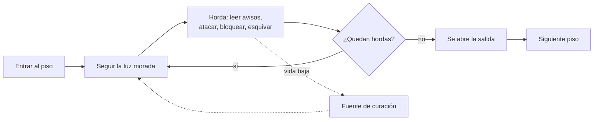

# Jugabilidad

## Bucle principal

1. **Entrar.** Una toma aérea baja hasta Abby y ella comenta el lugar.
2. **Buscar la horda.** Un haz de luz morada marca la siguiente; el HUD indica cuántas faltan.
3. **Pelear.** Al pisar la arena, la horda sale de grietas en el suelo: 5 enemigos, hasta 4 a la vez.
4. **Reponerse.** Cada piso tiene al menos una fuente que cura toda la vida, una sola vez.
5. **Salir.** Con las 4 hordas derrotadas se abre la salida y aparece el resumen del piso.

## Bucle de combate (segundo a segundo)

| Momento | Qué ve el jugador | Qué decide |
| --- | --- | --- |
| Aviso | Franja o anillo rojo en el suelo, el enemigo se agacha | Salir de la marca, bloquear o impulsarse a través |
| Golpe | El enemigo se lanza | Si bloqueó: pierde `20` de stamina y recibe `8 %`. Si esquivó a tiempo: esquiva perfecta |
| Recuperación | El enemigo queda quieto de `0,7` a `1,25 s` | Ventana para el combo `10 / 10 / 15` |

## Estructura de la demo

| Tramo | Escenas | Función |
| --- | --- | --- |
| Prólogo | `Expedicion`, `Intro` | Enseñar los controles con Dante y contar por qué Abby sube |
| Entrada | `Exterior` | Caminar por Cala Sombría hasta la torre, sin combate |
| Ascenso | `Diorama` a `Nevado` | Siete pisos con 4 hordas y la Biblioteca con 1 |
| Clímax | `Cima` | 4 hordas y Dante |
| Cierre | `Final` | Escena sin enemigos, cliffhanger y créditos |

Valores exactos en [[02 - Mecánicas]]; composición de cada piso en [[02 - Niveles]].
