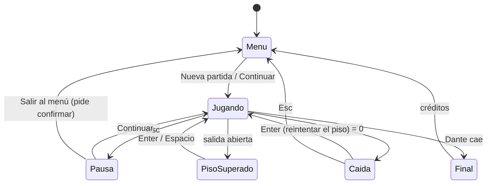

# Reglas y estados del juego

## Estados de la partida

## Reglas

| Regla | Detalle |
| --- | --- |
| Victoria del piso | Derrotar las 4 hordas y cruzar la salida. Aparece `¡PISO N SUPERADO!` con tiempo y enemigos derrotados. |
| Victoria de la demo | Bajar la vida de Dante a `0`. No muere: cae, y la escena `Final` toma el control. |
| Derrota | Vida en `0`: `Abby cayó.` con `Enter · Reintentar el piso` y `Esc · Menú principal`. |
| Reintento | Reinicia el piso con vida y stamina completas. Las hordas vuelven a empezar. |
| Reintento contra Dante | Abby reaparece frente a la arena del jefe con el aviso `Reintenta contra el jefe`; no repite las 4 hordas. |
| Tutorial | La vida no baja de `1`: no se puede perder. |
| Caída al vacío | `¡Caíste al vacío!`, `10` de daño y vuelta al último suelo firme. |
| Pausa | Detiene el juego. `Continuar`, `Opciones`, `Reiniciar piso`, `Salir al menú`. |
| Guardado | Automático al entrar a cada lugar de la ruta; se borra al terminar. Ver [[04 - Guardado y Configuración]]. |

## Estados de una horda

`Esperando` → `Combate` → `Limpia`. Si Abby se aleja durante el combate, la horda vuelve a `Esperando`.

## Estados de un enemigo

`Apareciendo` (grieta) → `Persiguiendo` → `Aviso` → `Golpe` → `Recuperación` → `Persiguiendo`. Al recibir daño por encima de su aguante pasa a `Interrumpido`.
