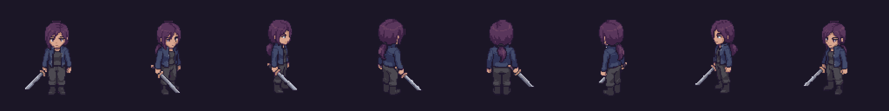
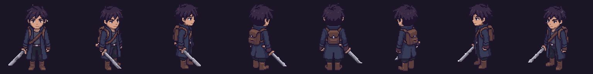
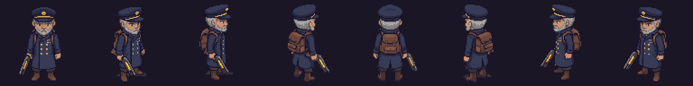
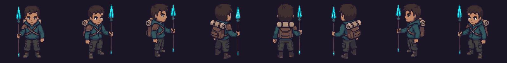
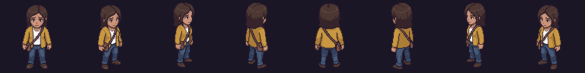

# Personajes

Fichas narrativas. Sprites, tamaños y GIF en [[02 - Personajes y Animación]]; valores de combate en [[03 - Enemigos y NPC]].

## Abby

| Campo | Dato |
| --- | --- |
| Edad | 17 (12 en el funeral, en 2030) |
| Rol | Protagonista jugable |
| Apariencia | Cabello morado recogido, chaqueta azul marino, espada en la mano derecha |
| Qué quiere | Encontrar a Dante y que le devuelva el colgante en persona |
| Qué la mueve | Dejó la escuela el día que cerraron la búsqueda. *"Que se enoje. Pero que me lo diga en la cara."* |
| Voz | Frases cortas, secas, con ternura escondida |

## Dante

| Campo | Dato |
| --- | --- |
| Edad | 22 en la expedición (17 en 2030) |
| Rol | Jugable en el tutorial; autor de las hojas del diario; jefe final como La Sombra |
| Oficio | Cazador del abismo |
| Apariencia | Abrigo azul marino, espada; mide `1,45 m` en el juego |
| Qué quiere | Pagar las deudas y que Abby siga estudiando |
| Arco | Sale solo del piso 20 con "algo negro en el brazo". Regresa piso por piso mientras olvida: *"Se me olvida cómo era tu voz."* |

## La Sombra

Lo que queda de Dante al llegar a la cima. No se mueve hasta que Abby llega: *"me está esperando"*. Usa el combo de Abby. Al caer, dice su nombre: *"Abby…"*.

## Angelo

Padre de ambos. Murió en 2030 cumpliendo su deber cuando apareció la torre. No aparece en pantalla; su colgante sí.

## Capitán Elías Vargas

Líder de la expedición de 2035. Da el discurso de la intro. En el piso 20 empuja a Dante hacia las escaleras; no se le vuelve a ver.

## El Coloso

La criatura del piso 20. Solo aparece en la cinemática del tutorial: ruge, da un zarpazo y el golpe corta a negro. No se muestra qué le hizo a la expedición.

## Secundarios

| Personaje | Aparece en | Sprite |
| --- | --- | --- |
| Cazadores y soldados de la expedición | Tutorial e intro |  |
| Gente del pueblo, invitadas del funeral | Intro |  |
