# Diálogos y narrativa

Textos tal como están en el juego (`Historia.cs`, `ExpedicionPiso20.cs`, `EscenaFinal.cs` y las notas de cada escena).

## Cómo se cuenta

| Recurso | Uso |
| --- | --- |
| Intro en imágenes | 14 imágenes fijas de 256×144 con paneo lento y texto; se salta manteniendo `Esc` |
| Cuadro de narración | Caja de texto que crece con el contenido; nombre de quien habla arriba |
| Relato del piso | Abby comenta al entrar, a la mitad de las hordas y al abrirse la salida (`RelatoPiso.cs`) |
| Notas | Objetos con destello que se leen con `E`: diario, placa, registro, nota |
| Escena final | 11 planos de cámara, recuerdos con imágenes de la intro y créditos |

## Intro

| Imagen | Texto |
| --- | --- |
| 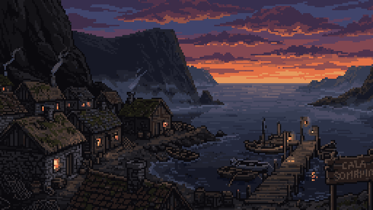 | "En el año 2030, en medio del pueblo de Cala Sombría se materializó una torre misteriosa de gran tamaño." |
| 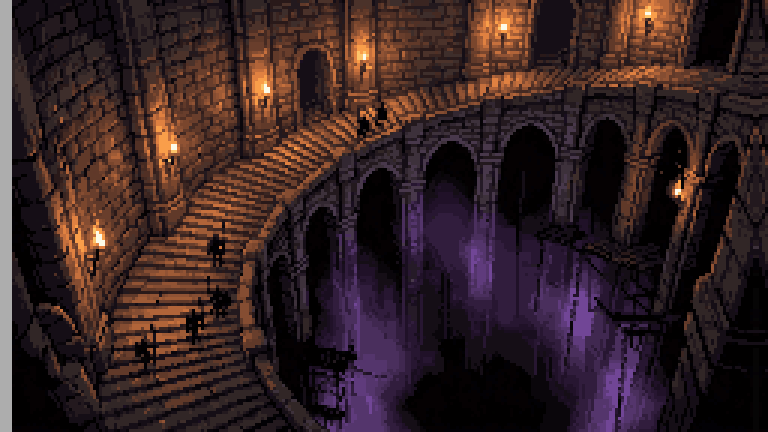 | "Cuando el ejército ingresó a la torre, descubrieron unas enormes escaleras que llevaban a un abismo oscuro." |
| 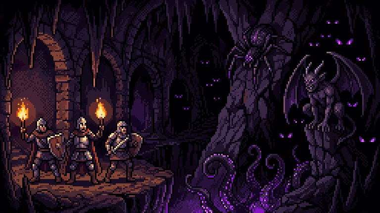 | "Al adentrarse en él descubrieron que ahí habitaban criaturas que solo existían en nuestras pesadillas…" |
| 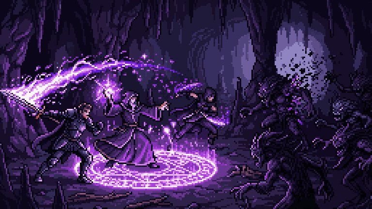 | "Junto con la torre empezaron a aparecer personas con la capacidad de canalizar la extraña energía que emana la torre…" |
| 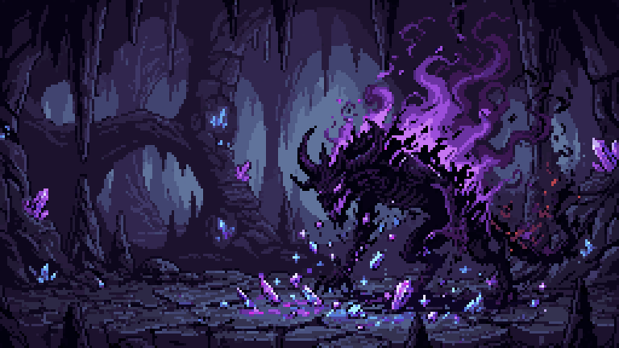 | "Al morir, las criaturas dejaban caer minerales raros nunca antes vistos en la Tierra…" |
| 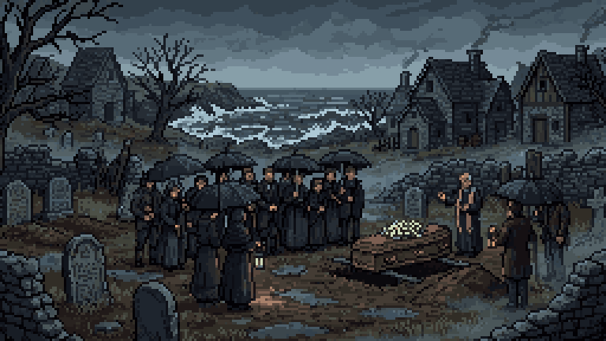 | **Invitada 1:** "Pobrecitos. Huérfanos a tan corta edad..." **Invitada 2:** "Su padre murió cumpliendo su deber cuando apareció esa misteriosa torre." |
| 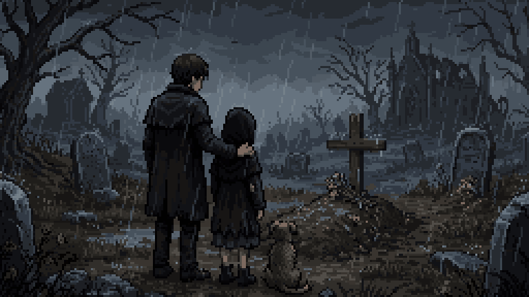 | **Invitada 1:** "Dante solo tiene 17. ¿Cómo va a mantener a su hermana ahora que su padre no está? Y Abby solo tiene 12 años." |
| 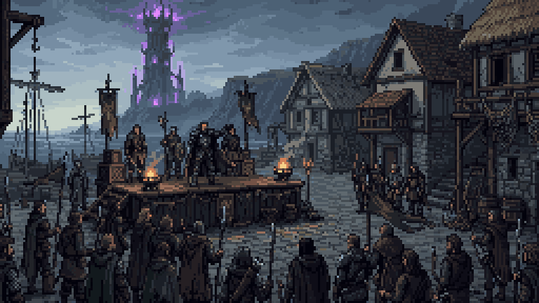 | Tarjeta **Año 2035**. **Capitán Elías Vargas:** "Escuchen todos. Han pasado 5 años desde que la torre del abismo apareció…" |
| 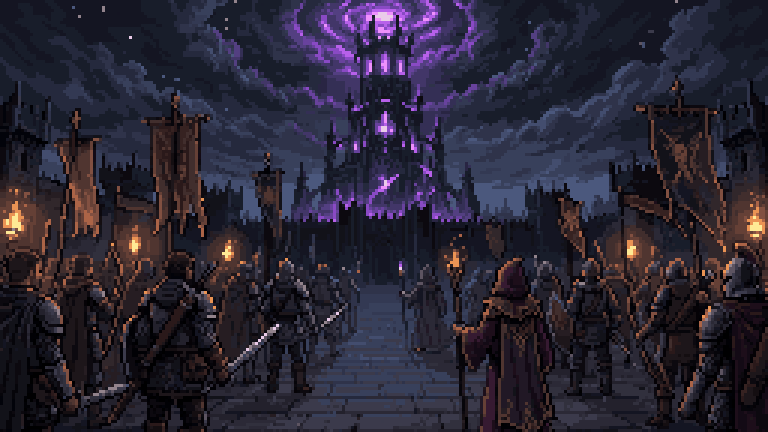 | "Entonces la humanidad aprendió a usar la misma energía de la torre contra ella. Desde entonces hemos llegado hasta el piso 15." |
| 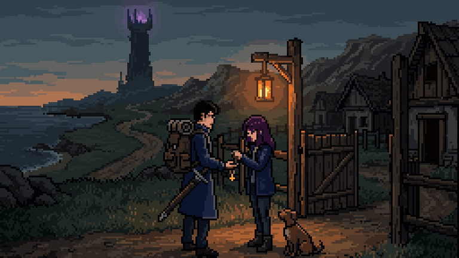 | **Abby:** "Hermano, no te vayas, no tienes que ser un cazador del abismo…" **Dante:** "¡No, Abby! No puedes abandonar tus estudios… Volveré..." |
| 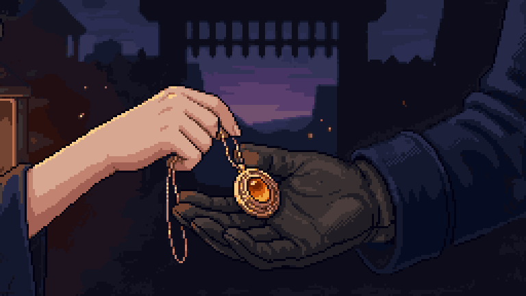 | **Abby:** "Entonces llévate esto. Era de papá. Me lo devuelves cuando vuelvas." **Dante:** "Te lo devuelvo en persona. Te lo prometo." |

## Tutorial (piso 20)

- "Piso 20. Ninguna expedición había bajado tanto."
- **Capitán:** "Mantengan la formación. Lo que encontremos aquí abajo, lo enfrentamos juntos."
- **Dante:** "Todavía traigo tu colgante, Abby. Te lo voy a devolver."
- "¿Qué es eso...?" · "¡Retirada! ¡Todos atrás!" · "La expedición nunca regresó."

## Relato de Abby por piso

| Lugar | Al entrar | A la mitad | Al abrirse la salida |
| --- | --- | --- | --- |
| Cala Sombría | "Hace tres meses que la expedición entró. A las dos semanas dejaron de buscarla." "Nadie va a entrar por él. Entonces entro yo." | — | — |
| Piso 1 | "Un pueblo entero, con las puertas abiertas. Y nadie." | "Cuando papá entró, en 2030, dijo que volvería para la cena." | "Ni rastro de él todavía. Sigo." |
| Biblioteca | "Libros, en un lugar donde nadie lee." | — | "Dante me hacía repasar en voz alta antes de irse a trabajar. Yo fingía que no me importaba." |
| Piso 2 | "El mar, otra vez. Papá nos traía a ver los barcos antes de la torre." | "El colgante de papá. Se lo di el día que se fue…" | "Todavía me lo debe." |
| Piso 3 | "Me hizo prometer que seguiría estudiando." | "Dejé la escuela el día que cerraron la búsqueda. Si me viera, se enojaría." | "Que se enoje. Pero que me lo diga en la cara." |
| Piso 4 | "Hay huellas en la piedra. Muchas botas, y todas van hacia adentro." | "Aquí hay otras, encima de las primeras. Las mismas botas..." | "...pero estas vienen de regreso. Y son de una sola persona." |
| Piso 5 | "Estos minerales pagaron nuestra casa. Nunca pregunté de dónde salían." | "Hay una mano marcada en el cristal. Negra, como quemada." | "Alguien se apoyó aquí para poder seguir caminando." |
| Piso 6 | "Todo está en calma. Es lo primero que me da miedo en esta torre." | "En el agua se ve mi cuarto. Con la luz prendida, como él la dejaba." | "Por un momento vi a alguien detrás de mí, en el reflejo. Llevaba su abrigo." |
| Piso 7 | "Las ventanas están prendidas, pero adentro no hay nadie." | "Una fogata apagada y una sola manta. Nadie duerme así si viaja con otros." | "Dante, ¿qué te pasó allá abajo?" |
| Piso 8 | "Aquí se acaban las huellas." | "Hay algo más adelante. Lo siento desde que entré. No se mueve... me está esperando." | — |

## Hojas del diario de Dante

| Piso | Título | Texto |
| --- | --- | --- |
| 1 | Diario de la expedición — día 1 | "Abby: entramos hoy. El piso 1 parece un pueblo de verdad, con río y casas, pero no hay nadie. El capitán dice que la torre copia lugares… Voy a ir dejando estas hojas." |
| 2 | día 2 | "El piso 2 tiene mar. Barcos amarrados, gaviotas que vuelan en círculos y ni una persona. Traigo el colgante de papá debajo de la camisa, Abby. Lo voy a cuidar. Es tuyo." |
| 3 | día 4 | "Aquí no se oye la torre, solo el agua… Pensé en ti, Abby. Te gustaría este lugar." |
| 4 | día 6 | "En este piso el sol nunca termina de ponerse… Cuando su sombra cae al suelo, hay que moverse. Eso me salvó hoy. Te lo apunto por si acaso. Aunque no vas a venir, ¿verdad?" |
| 5 | día 9 | "…Con lo de este piso pagaríamos todas las deudas, Abby. Todas. Los canalizadores dicen que no hay que tocarlos con la mano desnuda. Que la energía se queda." |
| 6 | día 12 | "Me asomé al lago y vi nuestra casa, Abby. La ventana de tu cuarto, con la luz prendida…" |
| 7 | Hoja sin fecha | "Ya no cuento los días. Del piso 20 salí solo. Esa cosa nos alcanzó a todos. El capitán me empujó hacia las escaleras y no volví a verlo. Me quedó algo negro en el brazo y no se quita… Voy de regreso, Abby. Te dije que volvería." |
| 8 | La última hoja | "Se me olvida cómo era tu voz. La letra ya casi no me sale. Traigo el colgante en la mano para acordarme de a dónde voy… Si ves algo en el camino, no le tengas miedo. Pero no te acerques. Volveré." — D. |

Las placas y registros de cada piso están en [[04 - Objetos y Coleccionables]].

## Final

1. **La Sombra:** "Abby…"
2. **Abby:** "¿Quién... eres?" · "Este colgante..." · "Era de papá. Yo te lo di."
3. Recuerdos (imágenes 12, 13 y 14): "Volveré..." · "Te lo devuelvo en persona. Te lo prometo." · "Voy de regreso, Abby. Te dije que volvería."
4. **Abby:** "Las huellas. Las hojas." · "Venías de regreso... todo este tiempo." · "Estabas a unos escalones."
5. **Dante:** "Volví."
6. **Continuará…**
7. Créditos sobre una casa en la nieve: "Para los que todavía dejan una luz prendida." · "Gracias por jugar".
