# Enemigos y NPC

Seis tipos de horda y un jefe. Valores base de `TowerEnemy.cs` y `TowerEnemy.Variantes.cs` en modo Normal, antes del multiplicador del piso.

| Enemigo | Tipo en código | Vida | Velocidad | Daño (el que recibe Abby) | Alcance | Aviso | Recuperación | Aguante | Empuje recibido |
| --- | --- | ---: | ---: | ---: | ---: | ---: | ---: | ---: | ---: |
| Larva del Abismo | `Sombra` | 40 | 3,3 m/s | 10 | 3 m | 0,55 s | 0,75 s | 0 | 1 |
| Acechador | `Saltador` | 55 | 3,2 m/s | 14 | 7,5 m | 0,45 s | 0,95 s | 12 | 0,8 |
| Bruto | `Bruto` | 120 | 2,1 m/s | 20 (**15**) | 3,2 m | 0,85 s | 1,1 s | 25 | 0,35 |
| Embestidor | `Embestidor` | 70 | 2,3 m/s | 13 | 10 m | 0,85 s | 1,25 s | 18 | 0,6 |
| Guardián | `Escudero` | 95 | 2,1 m/s | 16 (**15**) | 3 m | 0,7 s | 1 s | 30 | 0,4 |
| Espectro | `Hechicero` | 45 | 2,2 m/s | 12 | 12 m | 0,6 s | 1,1 s | 0 | 1 |
| **Dante, La Sombra** | `Dante` | 480 | 3,3 m/s | 12 | 4,2 m | 0,55–0,7 s | 0,85 s | inmune | 0,12 |

El daño entre paréntesis es el que llega a Abby después del ajuste al rango `8–15` de [[02 - Mecánicas]]. Pausa entre ataques de los enemigos de horda: de `0,6` a `1,4 s` (el Acechador y el Espectro, de `1,6` a `2,4 s`).

## Vida por piso (base × multiplicador)

| Enemigo | P1 | P2 | P3 | P4 | P5 | P6 | P7 | P8 |
| --- | ---: | ---: | ---: | ---: | ---: | ---: | ---: | ---: |
| Larva | 40 | 46 | 52 | 58 | — | 70 | — | — |
| Acechador | — | 63 | 72 | 80 | 88 | — | 113 | 88 |
| Bruto | — | 138 | 156 | 174 | 192 | — | 246 | 192 |
| Embestidor | — | — | 91 | 102 | 112 | 123 | — | 112 |
| Guardián | — | — | — | 138 | 152 | 166 | 195 | 152 |
| Espectro | — | — | — | — | — | 79 | 92 | 72 |

## Larva del Abismo

| Reposo | Caminar | Atacar |
| --- | --- | --- |
| 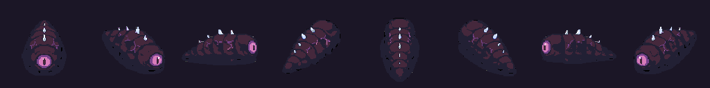 | 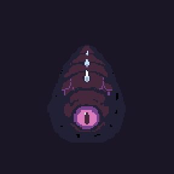 | 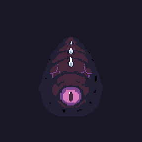 |

Rápida y frágil. Marca una franja roja y embiste a `12 m/s` durante `0,22 s`. Cualquier tajo la interrumpe. Es la masa de las hordas y la única del piso 1.

## Acechador

| Caminar | Atacar |
| --- | --- |
| 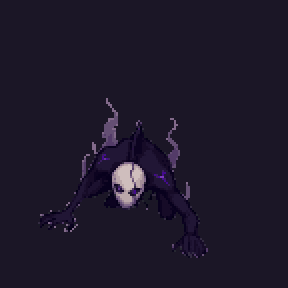 | 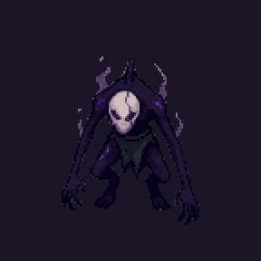 |

Salta desde lejos y cae en un círculo naranja de `2,4 m` de radio que marca el punto de caída. No salta al agua ni dentro de muros. Se castiga al aterrizar.

## Bruto

| Caminar | Atacar |
| --- | --- |
| 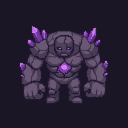 | 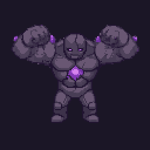 |

Lento y pesado. Solo lo frena el tercer tajo (aguante `25`). Su golpe es el más fuerte de las hordas: conviene bloquearlo o salir de la franja.

## Embestidor

| Caminar | Atacar |
| --- | --- |
| 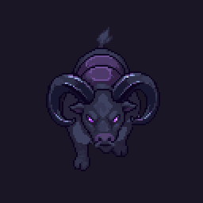 | 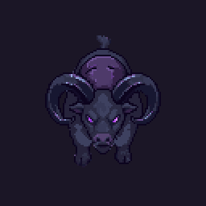 |

Ataca desde `10 m`: marca una franja larga y carga a `21 m/s` durante `0,45 s`, unos `9,5 m`. Queda `1,25 s` expuesto después.

## Guardián

| Caminar | Atacar |
| --- | --- |
| 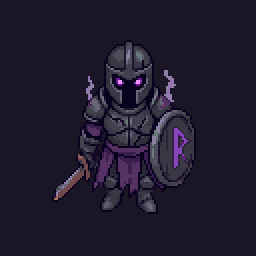 | 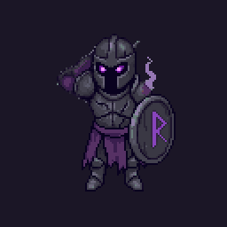 |

Lleva escudo: **para de frente** todo golpe que no rompa la guardia. La rompen el tercer tajo y el tajo de impulso; por la espalda recibe daño normal.

## Espectro

| Caminar | Atacar | Proyectil |
| --- | --- | --- |
| 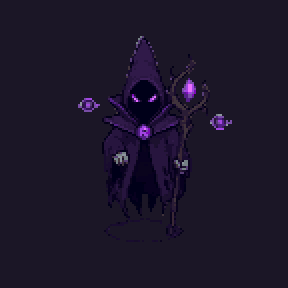 | 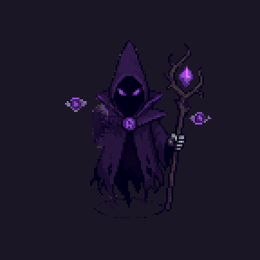 |  |

Único enemigo a distancia. Apunta el bastón y lanza una esfera. Cada tercer ataque hace caer tres golpes alrededor de Abby (`2,2 m` de radio, `1 s` de aviso). Si Abby se acerca a menos de `3,5 m`, desaparece y reaparece lejos.

## Dante, La Sombra (jefe final)

| Reposo | Caminar | Atacar |
| --- | --- | --- |
| 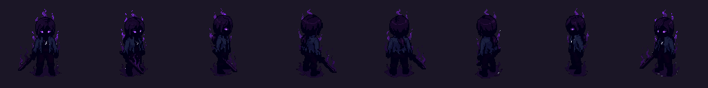 | 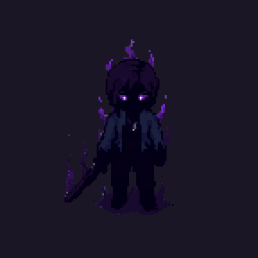 | 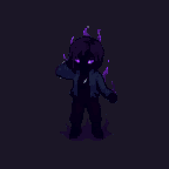 |

| Dato | Valor |
| --- | --- |
| Vida | `480` base × `1,6` del piso = **`768`** en Normal |
| Aparece | En su arena de `20 × 18 m`, solo con las 4 hordas derrotadas |
| Tamaño | `1,18` veces la altura de Abby; luz morada de `7 m` |
| Interrupción | No se le interrumpe; retrocede `12 %` |
| Música | Pista `Jefe`, 124 bpm |

| Patrón | Cuándo | Aviso | Golpe | Daño a Abby |
| --- | --- | --- | --- | ---: |
| Embestida | Abby a más de `4,5 m` | Franja larga, `0,7 s` | `22 m/s` durante `0,42 s` (unos `9,2 m`) | 12 |
| Golpe de área | Cada tercer ataque | Anillo morado de `4,6 m`, `1,05 s` | Salta y cae | 15 |
| Combo de 3 | El resto | Franja, `0,55 s` | Tres embestidas cortas de `11 m/s` × `0,18 s` | 12 c/u |

**Fase 2** al `50 %` de vida: aparece `¡FURIA!`, la cámara se sacude y todas sus pausas y el aviso del golpe de área bajan al `75 %`. A diferencia de los otros jefes del código, Dante no invoca refuerzos.

**Al llegar a 0 no muere:** cae, y `DanteFinal` lleva a la escena `Final`.

## Reglas comunes

- Aparecen desde una grieta y no dañan hasta salir.
- La primera mitad de la animación de ataque es la carga y la segunda es el golpe (`FaseAtaque()`): el dibujo y el daño van juntos.
- Miran hacia donde van a atacar; la franja roja y el sprite coinciden.
- Al recibir daño tiemblan y muestran el número; al morir se deshacen en sombra.

## NPC

| NPC | Dónde | Función |
| --- | --- | --- |
| Capitán Elías Vargas y expedición | `Expedicion`, intro | Acompañan a Dante en el tutorial; sin combate propio |
| El Coloso | `Expedicion` | Cinemática: `Rugido`, `Zarpazo`, `Golpe` |
| Gente del pueblo | Intro | Solo imagen |
