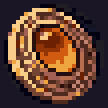

# Objetos y coleccionables

No hay inventario. Los únicos objetos de la ruta son las **fuentes de curación** y las **notas**.

## Fuente de curación

Santuario con un cristal que flota y gira, y una luz que se ve de lejos. `E` a menos de `2,4 m`: cura el 100 %, suena `Fuente` y muestra `FUENTE DE CURACIÓN · Tu vida se ha restaurado`. Después queda apagada. Detalle en [[02 - Mecánicas]]; cantidad por piso en [[06 - Economía y Recursos]].

## Notas

Objetos con destello que se leen a `1,6 m`. Cuatro tipos (`LoreNote.Kind`): Libro, Nota, Inscripción y Diario. El menú de pausa cuenta cuántas se han encontrado (`N notas encontradas`). Son opcionales: no bloquean el avance.

Las hojas del diario de Dante están transcritas en [[04 - Diálogos y Narrativa]]. El resto:

| Piso | Título | Tipo | Texto |
| --- | --- | --- | --- |
| 1 | Placa a la entrada del piso 1 | Inscripción | "PISO 1. Asegurado por el ejército en 2031. Las criaturas de este piso son las más débiles de la torre…" |
| Biblioteca | Detrás del muro | Diario | "Último escondite. Lo que hay en el cofre es para pagar las deudas cuando salgamos. Los dos." — A. |
| 2 | Registro del puerto | Libro | "Registro militar, piso 2. Los barcos no zarpan: más allá de la bahía el mar no lleva a ningún lado. Primer piso donde la pólvora dejó de servir. Desde aquí, solo armas canalizadas." |
| 3 | Piedra del valle | Inscripción | "Piso 3. El río baja cuatro bancales desde las cascadas del fondo… la salida está donde el agua cae más fuerte." |
| 4 | Placa del faro | Inscripción | "Este faro alumbra un mar que no existe afuera de la torre. Nadie sabe quién lo encendió. Se apaga cuando una criatura fuerte anda cerca." |
| 5 | Grabado en la piedra | Inscripción | "Al fondo de la gruta, una piedra que late como un corazón. Los canalizadores dicen que la energía de la torre sale de aquí, o pasa por aquí." |
| 6 | Piedra de los pescadores | Inscripción | "Piso 6. El lago refleja un cielo que no es el de afuera. Los que se asoman dicen ver su casa. Mejor no quedarse mucho tiempo mirando." |
| 7 | Bienvenidos a la aldea | Inscripción | "Piso 7. Aquí siempre es la última noche del invierno. Hay posada en la plaza. Las luces no se apagan nunca." |
| 7 | Nota de un cazador | Nota | "Salí a revisar las trampas. Si llegaste hasta aquí, sírvete de la fogata…" |
| 8 | Grabado en la piedra | Inscripción | "Nadie sabe qué es esta torre, de dónde proviene o por qué apareció…" |

Siete notas toman su texto final de `Historia.Notas` al leerse, sin regenerar la escena; el texto guardado en la escena es anterior.

## El colgante

No es un objeto que se recoja: es un elemento de la historia. Aparece en la imagen 13 de la intro y en la escena final.

