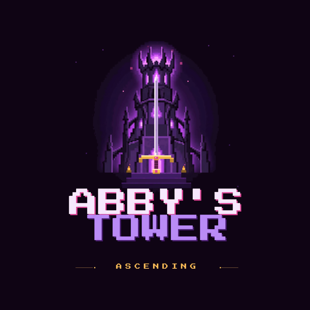

# Dirección de arte

## Estilo

**Sprites de pixel art en escenarios 3D tipo maqueta** (estilo HD-2D). Los personajes son sprites que siempre miran a la cámara; el mundo es geometría 3D con texturas de baja resolución, luz real y posproceso (bloom, color y viñeta).

| Elemento | Decisión |
| --- | --- |
| Personajes | Pixel art en 8 direcciones, generado con PixelLab y corregido a mano |
| Escenarios | Mallas generadas por código (`DioramaBuilder`), en cubos y terreno con ruido |
| Luz | Atardecer en los pisos (`AmbienteHistoria.cs`): sol bajo naranja, cielo morado, bruma cálida, faroles encendidos |
| Noche | Solo Cala Sombría: desaturada, con color únicamente en el fuego y el aura de la torre |
| Sombras | Proyectadas de frente al sol (`SombraAlSol.cs`); se usan para leer la posición de los enemigos |
| Color del peligro | Rojo para avisos de ataque; morado para la torre, las grietas y Dante; azul claro para el bloqueo; verde para la curación |

## Paleta

Colores dominantes del sprite de Abby (15 colores en total):

| Uso | Colores |
| --- | --- |
| Contorno y sombra | `#20182e` · `#38333e` |
| Cabello | `#59365b` · `#412447` |
| Chaqueta | `#424a6a` · `#2f3356` |
| Pantalón y botas | `#4c4951` · `#636477` |
| Piel | `#d9a690` · `#bc8971` · `#936a66` |
| Espada | `#8d8c99` |

Colores de interfaz (de `FloorDirector.cs` y `PauseMenu.cs`): dorado de títulos `(1, 0.9, 0.65)`, vida de verde `(0.45, 1, 0.6)` a rojo `(1, 0.25, 0.3)`, stamina azul `(0.45, 0.75, 1)`.

> **Cambio respecto al GDD 0.6.0:** el plan era la paleta DawnBringer 32. La revisión del 5 de noviembre midió 0 % de píxeles exactos de DB32 en Abby, Dante, el Coloso y las imágenes de la intro; forzarla cambiaría todo el arte. Queda registrado en [[03 - Registro de Decisiones]].

## Tamaños

| Recurso | Lienzo | Altura en el juego |
| --- | --- | --- |
| Abby | 128×128 px | `1,31 m` sin la espada |
| Dante humano | 96×96 px | `1,45 m` |
| La Sombra | 128×128 px | `1,18` veces Abby |
| Enemigos de horda | 96 a 128 px | Según su radio (`0,45` a `0,8 m`) |
| Animaciones de enemigos | 176×176 px | — |
| Coloso | 176 a 192 px | Solo cinemática |
| Imágenes de la intro | 256×144 px, ampliadas ×4 a 1024×576 | Pantalla completa |

El importador (`PixelLabImporter.cs`) calcula los píxeles por unidad para que cada personaje mida lo mismo en todas sus poses.

## Tipografía

| Uso | Fuente | Licencia |
| --- | --- | --- |
| Texto de juego, HUD y diálogos | Inter SemiBold | OFL |
| Logo | Press Start 2P | OFL |

## Logo

