# Personajes y animación

Sprites del proyecto en el commit `bf6203d`. Los GIF se armaron directo de los cuadros de `Assets/`, ampliados sin suavizado.

## Catálogo

| Personaje | Carpeta | Lienzo | Reposo | Caminar | Atacar | Otros |
| --- | --- | --- | --- | --- | --- | --- |
| Abby | `sprites/Abby`, `Resources/AbbyAnim` | 128 px (tajos 144 px) | 8 dir. | 8 dir. × 8 cuadros | 3 tajos × 5 dir. × 4–5 cuadros | Impulso 8 dir. × 9; poses Golpe, Guardia, Rodilla, Tendida |
| Dante humano | `Resources/DanteHumano` | 96 px | 8 dir. | 5 dir. × 6 | 5 dir. × 4–5 | Tendido (8 dir. y de lado) |
| La Sombra | `Resources/Personajes/Dante`, `EnemigosAnim/Dante` | 128 / 176 px | 8 dir. | 5 dir. × 6 | 5 dir. × 8 | — |
| Larva | `EnemigosSprites/Sombra`, `EnemigosAnim/Sombra` | 128 / 176 px | 8 dir. | 5 dir. × 8 | 5 dir. × 8 | — |
| Acechador | `…/Saltador` | 104 / 176 px | 8 dir. | 5 dir. × 6 | 5 dir. × 8 | — |
| Bruto | `…/Bruto` | 96 / 176 px | 8 dir. | 5 dir. × 6 | 7 dir. × 8 | — |
| Embestidor | `…/Embestidor` | 96 / 176 px | 8 dir. | 5 dir. × 8 | 5 dir. × 8 | — |
| Guardián | `…/Escudero` | 96 / 176 px | 8 dir. | 5 dir. × 6 | 5 dir. × 8 | — |
| Espectro | `…/Hechicero` | 104 / 176 px | 8 dir. | 5 dir. × 8 | 5 dir. × 8 | Proyectil × 4 |
| Coloso | `Resources/ColosoAnim` | 176–192 px | — | — | — | Rugido × 6, Zarpazo × 6, Golpe × 8 |
| Capitán, cazador, soldado, civil | `Resources/Personajes` | — | 8 dir. | — | — | — |

Las animaciones se dibujan en 5 direcciones (sur, sureste, este, noreste, norte); las del oeste se obtienen **espejando por escala**, porque el material `SpriteLit3D` ignora `flipX`.

## Abby

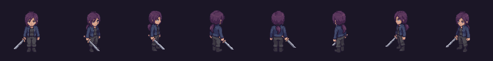

| Caminar (sur) | Caminar (este) | Caminar (norte) |
| --- | --- | --- |
| 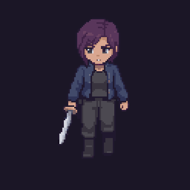 | 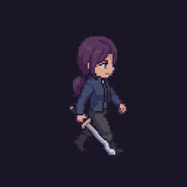 | 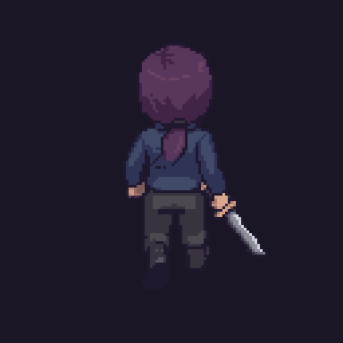 |

| Tajo 1 | Tajo 2 | Tajo 3 |
| --- | --- | --- |
| 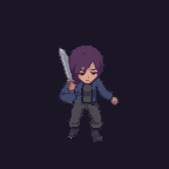 | 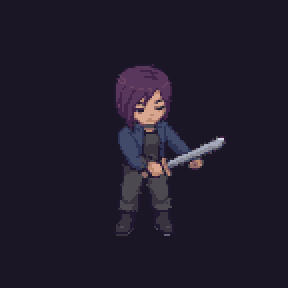 | 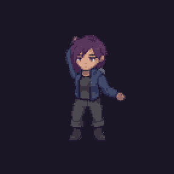 |
| 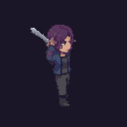 | 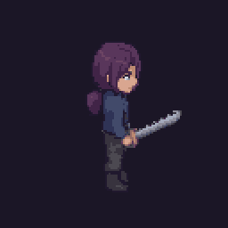 | 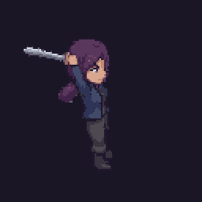 |

| Impulso (sur) | Impulso (este) |
| --- | --- |
| 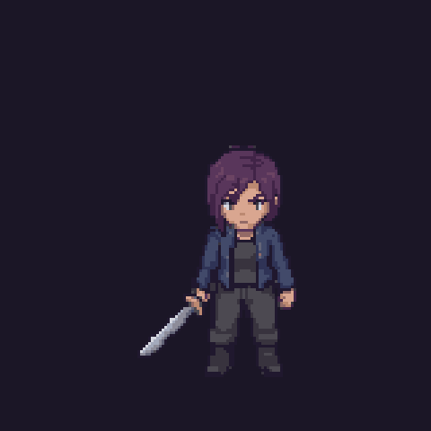 | 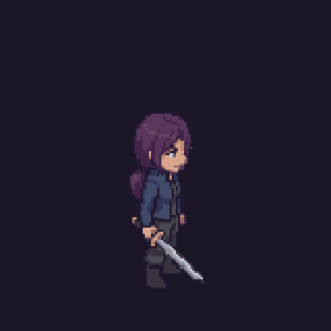 |

**Poses** (un cuadro por dirección):

| Golpe | Guardia |
| --- | --- |
| 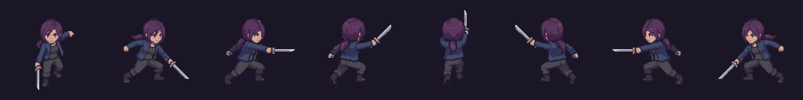 | 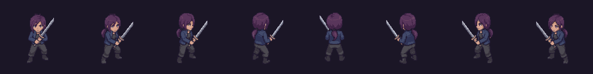 |

| De rodillas | Tendida |
| --- | --- |
| 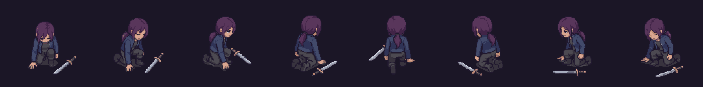 | 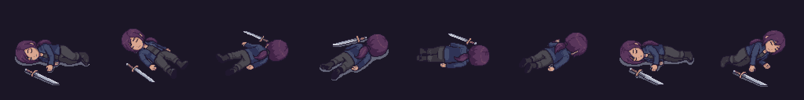 |

Reglas de animación (`AbbySpriteAnimator.cs`):

- El ritmo de los pasos sigue la velocidad real de Abby.
- Cada tajo del combo reinicia su animación (`AbbyAttack.Swings`).
- El **bloqueo es una pose** de guardia con tinte azulado, sin animación.
- El **golpe recibido** es un tinte rojo de `0,15 s` con sacudida; no tiene cuadros propios.
- Al norte y al sur corre con los cuadros de caminar, porque la carrera perdía la espada en la mitad de los cuadros.
- La espada va siempre en la mano derecha.

## Dante humano

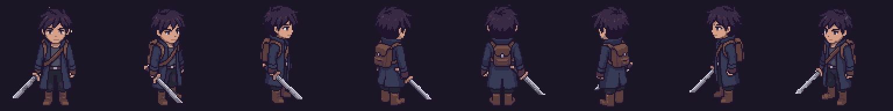

| Caminar | Atacar | Tendido |
| --- | --- | --- |
| 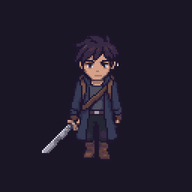 | 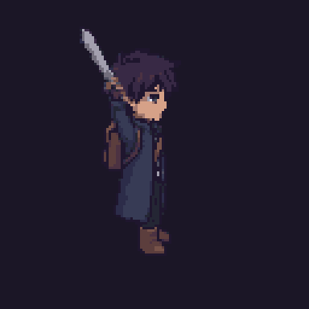 | 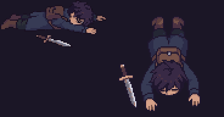 |

Solo se usa en el tutorial y tendido en el final. No tiene impulso, bloqueo ni golpe recibido propios: reutiliza caminar, reposo y el tinte rojo.

## La Sombra

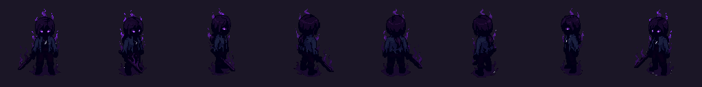

| Caminar | Atacar (sur) | Atacar (este) |
| --- | --- | --- |
| 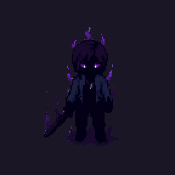 | 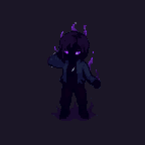 | 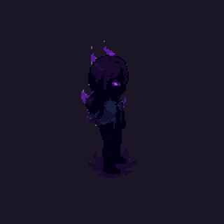 |

## Enemigos de horda

| Enemigo | Reposo en 8 direcciones | Caminar (este) | Atacar (este) |
| --- | --- | --- | --- |
| Larva | 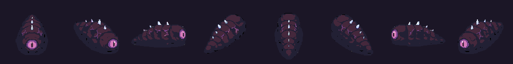 | 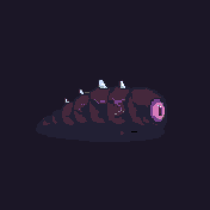 | 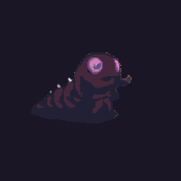 |
| Acechador | 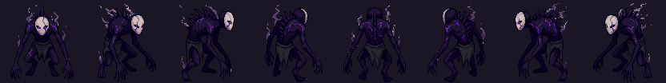 | 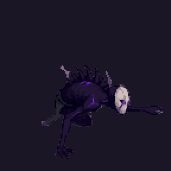 | 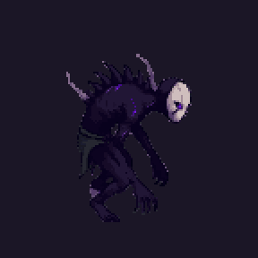 |
| Bruto | 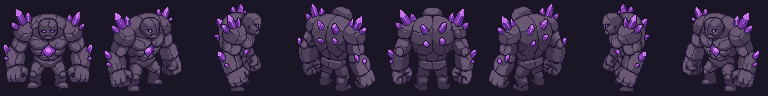 | 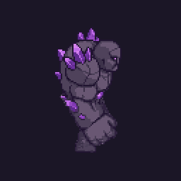 | 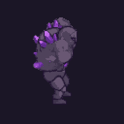 |
| Embestidor | 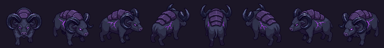 | 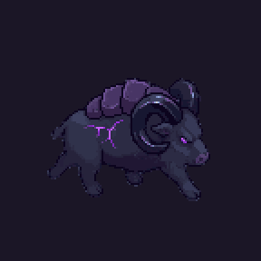 | 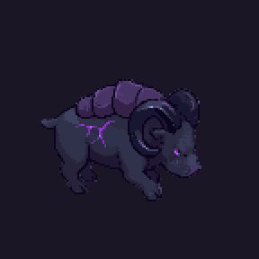 |
| Guardián | 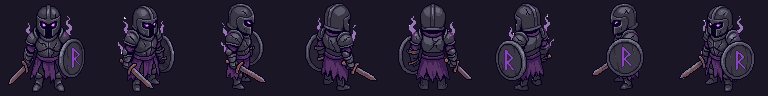 | 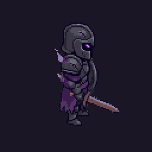 | 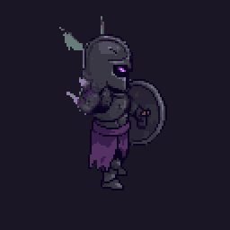 |
| Espectro | 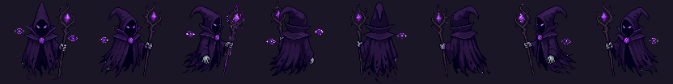 | 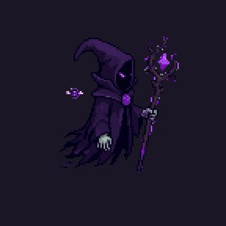 | 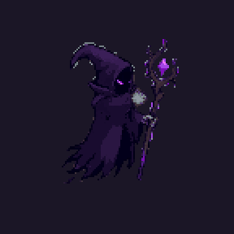 |

Además del dibujo, los enemigos se mueven por código: respiran, rebotan al caminar, se agachan al avisar, se estiran al lanzarse y tiemblan al recibir.

## El Coloso

| Rugido | Zarpazo | Golpe |
| --- | --- | --- |
| 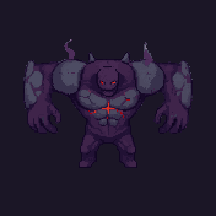 | 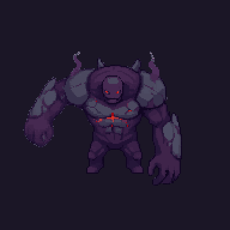 | 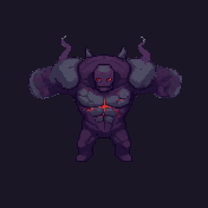 |

## Jefes dibujados que no aparecen en la demo

| Guardián de las Ruinas | Capitán sin Barco | Señor del Torrente | Gárgola del Faro Roto |
| --- | --- | --- | --- |
| 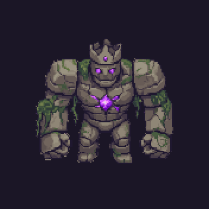 | 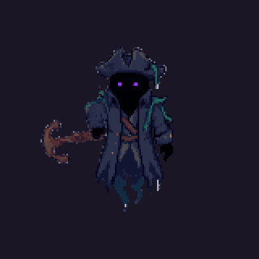 | 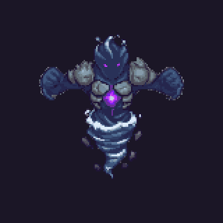 | 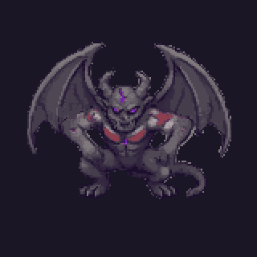 |

## Tabla de personajes del proyecto

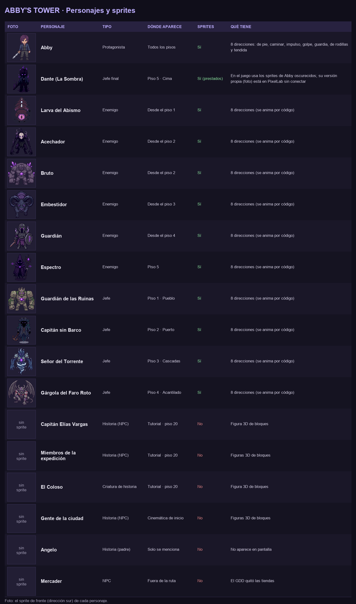

> **Pendiente:** bocetos a mano y archivos fuente de Pixelorama, si el equipo quiere incluirlos en `Media/ConceptArt/`.
