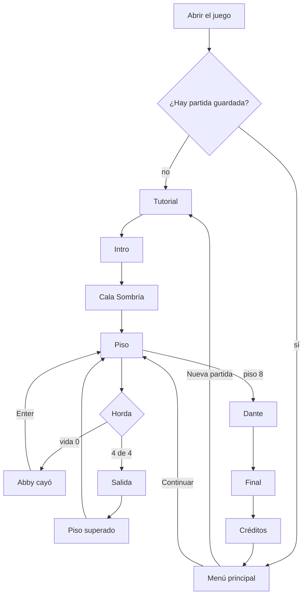

# UX y flujo del jugador

## Primer minuto

1. Al abrir el juego **sin partida guardada**, se va directo a la tarjeta de título y al tutorial; el menú no estorba la primera vez.
2. El tutorial enseña un control por paso, con el texto en pantalla y sin posibilidad de perder.
3. La cinemática del Coloso corta a negro y da paso a la intro en imágenes.

Con partida guardada, lo primero que aparece es el menú con `Continuar · Piso N`.

## Flujo completo

## Decisiones de experiencia

| Problema | Solución en el juego |
| --- | --- |
| No saber a dónde ir | Baliza morada en la siguiente horda y texto con las que faltan |
| No ver venir los golpes | Aviso en el suelo antes de cada ataque |
| Fallar el golpe por unos grados | Asistencia de apuntado a `4,2 m` y `70°` |
| La cámara tapa a Abby | Las casas y árboles que la cubren dejan de dibujarse; la cámara no atraviesa el terreno |
| Caer al vacío | Reaparece en el último suelo firme con `10` de daño, sin reiniciar |
| Repetir todo el piso por morir con el jefe | Reintento directo frente a la arena de Dante |
| Textos que no caben | El cuadro de narración crece y, si hace falta, reduce la letra |
| Una falla en plena presentación | `Continuar` retoma desde el último piso guardado |
| Quedarse quieto mirando | A los `6 s` la cámara se abre y muestra el paisaje |

## Ritmo previsto de la demo

| Tramo | Duración estimada |
| --- | ---: |
| Tutorial e intro | 3 min |
| Cala Sombría | 1 min |
| Pisos 1 a 7 y Biblioteca | 9 min |
| Cima y Dante | 2 min |
| Final y créditos | 1–2 min |

> **Pendiente:** tiempos medidos en una partida completa con una persona ajena al equipo. Con 8 pisos, la meta de 15 minutos del GDD 0.6.0 (pensada para 5) debe confirmarse.
