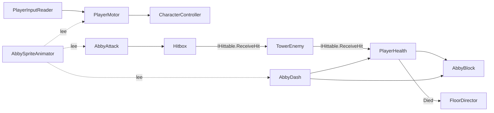
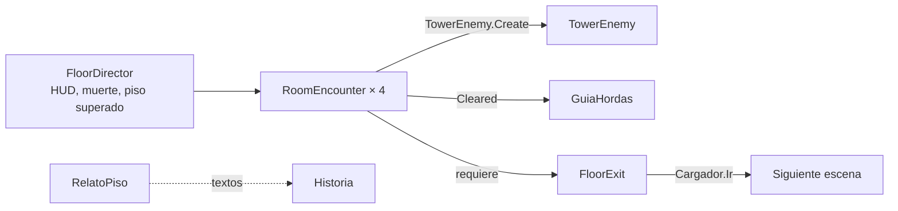

# Arquitectura técnica

Unas 34 000 líneas de C# en 171 scripts dentro de `Assets/scripts`, organizados por carpeta.

| Carpeta | Responsabilidad | Scripts clave |
| --- | --- | --- |
| raíz | Entrada, movimiento y golpe base | `PlayerInputReader`, `PlayerMotor`, `Hitbox`, `HitStop`, `LimiteFPS` |
| `Nivel/` | Combate, enemigos, hordas, HUD y pausa | `AbbyAttack`, `AbbyBlock`, `AbbyDash`, `PlayerHealth`, `TowerEnemy` (5 parciales), `RoomEncounter`, `FloorDirector`, `PauseMenu`, `Difficulty`, `RunState` |
| `Diorama/` | Generación de los pisos | `DioramaBuilder` (30 parciales), `AmbienteHistoria` |
| `Exterior/` | Cala Sombría | `ExteriorBuilder` (4 parciales), `ExteriorNoche`, `ExteriorIntro` |
| `Historia/` | Menú, intro, tutorial, final, carga, guardado y textos | `MenuPrincipal`, `IntroImagenes`, `ExpedicionPiso20`, `EscenaFinal`, `DanteFinal`, `Cargador`, `Progreso`, `Historia`, `RelatoPiso` |
| `Camara/` | Cámara y sombras de sprites | `MouseOrbitCamera`, `ZonasCamara`, `CameraShot`, `SombraAlSol` |
| `Audio/` | Síntesis de música y efectos | `Musica`, `Sonido`, `Pasos` |
| `Editor/` | Herramientas del editor | `PixelLabImporter`, `PixelLabClips`, `DioramaRoute`, `HoleAudit`, `TreeAudit` |

## Abby (prefab `Abby.prefab`)

- **`IHittable`** es el contrato de daño: lo implementan Abby y los enemigos. El golpe viaja en un `HitInfo` (daño, empuje, congelación, origen, atacante).
- **`Hitbox`** usa `OverlapBox`, sin triggers ni `Rigidbody`, orientado hacia donde mira el personaje.
- **`IMoveInput`** separa la lectura de controles del movimiento, lo que permite mover a Dante en el tutorial y a Abby en las cinemáticas.

## Un piso

- Los enemigos **no usan prefabs**: `TowerEnemy.Create` arma cada uno por código y carga sus sprites de `Resources`.
- Los enemigos se mueven sin físicas, dentro de los límites de su arena.

## Entre escenas

| Mecanismo | Uso |
| --- | --- |
| `Cargador.Ir(escena)` | Carga asíncrona con pantalla de carga |
| Clases estáticas (`RunState`, `Difficulty`, `Progreso`, `Historia`) | Estado y datos que sobreviven al cambio de escena |
| `DontDestroyOnLoad` | `HitStop`, música y sonido |
| `PlayerPrefs` | Persistencia; ver [[04 - Datos y Persistencia]] |

## Render

URP con el perfil `PC_RPAsset`: MSAA ×2, escala de render `1`, sombra del sol a `2048`, distancia de sombras `150 m`. Sprites con el material `SpriteLit3D` (Shader Graph) para que reciban luz. Once shaders propios en `Assets/Shaders` (agua, cascada, cielo, aurora, cristal, energía, partículas, destellos).

## Interfaz

`OnGUI` (IMGUI), sin Canvas ni prefabs de UI. Ventaja: todo el HUD está en código y bajo control de versiones. Costo: no hay editor visual.
