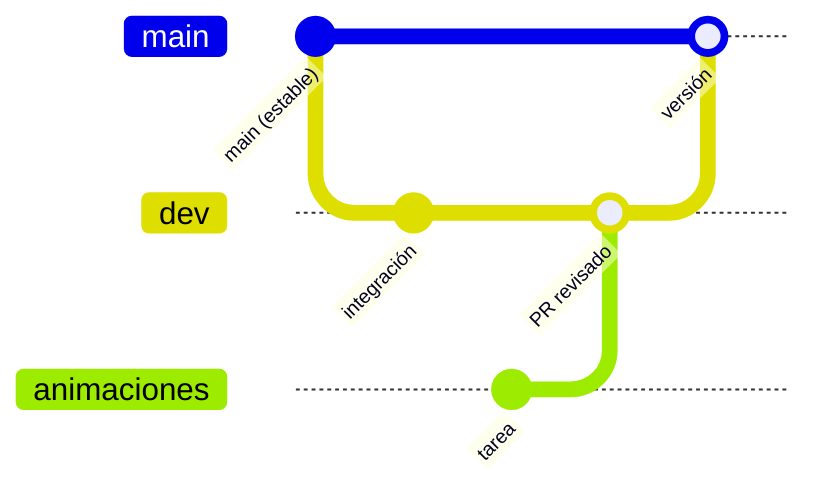

# Gestión de cambios

## Flujo de ramas

| Rama | Uso |
| --- | --- |
| `main` | Versión estable |
| `dev` | Integración |
| Rama por tarea (`combate`, `mapa-limites`, `animaciones`…) | Trabajo; entra a `dev` por Pull Request |

La rama `animaciones` terminó concentrando el desarrollo y es la **versión final**. Va más de 97 commits por delante de `dev`, y `dev` tiene 2 que `animaciones` no: falta integrarlas (tarea GIT-01).

## Reglas

1. Un cambio que altera lo que dice el GDD se anota en `Docs/Cambios_respecto_al_GDD.md` el mismo día, con el motivo.
2. Los mensajes de commit describen qué cambió para el jugador, no solo el archivo.
3. Después de regenerar un mapa se guarda la escena y se vuelve a correr la separación de superficies.
4. A partir del 10 de noviembre solo entran correcciones de bugs; ninguna función nueva.
5. Toda corrección posterior a la congelación se registra en [[03 - Bugs y Seguimiento]] y sube la versión del GDD.

## Documentos de control en el repositorio

| Archivo | Contenido |
| --- | --- |
| `Docs/Cambios_respecto_al_GDD.md` | Diferencias entre el juego y el GDD 0.6.0 |
| `PENDIENTE_GDD.md` | Lo que falta para cumplir el GDD |
| `NOTAS_PULIDO.md` | Qué se arregló y en qué archivo |
| `Docs/Personajes_y_sprites.csv` | Inventario de personajes y sprites |

## Versionado del GDD

`mayor.menor.revisión`. La 1.0.0 corresponde al juego congelado. Una corrección de datos sube la revisión; un cambio en el juego sube la menor. Historial en [[04 - Historial de Versiones]].
