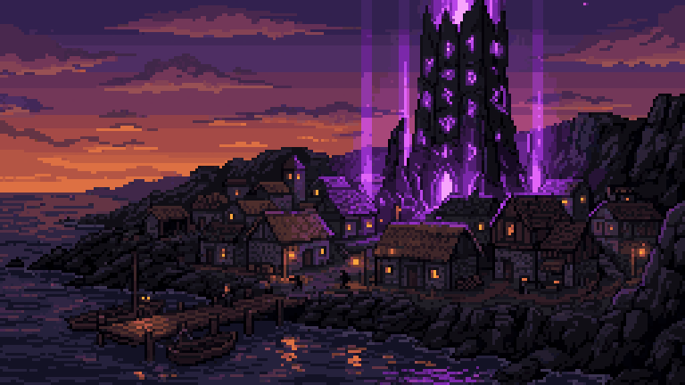
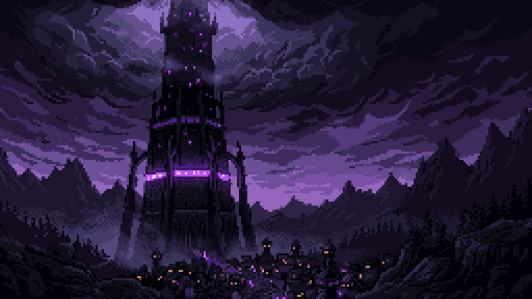

# Referencias e inspiración

| Referencia | Qué se tomó | Qué no |
| --- | --- | --- |
| **Young Souls** | Combate cuerpo a cuerpo 2.5D por salas; bloqueo con costo; lectura de golpes | Equipo, botín y cooperativo |
| **Soulslike** (género) | Stamina como recurso defensivo; todo ataque se anuncia; el jefe refleja al jugador | Dificultad punitiva, pérdida de progreso, niveles de personaje |
| **Octopath Traveler** (estilo HD-2D) | Sprites de pixel art en escenarios 3D con profundidad de campo y luz real | Combate por turnos |
| **Beat 'em up clásico** | Hordas por arena, avance bloqueado hasta limpiar | Puntuación y vidas |

## Referencias visuales del proyecto

Carpeta `References/` del repositorio:

- Doce imágenes de la intro (`01_pueblo` a `12_despedida`), base de las finales en `Resources/Intro`.
- `logo_torre.png`.
- Texturas de referencia y un personaje de referencia de fantasía oscura.

## Material del curso

- Plantilla de GDD: Ing. Luis Fernando Villafaña Rejón.
- GDD de referencia de calidad compartido por el docente: EchoScrap (`ShiroRex/GDD-Echoscrap`).

> **Pendiente:** otras referencias que el equipo haya usado (películas, música, arte) y los bocetos a mano.
