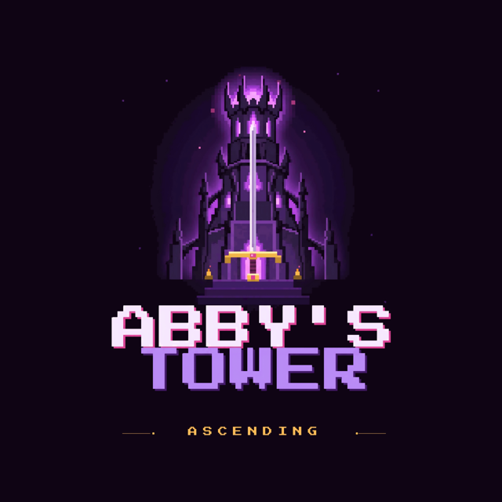

# Abby's Tower — GDD 1.0.0

**Nombre clave:** Ascending · **Estudio 02** · Integradora, IDYGS103 · Universidad Tecnológica de Cancún

Documento cerrado el **10 de noviembre de 2026** sobre la rama `animaciones`, commit `bf6203d` (9 de noviembre de 2026). El juego quedó congelado en ese commit: todo valor de este documento se leyó del código, los prefabs y las escenas de esa versión, y cada nota indica el archivo de donde sale.

- [[00 - Índice]]
- [[00 - Avance jugable]]: recorrido completo de la demo.
- [[00 - GDD Completo (Para Exportar PDF)]]: todo en un solo archivo.
- [[02 - Mecánicas]]: valores y fórmulas de combate.
- [[03 - Enemigos y NPC]]: tabla de enemigos y pelea contra Dante.
- [[02 - Personajes y Animación]]: sprites y GIF por acción.
- [[03 - Registro de Decisiones]] y [[04 - Historial de Versiones]].

Se abre como bóveda de Obsidian o con cualquier lector de Markdown que muestre GIF. La referencia vigente es el Markdown; el PDF exportado muestra los GIF como imagen fija.

Plantilla original: Ing. Luis Fernando Villafaña Rejón. Proyecto y contenidos: Estudio 02.
